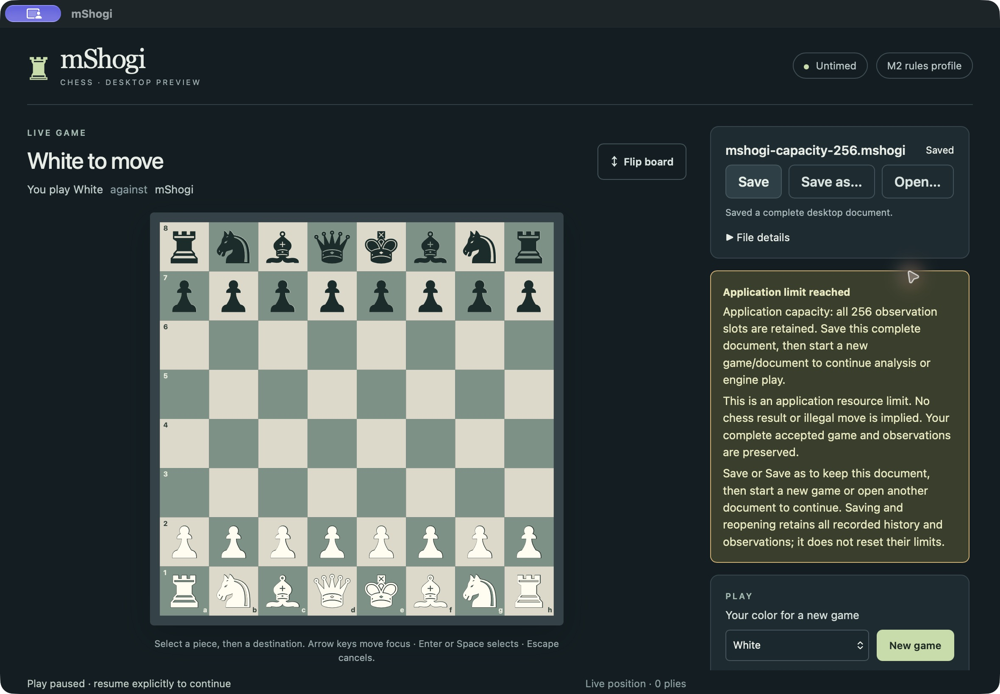
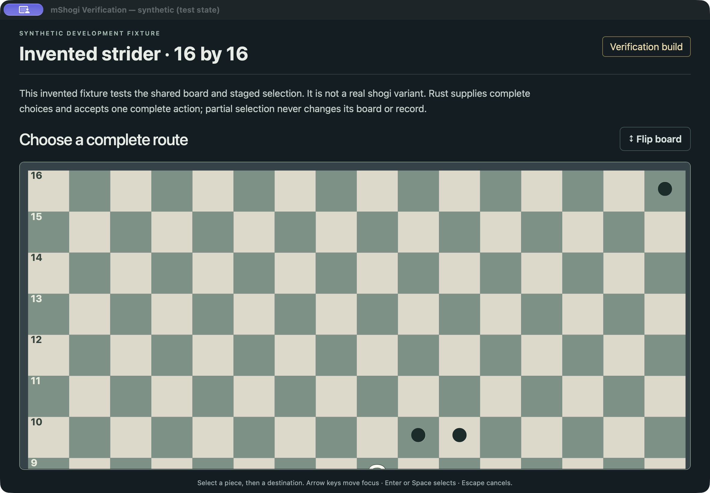
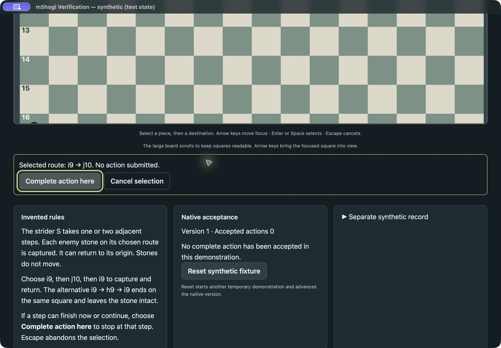
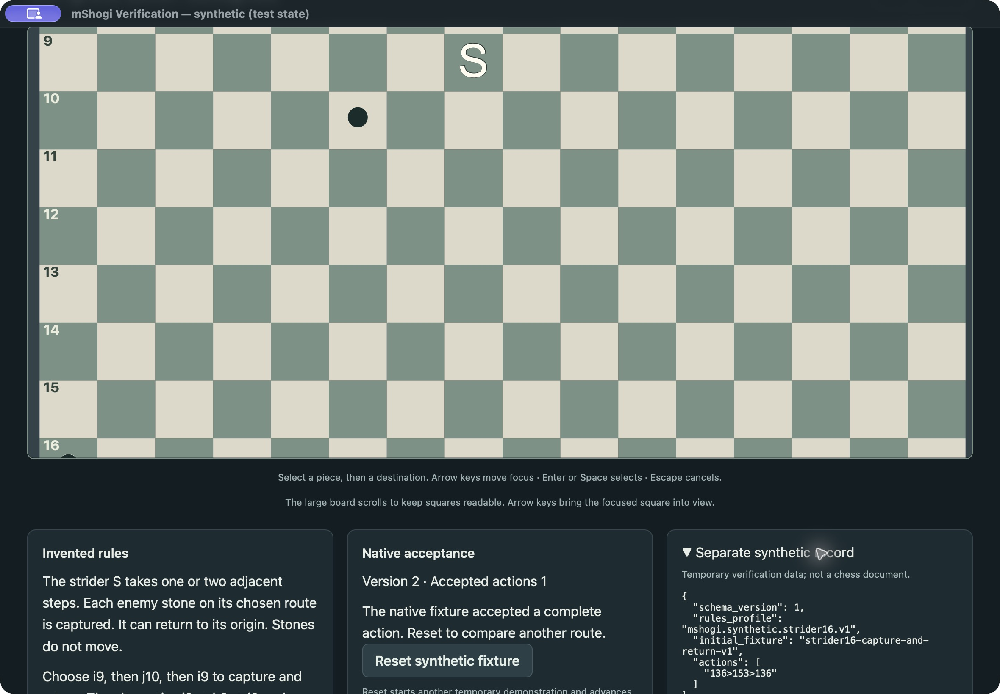
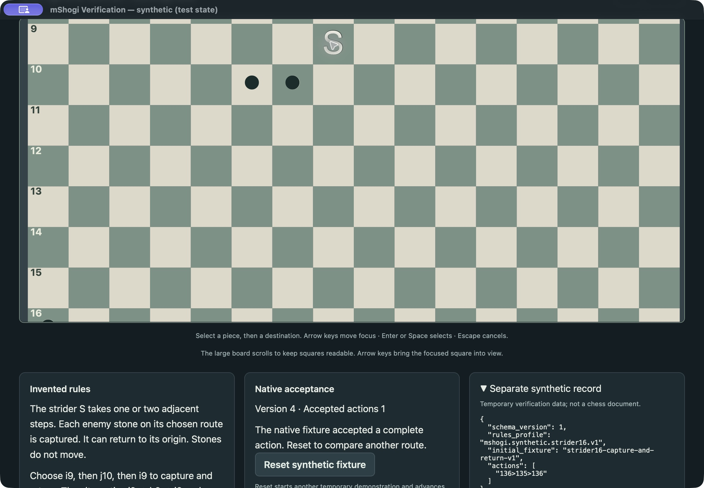

# M3 completion batch evidence

M2 remains closed. MSH-27–35 and roadmap correction MSH-40 retain their
existing evidence. MSH-61 precedes MSH-36–39. M4–M6 are future work; this batch
does not implement them. M3 closure requires every acceptance criterion,
including actual Windows, macOS and Linux packaged GUI interactions.

## MSH-61: complete archive capacity

Native admission checks an immutable complete candidate before accepting an
ordinary document command or engine/analysis response. Separate bounded workers
perform document admission and filesystem operations. Runtime resource pauses
have no chess result. The current accepted document remains saveable, with
reserved stop/close and identity headroom. The format limits and archive schema
are unchanged. Saving and reopening retain all observations and canonical
history.

Independent review identified concurrent Save As bookkeeping replacement and
near-limit persisted identity exhaustion. Both were fixed with regression
coverage: document identity preserves the newer successful Save As metadata,
and persisted archive revision is separate from runtime-only snapshot progress.
Near-exhausted Open inputs are rejected before replacement, while ordinary
mutation refusal retains the save path. Host receipts identify the exact accepted command
even when a following engine-result admission advances the current admission.

Focused verification distinguishes native admission/controller tests, actual
console-child process tests, frontend component tests and packaged GUI evidence.
The first packaged macOS pass used the separate `mShogi Verification.app`,
fixture `capacity`: 255 native zero-node incomplete observations, then a real
bundled depth-1/20,000-node analysis accepted as observation 256 (21 visited
nodes). The next Start was refused before execution, keeping 256 observations
and zero moves. Save As succeeded; Open retained all 256 historical observations
with play stopped. Another Start was refused again. Explicit New game cleared
the old document from the live view; native Cmd-Q displayed the dirty-document
guard and Discard closed it. This first pass precedes the final identity fix;
final revision/package evidence is recorded separately below when available.

The application notice preserves Save and Save As, explains resource capacity
separately from illegal moves, failures and outcomes, and directs the user to
save then explicitly start another document. It does not suggest that a retry
or reopening replenishes structural capacity.

The temporary saved archive contained 256 observations and 256 controls,
385,760 bytes, SHA-256
`d88d54d9469a565d0a71cbe4ddd3a1f92962e181665a6d86f7bf21da34ab39f3`.
Local environment: macOS 27.0.1, arm64. The archive is test output, not a normal
package resource.

Final normal-package verification reopened that complete archive without QA
initializers, refused another analysis as an application resource limit and
successfully saved the entire document again. The final archive retains 256
observations/256 controls; historical flags explain the 256-byte reduction.
Package/engine hashes and final archive hash are in
[capacity-local-macos.json](evidence/m3-completion/capacity-local-macos.json).
The normal package inventory, UCI, engine-turn, move-analysis and bounded Full
protocol checks passed; fixture and native Cocoa probe markers are absent.

Focused commands on the final source:

- `cargo test -p mshogi-desktop-session --lib --features desktop-verification`:
  **41 passed**, including 256/257 engine and analysis observations, actual
  serialized byte growth using legal Full witness evidence, 4,096/4,097 events,
  control/close reservations, cancellation, unchanged rejection, Save As races,
  reopening and identity headroom.
- `cargo test -p mshogi-console --test desktop_play --test desktop_analysis --test desktop_persistence`:
  **9 passed**, using actual native child processes.
- `cargo clippy -p mshogi-desktop-session --all-targets --features desktop-verification -- -D warnings`:
  passed. Repeated generation of 16 ordinary snapshots plus the isolated
  capacity snapshot was byte-identical.
- `npm test`: **56 passed**; strict TypeScript/Vite production build passed.
- `npm run desktop:build -- --bundles app`: normal macOS package passed.

Independent reviewer `capacity_review` examined the native/host/frontend delta
against `7c7df45`, reran 40 normal-feature native and 9 process tests, and
reproduced the formerly dangerous identity boundary: 17 legal Preferences
commands from a near-limit input, then capacity refusal, then successful Save.
No remaining material findings. This source review is separate from the actual
packaged GUI observations above. Hard runtime identity lifetime remains an
explicit guard; no archive caps were raised and no canonical evidence removed.

The exact normal GUI source is `3b427d49fb481c9391992d40f047941ae7f445c2`.
The host's two close/file serialization tests and both workspace formatting
checks also passed. Initial native CI passed on macOS and Windows; Linux found
a timing assumption in the new receipt/close test. The public command API polls
before returning, so a tiny candidate may already have been accepted. The test
now waits for completed validation without polling admission, then verifies
close supersedes that still-uncommitted candidate. This changes test setup only.
Independent review ran the corrected exact test plus **50/50 repetitions**.
The product GUI evidence remains applicable; replacement CI is recorded below.

Integrated implementation: `3b427d49fb481c9391992d40f047941ae7f445c2`;
test-only correction: `ec7e6e7151f01d095430c874b70958f24c93fbd3`, both on
`codex/rewrite`. [Replacement Rust workspace CI](https://github.com/jweathers777/mShogi/actions/runs/40220802720)
passed Linux, macOS and Windows. [Normal desktop package CI](https://github.com/jweathers777/mShogi/actions/runs/40220415685)
passed all three systems at the exact product source; the later revision changes
only a test and evidence. These package checks establish build/inventory and
actual bundled-engine protocols, separately from local macOS GUI interaction.
They do not substitute for MSH-38's three-platform GUI requirement.

## MSH-36: shared board and synthetic routes

Source `4e997f0472e09c98f98d211236e2706c453f4f08` uses the actual shared SVG
board/selection component for both chess and an invented 16-by-16 strider
fixture. The fixture's native rules source is shared with the unchanged M1
action-boundary demonstrations. Its profile and ephemeral record are separate
from chess. Rust supplies complete choices and accepts atomic actions; the
frontend retains only an uncommitted prefix. A terminal prefix which also has
continuations requires explicit completion. The large board scrolls at readable
square sizes; keyboard focus brings off-screen squares into view.

Actual macOS packaged interaction used the separately named verification app:

- Initial white orientation displayed full two-digit rank labels, 256 accessible
  squares and clear invented-fixture labeling. Flip and keyboard Tab/arrows
  exposed the same board in black orientation.
- `i9 → j10` remained uncommitted at native version 1, zero accepted actions.
  Tab reached **Complete action here**; Escape cancelled and restored i9 focus.
- Keyboard completed `i9 → j10 → i9`: native version 2, one accepted action,
  j10 stone removed, strider returned to i9, record `136>153>136`.
- Reset advanced the native version and restored zero accepted actions. Pointer
  selection of `i9 → h9 → i9` kept the j10 stone and recorded `136>135>136`.
  The two actions share origin/end but preserve different native effects.
- Explicit completion of the one-step prefix recorded `136>153` and left the
  strider on j10. Reset never reused an earlier runtime version.
- Native Cmd-Q opened the fixture Close/Cancel guard. Escape preserved its
  accepted record; a later Close exited through the guarded native lifecycle.

Exact normal/verification package and engine hashes, environment and observations
are in [synthetic-local-macos.json](evidence/m3-completion/synthetic-local-macos.json).
The normal package passed the external inventory/host-marker and actual bundled
engine verifier. Normal production frontend generation forces verification off,
including when its environment flag is inherited; emitted modules/markers were
checked. Explicit verification output is separate in `dist-verification`.

Root frontend suite: **64 passed**. Independent `capacity_review` ran 10 core
action-boundary, 4 synthetic native, 4 verification-host and 14 focused frontend
tests. Strict native Clippy, normal native checks, both frontend builds and
fixture regeneration/exclusion checks passed. Review found one keyboard gap:
Escape from a partial-route control did not cancel; it was fixed and tested.
No remaining source findings. These checks and actual packaged GUI evidence
remain distinct. CI status and any corrections are recorded before finalization.

Initial MSH-36 Linux CI found a test clock/setup race in historical analysis:
the test could use timestamp zero after a real accepted controller command, or
inspect before its future claim had been accepted. The test-only correction
waits for exact receipts, proves the future claim/conclusion exists, and uses
the same controller clock for subsequent operations. Two analogous roundtrip
and restoration assertions now also wait for admission. Production timestamp
validation is unchanged. Independent exact tests plus 75 focused repetitions
passed; no product/package rebuild is needed for this test-only correction.

The first Linux/Windows package checks also exposed five-second frontend test
timeouts from repeated accessible-name scans over 256 SVG squares. Test-only
coordinate queries now use the existing SVG button/ARIA labels directly;
startup waits for the heading and completion queries target HTML buttons.
The 256-button accessibility inventory and every behavior assertion remain.
No production change or timeout increase: full 64-test suite passed in 5.40s;
independent 8-test focused rerun passed in 3.48s. Replacement package CI must
pass before the ticket is finalized.

MSH-36 integrated revision: `415f080ea3d0f3ad361120b07bcfaab3fd001678`.
[Rust workspace CI](https://github.com/jweathers777/mShogi/actions/runs/40223036914)
and [normal desktop package CI](https://github.com/jweathers777/mShogi/actions/runs/40223036915)
passed Linux, macOS and Windows. Product source/package GUI evidence remains
`4e997f0`; subsequent desktop changes are test/evidence corrections. Independent
review also inspected all four screenshots and recomputed both host and both
bundled-engine hashes against the JSON, with no material evidence findings.
Nested scrolling/control access at minimum size is carried into MSH-37's
integrated interaction assessment. M3 remains open.
