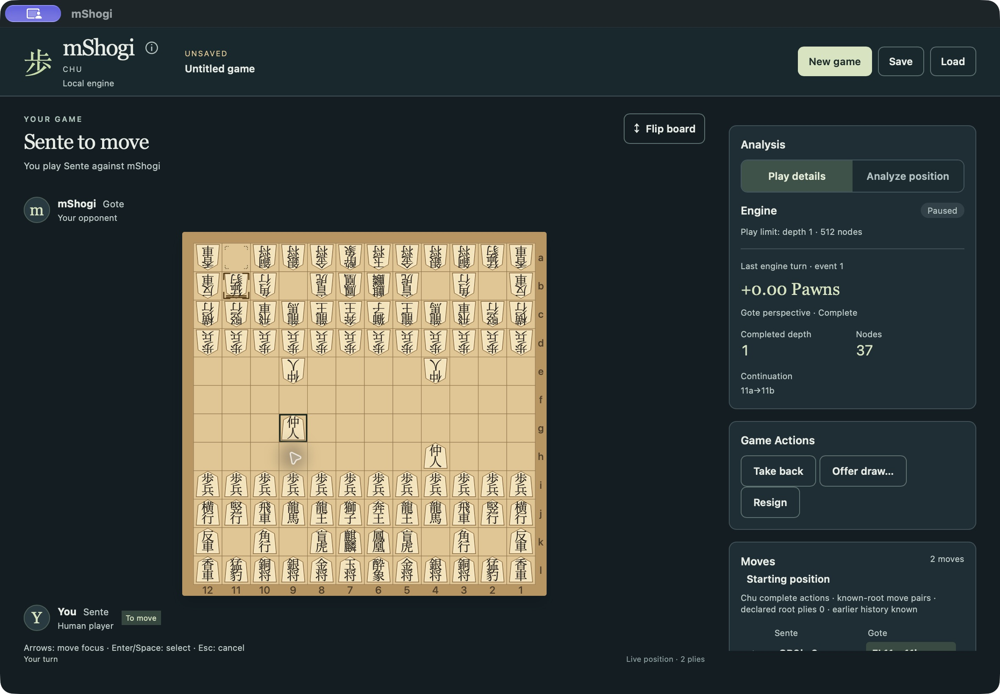
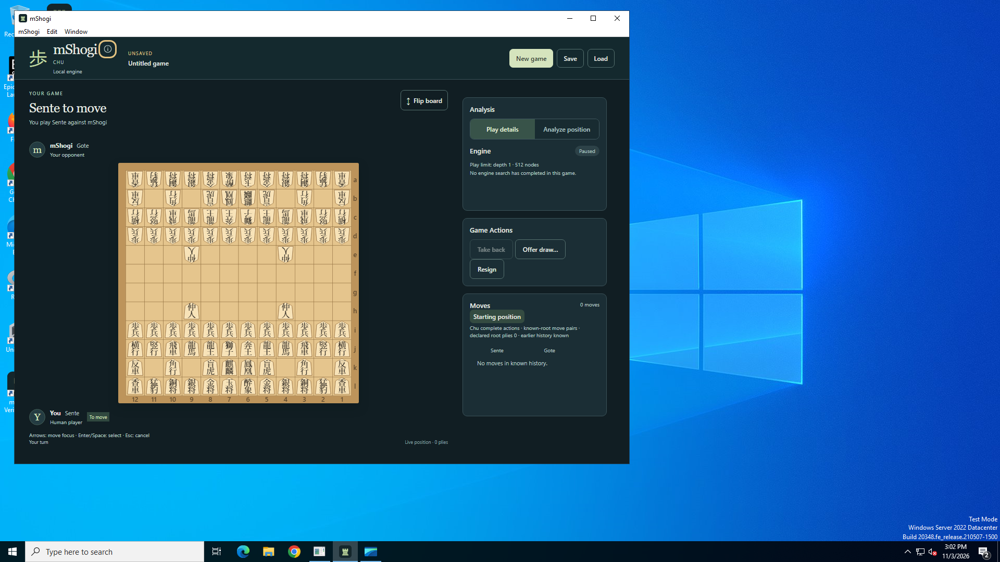
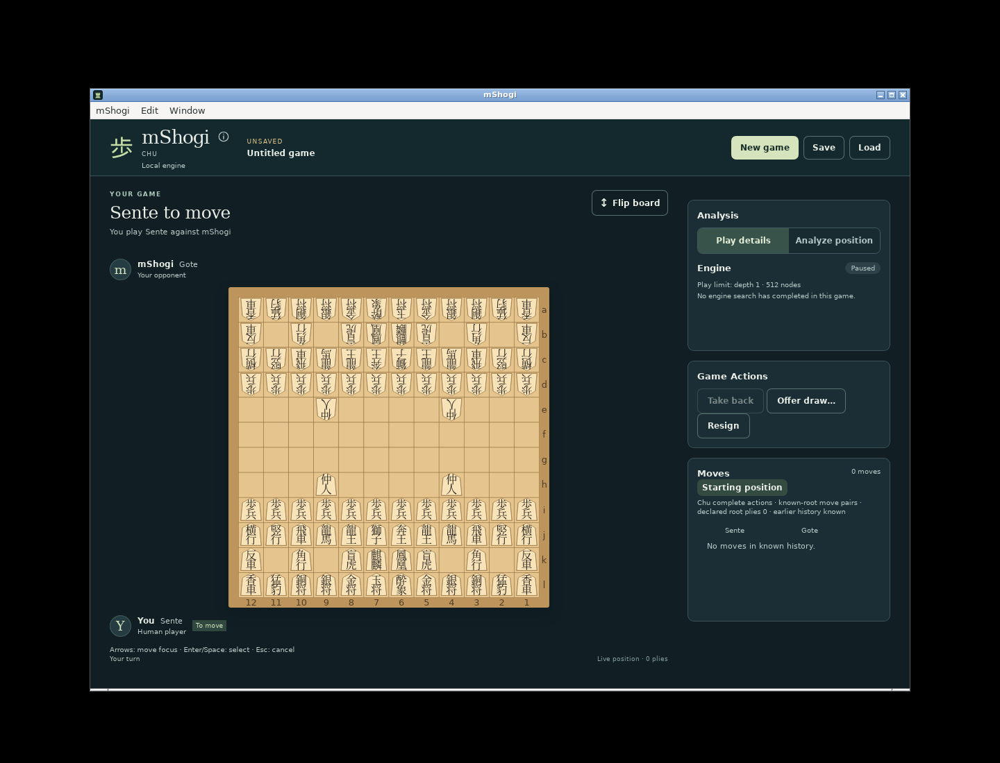

# MSH-43 Chu playable-product acceptance

**MSH-43 accepted: all eight original criteria are supported.** This resumes the existing
MSH-43 assessment after explicit owner visual approval; it does not reopen the
selected rules or create another implementation phase. The single
[structured verification record](evidence/playable-product.json) distinguishes
production, verification-only revisions, actual packaged interaction, local
checks, independent reviews, CI and evidence reused below.

Last production-changing source is `bba834e128f228b84963816300c7cab52be8a492`;
final external verification source is `bd4bf619e18d5809a441edaf93aa0b692eb4df99`.
Rust/native-host source remains identical to the passing `8ea3245` checkpoint;
the new shared diagnostic renderer has its own frontend and actual packaged evidence.

John approved the actual running traditional kanji, promoted faces, King/Prince,
Lion interaction and responsive12×12 layouts at integration
`cf9e50b122cb879d9f01677034fce88bcd92f222`, production
`c52e253b9f8d61d30434f53b818ad3ae52becf5b` and verification-only
`f43583de84c147591c4e83dd07068aa1779b3e09`. The renderer and common dark shell
remain unchanged. Desktop Take back remains distinct from native/console Undo.

## Original eight criteria

| Criterion | Reconciliation and evidence |
|---|---|
| AC1 complete sourced profile | Supported: [profile](profile.md), [decisions](decisions.md), [sources](sources.md), completed82. `mshogi.chu.jcsa2019.v1`, JCSA2019/compatible2004/owner direction; capture-based movement, finite immediate mate, before-fourth admission, narrow material exhaustion and actual opposing draw consent. No unresolved required rules decision or new playing convention. |
| AC2 authoritative native game | Supported: [native contract](native-v1.md), completed86. Complete native actions/effects, every remaining royal, Lion rights, exact apply/undo and history-sensitive atomic admission. Structural diagrams, declared counters, known history and proven reachability remain distinct; saved, repetition and execution identities have different roles. No client rules implementation. |
| AC3 independent correctness | Supported: [native verification](native-verification.json), immutable250-row corpus with240 native rows and1,076 independently established native assertions; hand-counted7/42 perft/divide, rotations, negative/adversarial, sequence/reversal/replay. Ten consumer rows are reconciled below. External comparators are optional under the accepted conformance policy, not a missing delivery gate. |
| AC4 independently usable console | Supported: [notation](notation.md), real `--game chu profile/shell`, eight actual CLI tests and native notation tests. Complete routes/ordered captures/returns/promotion, diagnostics, explicit outcome/history, atomic canonical Save/Load, bounded read-only analysis and native Undo. The documented native notation extension is not attributed to JCSA as a published standard. No unsupported USI/UCI mapping is claimed for Chu. |
| AC5 functional native engine | Supported: [engine contract](engine-v1.md), real full-history native search, complete actions and correct native terminal scores; genuine incomplete/failure remain unscored. Six actual-child/controller journeys cover both assignments, purpose/history/identities, cancellation/replacement and cleanup. Reproducible actual engine naturally concludes the independently reviewed royal diagram and returns Finished; a separate standard-root12-turn record ends in explicit resignation. Neither is a strength claim or natural standard-root self-play completion. |
| AC6 lossless native archive | Supported: completed78/[shared contract](shared-v1.md), current strict envelope/raw dispatch and native replay, complete actions/actors/events/rights/obligations/royals/conclusions/settings and exact observations/retired branches. Atomic Save/Open, failed replacement integrity, fresh stopped reopen, historical results and explicit Resume retain one native owner. Real observation/branch measurements and ending/Close reserves remain unchanged. |
| AC7 actual finished desktop | Supported: normal fifth-game New/Load and real engine use the accepted controller/document/frontend/choice owners and approved renderer. Actual normal macOS gameplay, native routes/endings/history/Save/Load/Resume and separately identified QA cancellation/recovery are recorded. Actual installed Windows f904 and Linux bd4 each pass all39 normal/QA GUI phases, including both assignments, standard-root progression, full compound/native scenarios, bounded analysis, exact history/Take back, recovery, capacity, Save/Load and native Quit. All256 observations survive reserved Resign and stopped reopening. |
| AC8 complete coverage/review | Supported by the native/shared/engine/console/renderer reviews, ten C11 consumer mappings below, exact-source regressions and actual three-platform package/gameplay evidence. Final read-only evidence reconciliation is recorded in the structured record. Required capacity-Resign and diagnostic-rendering findings are resolved with tests and actual GUI evidence; original failed probes remain historical. No required game behavior is deferred to M5. Shared46/47/88/89, diagnostic107 and M4 closure remain separate. |

## Final platform and review provenance

- macOS actual normal GUI: stable `org.mshogi.desktop` gameplay/interaction at
  e7e45ce, unchanged-path evidence reused through later corrections; final capacity/
  reserved Resign at1537b48 and bounded Diagnostics/capacity/ending Save/Load at
  bba834e. The approved board renderer is unchanged across these sources.
  Separately labeled stable QA pending-work and missing-sidecar/Retry journeys
  retain their exact earlier package sources.
  Current macOS package/check job126006165552 at bd4bf61 passes; package smoke is
  distinct from local actual GUI interaction.
- Windows actual installed normal NSIS and separate verification package:
  f904372, job125990316827/run41657129728, **39/39 phases pass**. The complete
  report and exact normal/QA package manifests are retained losslessly.
- Linux actual dpkg-installed normal Deb and separately extracted verification
  package: bd4bf61, job126006166186/run41661670863, **39/39 phases pass**.
  X11/Xvfb/WebKitGTK uses `WEBKIT_DISABLE_COMPOSITING_MODE=1`; no other Linux
  compositor/display environment is inferred. The readback and keyboard fixes
  now execute successfully in the real application.
- Native Rust CI41636847382 at8ea3245 passes on allthree systems. Exact Rust and
  standalone-host source equivalence through bd4bf61 permits reuse. Local final
  production tests include445 frontend checks, strict TypeScript, both host
  configurations and the recorded native regressions;148 external observer
  checks apply to the final verifier. No unchanged expensive campaign is
  recounted as newly run.

Final independent read-only source and actual-report reconciliation passes all
eight criteria with no remaining material finding. Normal production changes
are already integrated and pushed; terminal task/evidence bookkeeping completes
the delivery. The extra bd4 Windows leg was superseded after required Linux/
macOS completion, reusing the independently verified f904 39/39 campaign; the
latest workflow is not described as an all-three-platform green run.

Current production behavior is identical at the bba/f904/bd4 GUI checkpoints;
subsequent changes affect only external verification and evidence. Native
shutdown is observed before driver teardown; cleanup alone is never exit proof.
The earlier cancelled macOS f904 job ran zero steps because hosted capacity was
unavailable; it is not called passed. Its later bd4 package job succeeds.

## Consumer scope and actual execution

The ten C11 rows are product obligations, not another native assertion count.
Their original expected data remains unchanged.

| Consumer obligation | Concrete evidence |
|---|---|
| Same board, different history | Native86 and actual child `actual_child_executes_complete_chu_choices_for_full_known_history_and_purpose`; native search repetition tests and exact canonical routing. |
| Stale request | Actual child/controller negative probes and retired selection/Take back/replacement/Open authority reject superseded results. |
| Wrong purpose | `forged_actual_observation_score_pv_limits_context_and_journal_are_rejected_atomically` and read-only historical analysis probes; analysis never enters the engine-action application path. |
| Wrong process generation | Actual child/controller forged-context probes, process replacement and fresh stopped Open reject old generations even when the board matches. |
| Historical prefix without future | Actual child `real_historical_analysis_saves_exact_prefix_and_reopens_stopped_without_future`; normal GUI prefix4 excludes future repetition obligation, Return to live restores exact10-event context. |
| Save/reopen stopped | Actual native worker/controller and normal GUI Save/Load, saved observations historical, new document/request/process authority and explicit Resume. |
| Reserved closing headroom | Native/shared byte/event/control/work/observation boundary tests and real256→257 refusal. Complete current document and actual Stop/Resign/Close continuations remain admitted. Final normal macOS GUI exposes reserved Resign while ordinary work stays paused; nativeGoteResignation/0boardplies and all256 observations survive Save/Open. |
| Complete route and partial selection | Shared native-choice controller/component tests and actual packaged Lion partial/cancel, quiet/capture return, same-endpoint alternatives, one-stage explicit completion and ordered double captures. |
| No unsupported normal chooser | Actual five-option dropdown and exact native New/Open/side/Random tests. Chu is now functional, so its former gate is lifted; no unsupported Tenjiku or synthetic option is exposed. |
| Full board without scrolling | Owner-approved actual normal/minimum/intermediate captures, both orientations, all144 cells; traditional bundled glyphs. New platform GUI measures actual clip/font/geometry rather than inferring it from build success. |

## Complete games and resource truthfulness

The [native GUI input manifest](../../../desktop/scripts/fixtures/chu-native-fixtures.json)
and [provenance](../../../desktop/scripts/fixtures/CHU.md) retain original source
fixture identities and clearly identify derived diagrams. The actual engine
natural-ending diagram adds a remote Gote Gold at11a to the sourced two-royal
case: single-royal removal cannot trigger the material shortcut, while capturing
both royals remains a native royal-capture win. The real line-server chooses
`6f→6e→5e`, both captured royals are checked, and the next real request returns
Finished. Both observations and one native event survive exact replay. This is
in-process actual engine execution; the subprocess and packaged GUI evidence
are separate.

The standard-root record retains12 actual engine observations,12 board actions
and Sente's explicit resignation. The earlier32-ply progression remains a smoke
check, never a completed natural game or a playing-strength measurement.

No limits change: native512KiB/512events/4M units; complete desktop16MiB/4,096
retained events/8,192controls/256observations/12M aggregate units/15-second worker.
Real observations and retained histories/branches are charged, including actual
ending/Close headroom. Mandatory representative journeys succeed; near-limit
work may truthfully refuse without changing the accepted session or previous
file. Saving/reopening cannot reset structural limits. Exact measurements,
source/package hashes and lossless saved capacity evidence are in the structured
record, without duplicating the earlier native campaign.

## Findings and evidence boundaries

- Existing visual-checkpoint failures and corrections remain in the original
  [checkpoint](desktop-visual-checkpoint.md) and records. Owner approval resolves
  the former aesthetic checkpoint; technical review is not substituted for it.
- Actual macOS exposed a verifier-only CSS capitalization assumption for optional
  promotion labels. The corrected observer reads the exact native button labels;
  no product style or rules change was needed. Superseded CI is not called passed.
- Independent final review identified the ordinary-capacity pause disabling
  reserved Resign. The bounded correction separates that button's genuine
  busy/modal protection from ordinary resource-paused work. Native admission
  still decides the result; claims/offers/declarations/Take back remain blocked
  at capacity. Focused five-game tests, independent18-test review and actual final normal macOS
  capacity→Resign→Save/Open resolve the source/interaction finding. Required
  Windows/Linux campaign evidence was pending at that historical checkpoint;
  the final successful reports above now cover it.
- Desktop run41639824124 at1537b48 passed37/39 actual GUI phases on each of
  Windows and Linux. Two external-driver failures expected `CHU SHOGI` instead
  of the approved actual `CHU` header and omitted the no-promotion completion
  for a native Gote Rook. Independently reviewed verifier-only bff5338 corrects
  both. Failed reports, screenshots and DOM remain evidence.
- Run41643591356 resolves those two errors, then exposes an overstrict native
  action-card height assertion and platform failures after capacity Save. Chu's
  additional draw control legitimately changes content height; e142de7 preserves
  exact shared flow/anchors while reopening the actual ordinary Save path, not an
  external evidence copy. Linux's picker did not close; Windows accepted its
  picker, then its native screenshot shows a real renderer **Out of Memory**.
  The 91,625ms metric is scenario-cumulative, not picker duration. Only WebView/DOM
  failure capture was unavailable; the native OOM screenshot is retained.
- Shared production correction bba834e lazily captures complete compact diagnostic
  JSON on expansion and renders one Unicode-safe 64Ki-character page at a time.
  Every byte remains available through public Previous/Next controls; closing and
  reopening refreshes the frozen capture. No native/archive limit or saved
  observation changes. Unbounded 8.7MB/287,562-line diagnostic layout is a plausible
  OOM trigger, not a proven complete root cause. Independent review, 445 frontend
  tests, 142 observer checks and actual final normal macOS pagination/capacity/
  Save/Load/native Resign pass. The then-required Windows/Linux campaign41650536254 remained
  pending at that checkpoint; cancelled41648306477 is not counted as passed.
- Campaign41650536254 passes the complete Windows normal-Chu native journey,
  including paged Diagnostics, all256 observations, reserved Resign and Save/Load;
  the prior OOM is not reproduced there. Both platforms still finish37/39: the
  History-bottom assertion is corrected to preserve native content flow and equal
  History height. Windows also has an external-driver socket-bind conflict (`0x2740`)
  before the capacity fixture, with the specific port/owner unknown; Linux has a small-record native picker timeout.
  Its screenshot alone cannot distinguish horizontally clipped text from missing
  characters. Independently reviewed verification-only f904372 confirms the actual
  full native filename through Copy before acceptance and fails closed on mismatch;
  only an actually observed suffix permits one bounded replacement. All147 Python
  GUI checks pass. Campaign41657129728 passes all39 Windows phases and38/39
  Linux phases, including the complete native/capacity journey. Its sole Linux
  failure is direct element-click on a clipped Moves button after Take back;
  bd4bf61 reuses the existing bounded real Tab/Enter path for that exact target.
  Independent review and148 Python checks pass; final Linux41661670863
  subsequently passes all39 phases, including complete normal history/analysis/
  Save/Load/native Quit. Product source remains bba834e. The f904 macOS job ran zero
  steps because GitHub could not acquire a hosted runner; its cancellation is
  preserved, and independently verified identical inputs justify reusing the
  successful bba macOS job125967163245 and actual local bba GUI evidence.
- Actual macOS CUA, actual Windows/Linux native-webview GUI, component simulation,
  package inventory and native tests are separate evidence. No comprehensive
  VoiceOver/screenreader campaign or DeveloperID/notarized release is claimed.

Functional play uses depth1/512 visits; analysis is bounded at depth2/2,000.
Finite native queries and archive replay remain bounded and expensive histories
can refuse honestly. Competitive strength belongs to52/M5. Diagram reachability,
all-game platform closure, shared six-game integration and M4 closure are not
inferred from this game's acceptance. No Tenjiku/M5/107 work is started here.

## Launch

Use the ordinary package in the primary checkout:

```sh
open "/Users/johnweathers/Development/Personal/mShogi/desktop/src-tauri/target/release/bundle/macos/mShogi.app"
```

Choose **New game → Chu Shogi → Sente/Gote/Random → Start game**. Native Load
opens complete `.mshogi` documents with work stopped; press **Resume play**
explicitly. [Build and interaction instructions](../../../desktop/README.md)
cover bounded analysis, native complete-action selection and guarded files/quit.

## Actual normal application captures

These are native desktop captures, not render mocks. Exact package sources,
full reports, native events and hashes are in the structured record.

| macOS normal gameplay at e7e45ce; approved renderer unchanged | Windows normal Chu, f904 | Linux normal Chu, bd4 |
|---|---|---|
|  |  |  |

Actual bba834e Diagnostics/capacity/ending captures32–34 are retained separately;
the earlier gameplay image does not claim those later corrections were present.
The approved minimum-size gallery remains in the visual checkpoint; the final
Linux minimum capture and historical/read-only analysis/ending captures are
also retained beside its report. This does not replace later six-game or M4
closure acceptance.
