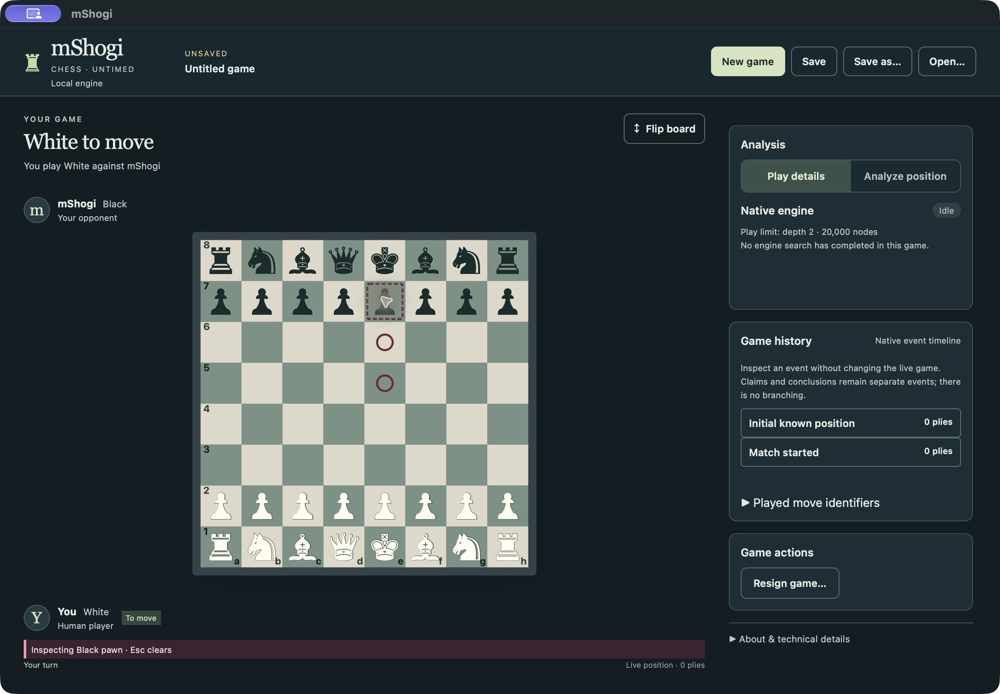
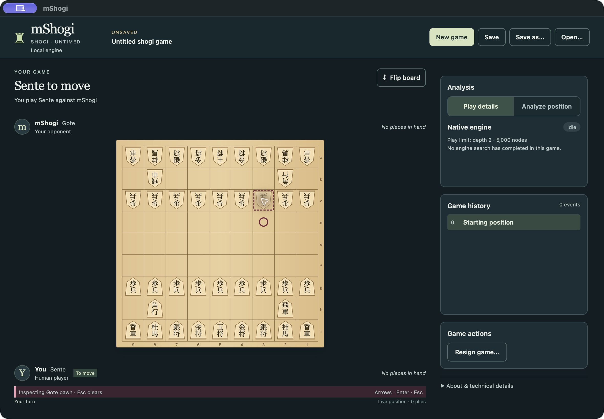
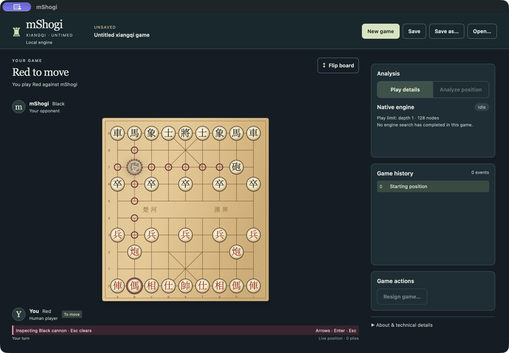
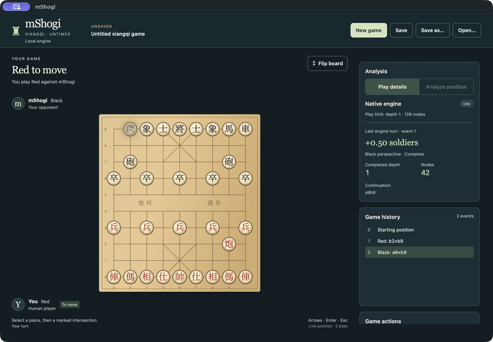

# MSH-101 completion evidence — 2026-10-29

Tested, independently reviewed and packaged source: **`be3055a1bc8d4b0d0fdf11f8509b97076d13fa43`**, integrated/pushed on `codex/rewrite`. The later verification-script revision **`1c8a1682db5b98e765eb755b7978537c20a2ddd2`** changes only the external GUI verifier/tests and task evidence; product code is identical to the packaged source. Subsequent evidence/status commits also leave product code unchanged. The owner's continuation attachment explicitly approves the earlier actual `3a1aefc` visual checkpoint; it does not substitute for the checks below. The original [checkpoint](../visual-checkpoint-2026-10-28/README.md) is preserved as historical evidence, including its failed resize automation and then-open Debug-label finding.

## Delivered change and semantic boundary

The native Rust presenter now exhaustively formats Xiangqi event labels from authoritative native fields. Quiet moves use existing native coordinates (`Red: a3–a4`), captures use the derived capture fact (`Red: b2×b9`), and check uses the native `gave_check` observation. Warning/retirement, claimant-specific claim submission/rejection/acceptance, offers/agreement/resignation, unresolved unscored adjudication and native conclusions have separate readable labels. Canonical records, complete action payloads, WXF history/provenance, event indices, board plies and replay are unchanged. There is no frontend rules parser, history reconstruction or exact-proof execution for formatting. Native diagnostic representations remain available in technical details.

The small shared `inspectionStatus(nativeLabel)` formatter supplies exactly **`Inspecting {side} {piece} · Esc clears`** to Chess, Shogi and Xiangqi. Game-owned labels retain their native side/piece/promotion/hand meanings. Visible redundant explanations were removed; screen-reader read-only announcements, native token binding, non-actionable hollow markers, capture precedence and keyboard/Escape handling remain unchanged. Design A-07 records this owner-approved convention for future Tori/Chu/Tenjiku consumers.

## Actual normal packaged application

All new images here are unmodified CUA screenshots of the **normal** macOS `.app`, at 1180×820 logical native window frame (2360×1640 raw Retina pixels, including title bar). No fixtures, initial-size override, verification feature or web-only harness supplied these positions. [screenshots.json](screenshots.json) records hashes, dimensions, source and provenance; adjacent `.ax.txt` files preserve native accessibility observations.

| Chess | Shogi | Xiangqi |
| --- | --- | --- |
|  |  |  |



Additional captures: [friendly selection](xiangqi-selection-normal.jpg), [keyboard play](xiangqi-keyboard-play-normal.jpg), [Flip after play](xiangqi-flipped-play-normal.jpg), [Black-human assignment](xiangqi-black-human-normal.jpg), [Black-human play](xiangqi-black-human-play-normal.jpg).

Actual actions and observations:

1. Selected Black e7 pawn in Chess and Gote 3c pawn in Shogi: exact common visible inspection wording; hollow markers. Escape cleared each. These are narrow shared-copy compatibility checks, not repeated unrelated complete-game campaigns.
2. New Xiangqi, human Red: native Red-bottom assignment and Red to move. Inspected Black cannon b7: exact common wording, hollow empty/occupied rings. Clicking empty inspection destination b8 left 0 events/0 plies. Escape cleared inspection and native AX reported focus returned to b7.
3. Selected friendly b2 cannon: green native destinations, including occupied b9. Clicking b9 committed the complete native capture rather than inspecting the enemy. Native Black engine replied a9b9. The screenshot shows live 2 plies, `Red: b2×b9` / `Black: a9×b9`, depth 1 / 128-node limit, and actual completed-depth/nodes/perspective/score observations (42 nodes for this reply). No Debug payload is visible.
4. Selected Red a3, Up moved focus to native legal a4, Return committed a3a4; native Black replied. Captured live 4 plies with readable quiet/capture rows and actual telemetry. Flip preserved the game while reversing native presentation; upright discs, player labels and common status footer remained.
5. New Xiangqi, human Black: native Red engine opening, Black-bottom assignment and Black to move. Selected Black a9, Left moved focus to occupied legal b9, Space committed the capture; native Red replied h2h9. Captured live 3 plies and readable Red/Black history.

The board, player areas and common footer remain fully visible; the independently scrolling sidebar remains in its approved Analysis→History→Actions→Technical order. No layout/theme/board-art redesign occurred.

## Reused sizing and accepted baseline evidence

The unchanged 90-intersection geometry, palace/river metadata, font/glyph artwork, responsive CSS, player/footer slots and earlier reviewed native admission/supervision implementation retain their `3a1aefc` evidence. The owner explicitly approved those board/piece/marker/sizing/shell images. The final shared wording is shorter and introduces no geometry changes.

Earlier 760×650 minimum and 960×740 intermediate evidence used separately labeled **normal-feature product packages** with initial-size/title/name/bundle-ID overrides, as recorded in their [package manifest](../visual-checkpoint-2026-10-28/packages.json). It establishes actual product fit at those measured sizes, not successful runtime resize automation of the unchanged normal artifact. No new runtime-resize success is claimed here. Original captures and provenance are preserved; no repeated sizing build was needed for these text-only corrections.

## Local verification and build provenance

Local Apple arm64/macOS 27.0.1 (26A434), Rust 1.99.1, Node 24.19.0, locked dependencies. Node PATH prefix: `/Users/johnweathers/.cache/codex-runtimes/codex-primary-runtime/dependencies/node/bin`; unrelated Homebrew Node was not repaired or changed. Build retains the existing vendored Tao patch and its 20 warnings; no Tao changes in this task.

Passed commands:

- In `desktop`: `npm run check`; `npm test` — **183 tests/23 files**, including exact visible status and unchanged accessible read-only announcements in all three boards, delayed inspection retirement, capture precedence, keyboard/focus, shell compatibility and actual native capture-history fixture rendering.
- `cargo test --locked -p mshogi-desktop-session --all-features label_tests -- --nocapture` — **2 passed**: native quiet/capture/check mapping and non-board event/conclusion distinctions. These are presentation expectations, not a replacement rules oracle.
- `cargo test --locked -p mshogi-desktop-session --all-features shared::xiangqi::tests` — **14 passed**: actual native checks/warning labels, claim/resignation board-ply distinction, exact event prefixes/canonical preservation, action rejection, supervision/cancellation/stale work and capacity boundaries. Initial mistaken filter `shared::xiangqi_tests` selected **0 tests**; it is not counted as verification. The corrected module-path suite passed.
- `cargo run --locked -p mshogi-desktop-session --features desktop-verification --example write_frontend_fixtures -- desktop/src/__fixtures__` — generated a new **actual native** b2b9/a9b9 capture/recapture ledger for frontend tests; existing fixture files unchanged. This test-only generator/feature is not used for the normal package.
- `cargo clippy --locked -p mshogi-desktop-session --all-targets --all-features -- -D warnings`; `cargo fmt --all -- --check`; `git diff --check` — passed.
- In `desktop`: `npm run desktop:build -- --bundles app` — normal `.app` built, 18.05 MiB. Actual package `/Users/johnweathers/Development/Personal/mShogi/desktop/src-tauri/target/release/bundle/macos/mShogi.app`.
- `python3 desktop/scripts/package-smoke.py desktop/src-tauri/target/release/bundle/macos/mShogi.app --report docs/m4/evidence/msh101/completion-2026-10-29/normal-package-smoke.json` — passed. [Report](normal-package-smoke.json) verifies normal-package instrumentation exclusion and actual bundled-engine UCI/internal engine-turn/analysis/bounded chess Full execution. It is supporting package/process evidence, separate from the actual GUI observations above.
- `python3 -m unittest discover -s desktop/scripts -p test_gui_smoke.py` — **24 external driver boundary tests passed**, including exact visible inspection copy for native Chess/Shogi/Xiangqi/hand labels. These unit tests are not GUI evidence.
- Backlog 1.55.1 `doctor` — no duplicate IDs, self-dependencies or cycles. Backlog mutations used pinned 1.55.1; PATH 1.55.0 was not used for mutations.

Normal host SHA256: `611781adb4c063f471694cb84540327e70f51b15032d4f09a4c8083f53af8f97`. Bundled engine SHA256: `ed58d09b4c05d9d4cc8ca65db7fc7df4d9129608605ff02677484ff5c1266f5f` (unchanged). Exact source and hashes distinguish this package from the previous checkpoint and size-verification packages.

## Independent review

A separate read-only agent reviewed the completion diff, original MSH-101 criteria and approved checkpoint. The reviewer independently passed strict TypeScript, **82 focused frontend tests**, **2 native label tests**, **14 native Xiangqi session tests**, and diff checks. It then inspected all nine final actual normal-package images and AX snapshots. No actionable implementation, interaction or visual findings remain. This is independent agent source/test/screenshot review, not a fabricated external human assessment. The earlier separate font audit and checkpoint visual review remain applicable. The previously open visible Debug-history finding is resolved by the native presenter and refreshed genuine played-game capture. The same independent reviewer additionally reviewed the external GUI-verifier correction and independently passed its 24 tests, confirming no semantic or transport checks were weakened.

## Acceptance/evidence mapping and remaining scope

| Original MSH-101 criterion | Evidence |
| --- | --- |
| AC1 Native untimed own-engine play in approved shell | Actual Red/Black games and replies above; native product/session tests; owner-approved shared-shell checkpoint |
| AC2 Native intersection geometry, pieces, full board at supported sizes | Approved unchanged checkpoint geometry/font/normal/minimum/intermediate evidence; final normal GUI images; no Shogi controls or frontend legality |
| AC3 Pointer/keyboard/complete action, inspection/focus/Flip/footer/limits | Actual capture/keyboard/inspection journeys; all-three status tests and stale-response/native session tests; normal-package exclusion report |
| AC4 Focused regressions, packaged play/inspection and independent comparison | Root and independent checks, nine final GUI captures, preserved matching approved comparisons and applicable CI records |

MSH-101 does not close Xiangqi delivery. MSH-102 owns complete analysis, WXF outcomes/claims, recovery and Save/Open/history/Return to live/Resume journeys; these controls remain deliberately unavailable/display-only/gated where not yet delivered. MSH-103 remains complete-game review; MSH-45 and M4 stay open; MSH-106 remains downstream of complete delivery. Current ordinary execution stays at the existing measured depth 1 / 128-node limits, with sound-fast-only no-win policy. There is no new playing-strength or exact-proof claim. Xiangqi GUI evidence here is macOS; Windows/Linux CI compatibility does not establish Xiangqi GUI there. Earlier Linux failure and MSH-111 provenance remain intact.

## Launch

```sh
open /Users/johnweathers/Development/Personal/mShogi/desktop/src-tauri/target/release/bundle/macos/mShogi.app
```

Choose **New game → Xiangqi → Red/Black → Start game**. Use pointer selection or arrows/Enter/Space; Escape clears selection/inspection. Flip changes presentation, not human assignment. Developer details remain collapsed.

## Initial CI failure retained

[Native CI40834914585](https://github.com/jweathers777/mShogi/actions/runs/40834914585) passed on all three systems at product source `be3055a`. The initial [desktop run40834914598](https://github.com/jweathers777/mShogi/actions/runs/40834914598) failed its Linux and Windows GUI journeys: the external verifier still asserted that ordinary visible inspection text contains “read only”. That assertion contradicts the new owner-approved wording. The aborted normal Chess/Shogi phases then deprived the later reopen phase of its saved input: Linux reported the missing dispatch, while Windows reported that its native Open picker did not close after selecting that unavailable input. The original matrix records macOS success and Linux/Windows failure in [initial-desktop-ci.json](initial-desktop-ci.json). [Failure record](initial-linux-gui-failure.json) preserves the exact job/artifact links, error and diagnosis; it is not counted as a passing check or hidden as unrelated infrastructure.

Verification-script revision `1c8a168` observes the actual visible status span (or Chess paragraph) and requires the exact new wording. Destination accessibility, hollow markers, unchanged native context/history, non-actionable completed routes, Escape and canonical archive comparisons all remain required. It does not modify MSH-111's driver/proxy/retry behavior or any product source. Fresh applicable CI outcomes follow separately.

## Final applicable CI and completion

At exact verifier-corrected revision **`1c8a1682db5b98e765eb755b7978537c20a2ddd2`**:

- [Rust workspace40836312043](https://github.com/jweathers777/mShogi/actions/runs/40836312043): **PASS** Ubuntu24.04, macOS15, Windows2022. [Exact job/step records](native-ci.json).
- [Desktop packages40836312034](https://github.com/jweathers777/mShogi/actions/runs/40836312034): **PASS** all three systems. [Exact job/step records](desktop-ci.json). Normal packaging/bundled-engine checks and separate Windows/Linux actual installed/packaged Chess/Shogi interaction campaigns passed, including the corrected inspection wording and unchanged non-actionable/native-history protections. These compatibility journeys do not establish Xiangqi GUI on Windows/Linux.

The initial failed desktop matrix remains preserved above; it is superseded by a passing corrected-verifier run, not reclassified as success. All original MSH-101 AC/DoD are supported by the mapping, independent reviews, actual local Xiangqi GUI, reused approved sizing evidence and applicable CI. No unresolved task-scope findings remain. The remaining Xiangqi journey limitations are explicitly MSH-102 work. MSH-101 may close under the owner-authorized continuation; MSH-102/103/106 are unstarted and MSH-45/M4 stay open.
