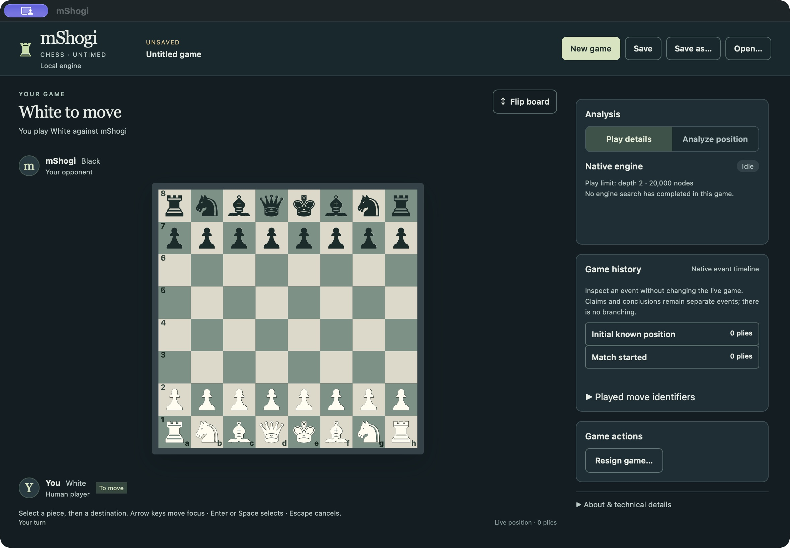
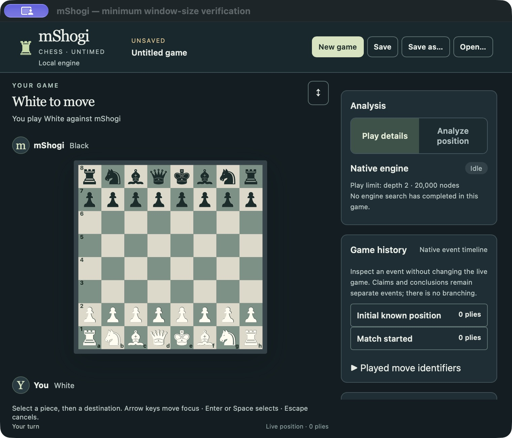
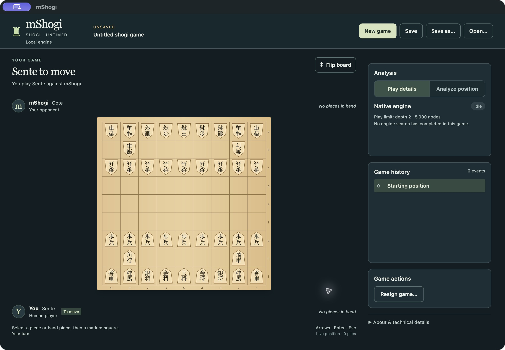
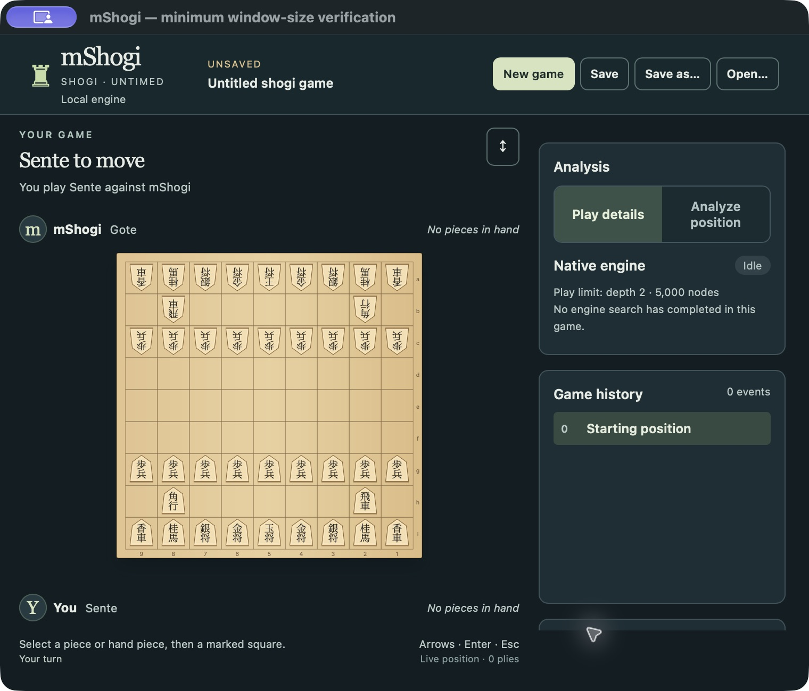
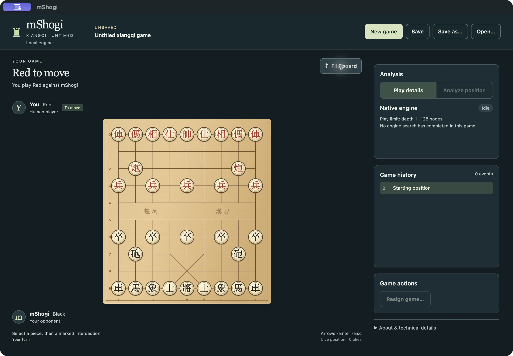
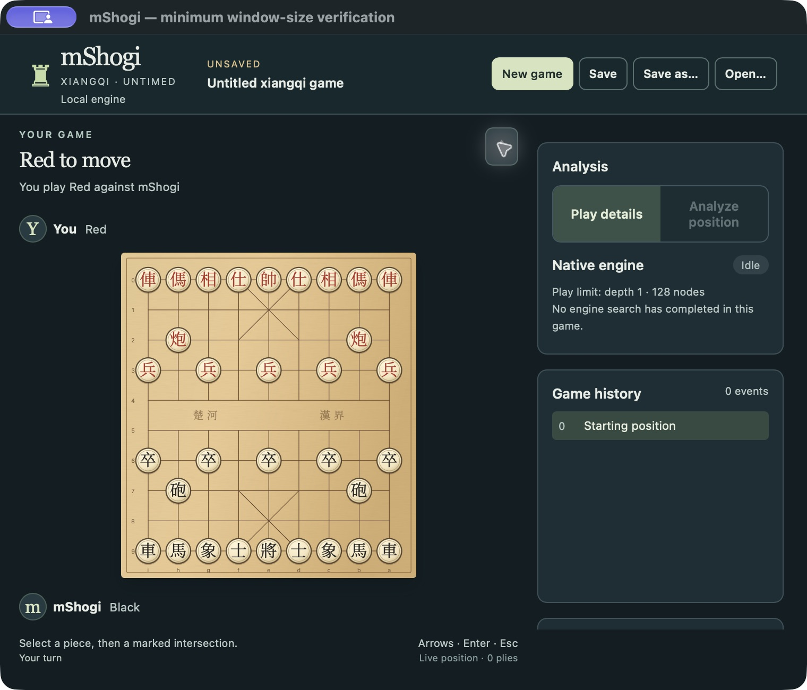
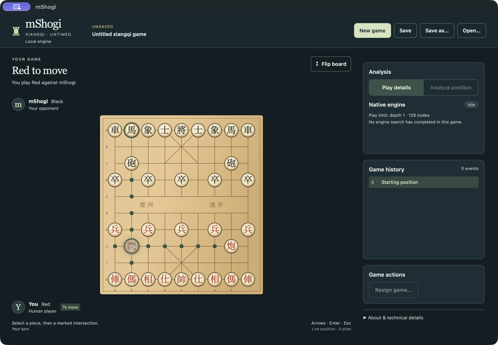
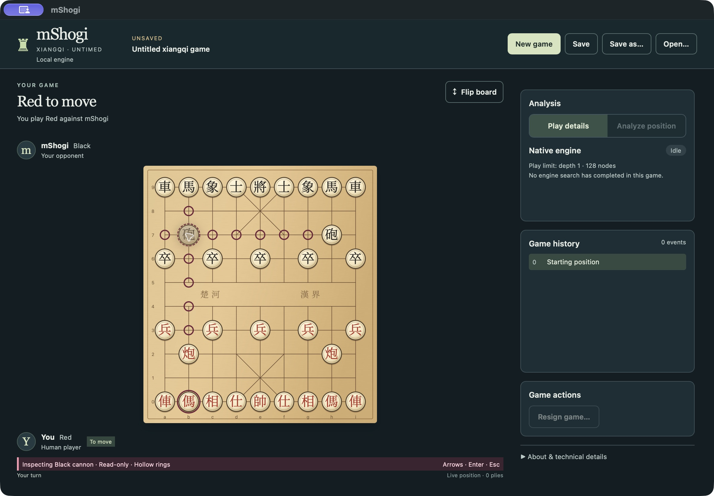
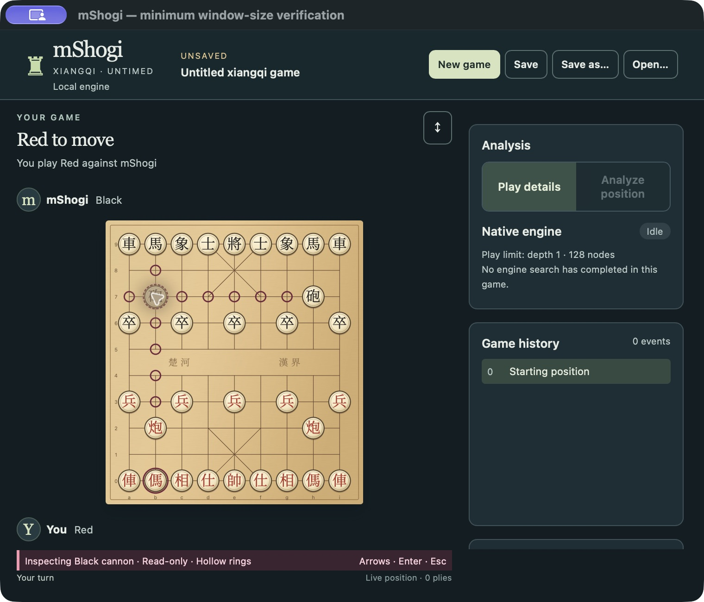
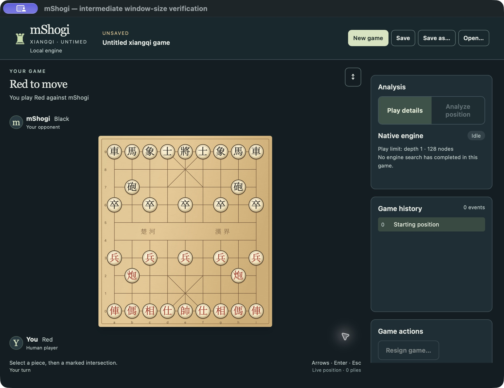

# MSH-101 early packaged visual checkpoint — awaiting owner approval

This is an unfinished MSH-101 checkpoint, **not** complete Xiangqi delivery or owner visual approval. Source `3a1aefc73c4b956a193059bb99f114af5b69ebe9` is integrated and pushed to `codex/rewrite`. MSH-101 remains In Progress with its original AC/DoD unchecked. MSH-102/103/106 were not started; MSH-45 and M4 remain open.

## Actual application comparison

These are unmodified native CUA screenshots of the real product, with companion accessibility snapshots. No synthetic board or contract harness supplies these positions. Screenshots are Retina 2×; stated logical dimensions describe the captured native **window frame**, including the title bar. The normal frame is 1180×820, minimum 760×650, intermediate 960×740. The content area is shorter by the native title bar. Image dimensions and hashes are in [screenshots.json](screenshots.json).

| Game | Normal 1180×820 | Minimum 760×650 |
| --- | --- | --- |
| Chess |  |  |
| Shogi |  |  |
| Xiangqi |  |  |

| Native Xiangqi interaction | Normal | Minimum |
| --- | --- | --- |
| Initial position, Black at bottom via Flip |  |  |
| Friendly Red cannon b2 selection |  |  |
| Read-only Black cannon b7 inspection |  |  |



## Package/build provenance and sizing limitation

Environment: local Apple arm64, macOS 27.0.1 (26A434), Rust 1.99.1, Node 24.19.0, locked repository dependencies. The existing vendored Tao patch is unchanged; its 20 build warnings remain. Node used `/Users/johnweathers/.cache/codex-runtimes/codex-primary-runtime/dependencies/node/bin`; the broken unrelated Homebrew Node installation was bypassed, not changed.

Normal product build, in `desktop`:

```sh
npm run desktop:build -- --bundles app
```

Normal package: `desktop/src-tauri/target/release/bundle/macos/mShogi.app`. Host SHA256 `d4f299e154786ceb81b612cc9e71a441a6c1143ac141cb2dcc9d09870ad94335`; bundled engine SHA256 `ed58d09b4c05d9d4cc8ca65db7fc7df4d9129608605ff02677484ff5c1266f5f`.

Native automated resize gestures were unreliable. Rather than labeling unchanged normal-size captures as minimum, final minimum/intermediate images use **separately labeled window-size verification packages** compiled from the same source and **normal/default features**, with only initial window dimensions, title, product name and bundle identity overridden. They use the actual ProductApp, authoritative native session and bundled engine; no `desktop-verification` feature or fixtures. Exact overrides are [minimum-window-config.json](minimum-window-config.json) and [intermediate-window-config.json](intermediate-window-config.json). Commands:

```sh
npm run tauri -- build --config /private/tmp/msh101-minimum-window.json --bundles app
npm run tauri -- build --config /private/tmp/msh101-intermediate-window.json --bundles app
```

[packages.json](packages.json) records all three identities and executable hashes. These images establish actual product layout at three measured sizes. They **do not establish successful runtime-resize automation of the unchanged normal artifact**. The normal `.app` remains intact and launchable. Do not launch a size-verification package as the normal distribution.

## Native interaction exercised

- New Xiangqi with human Red: standard native 32 pieces/90 intersections; Red below; actual depth 1 / 128-node play limit visible.
- Flip on the untouched initial position: Black below, upright discs, reversed native file/rank order, unchanged 0 board plies. This is orientation evidence, not a Black-human assignment.
- Friendly b2 cannon selection: green native complete destinations, including occupied b9 capture. Escape clears selection.
- Opponent b7 cannon: token-bound native inspection, hollow burgundy empty markers, occupied b0 ring, explicit Inspecting/Read-only footer. Clicking an inspected empty destination did not commit an action: live 0 plies/0 events. Escape exits inspection.
- Pointer origin a3, keyboard Up then Return: native a3a4 accepted; bundled Black engine replied; live 2 plies and real observations. [Zoomed play](xiangqi-red-play-zoomed.jpg) is supplemental 1728×1012 evidence, not normal-size evidence.
- New Xiangqi with human Black: native engine Red opening, Black-bottom assignment, Black to move and real engine observations ([supplemental zoomed capture](xiangqi-black-human-play-zoomed.jpg)).
- Minimum package: friendly b2 then occupied b9 committed the native capture, preserving capture precedence over enemy inspection; bundled engine replied, live 2 plies ([actual capture/play](xiangqi-capture-play-minimum.jpg)).
- Native quit protected disposable unsaved games; explicit Discard closed them. This is a narrow regression observation, not MSH-102's complete document/recovery acceptance.

No TypeScript movement rules, invented scores or exact-analysis calls were added. Existing search work limits and `sound_fast_only` ordinary execution remain unchanged. Full analysis, outcome/recovery and complete archive/history journeys remain MSH-102. In this checkpoint Analyze and Resign are visibly unavailable; history is display-only and Xiangqi Open remains gated. Canonical/native capabilities needed by MSH-102 remain intact.

## Verification and actual independent review

At the checkpoint source:

- `npm run check` and `npm test` in `desktop`: strict TypeScript and 182 tests/23 files passed. New Xiangqi tests use actual Rust-emitted snapshots and inspection replies; independent test author supplied 18 board/app tests. That test author is not counted as the final independent reviewer.
- `cargo test --locked -p mshogi-desktop-session --all-features`: 127 passed, including archive/capacity and Chess/Shogi regressions; focused product admission checks also passed.
- Native session all-target/all-feature Clippy with `-D warnings`, root and host Cargo format checks, and `git diff --check` passed. Native fixture generator preserved previous fixture contents.
- Actual normal macOS `.app` construction and `python3 desktop/scripts/package-smoke.py desktop/src-tauri/target/release/bundle/macos/mShogi.app --report /private/tmp/msh101-refined-package-smoke.json` passed. [Report](normal-package-smoke.json): package inventory/instrumentation-marker exclusion plus actual bundled-engine UCI, internal engine-turn, analysis and bounded chess Full requests. This is supporting execution evidence, not GUI evidence.
- Separate read-only font audit verified the pinned official Noto Serif CJK TC Regular 2.003 source, OFL license, all 18 required characters, nonempty glyph outlines and byte-reproducible renamed subset. Existing Shogi font unchanged. See the source/design and font NOTICE for hashes and reproduction.
- Separate read-only implementation/visual reviewer inspected the bounded diff, independently ran TypeScript and 31 focused Xiangqi/shared-shell tests, and compared the actual normal/minimum/intermediate images. This is a fresh agent review, not an external human review or owner approval.
- [Rust CI](https://github.com/jweathers777/mShogi/actions/runs/40747229601) and [desktop CI](https://github.com/jweathers777/mShogi/actions/runs/40747228852) passed at exact `3a1aefc` on macOS/Windows/Linux. [Native jobs](native-ci.json) and [desktop jobs](desktop-ci.json) retain exact steps. Existing Windows/Linux packaged Chess/Shogi interaction campaigns passed; **they do not establish Xiangqi GUI on those platforms**. Xiangqi checkpoint GUI here is macOS only. Earlier Linux GUI failure history and MSH-111 evidence remain unchanged.

## Findings and stopping point

The first actual visual pass found exterior coordinates occluded by discs and an 8/14-pixel common-slot spacing drift. Source `3a1aefc` corrects the board margins without changing equal intersection pitch and makes the existing shared empty-slot baseline explicit. Independent corrected-image review found these resolved. `first-pass/` and the first-pass Xiangqi image are retained only as diagnostic pre-correction evidence, not final captures.

Independent normal/minimum/intermediate review found no remaining material board, glyph, marker, sizing or common-shell visual issue. The full board, both player areas and common footer fit; the sidebar independently scrolls as before.

**Open presentation finding:** the supplemental played-game capture exposes existing native Debug syntax in the visible history label (`Some(Red): BoardAction { ... }`). This does not change or lose native history, but is inappropriate normal player presentation. Keep it as remaining MSH-101 polish after the mandatory early board/shell visual approval: native-owned readable board-action labels, with focused tests and a refreshed played-game capture. Do not silently transfer this finding to MSH-102 or treat current debug labels as approved product design. MSH-102 still owns the complete interactive history journey.

Stop here for owner visual review as explicitly required in the request. No MSH-101 completion verdict, AC checks or downstream implementation is authorized before that approval.

## Launch

```sh
open /Users/johnweathers/Development/Personal/mShogi/desktop/src-tauri/target/release/bundle/macos/mShogi.app
```

Choose **New game → Xiangqi → Red or Black → Start game**. Flip changes presentation; it does not change the human assignment. Use pointer selection or arrows/Enter/Space, Escape to cancel; enemy pieces support read-only inspection.
