# Shogi product visual review

MSH-74 is In Review for owner visual approval. These are actual normal packaged
application captures, not the development harness. Board/font/layout source is
unchanged between `60796ec`, `5de7441` and `a9111ae`; the final revision adds close protection.
See [evidence and limitations](README.md), [independent visual review](visual-review.md),
and [exact capture revisions and hashes](screenshots.json).

## Initial Sente

macOS normal package; source `a9111ae`.

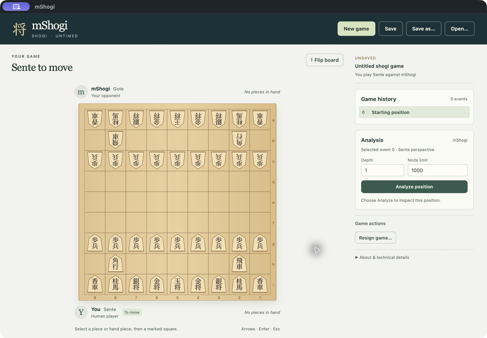

## Gote, after the real opening engine move

macOS normal package; source `60796ec`.

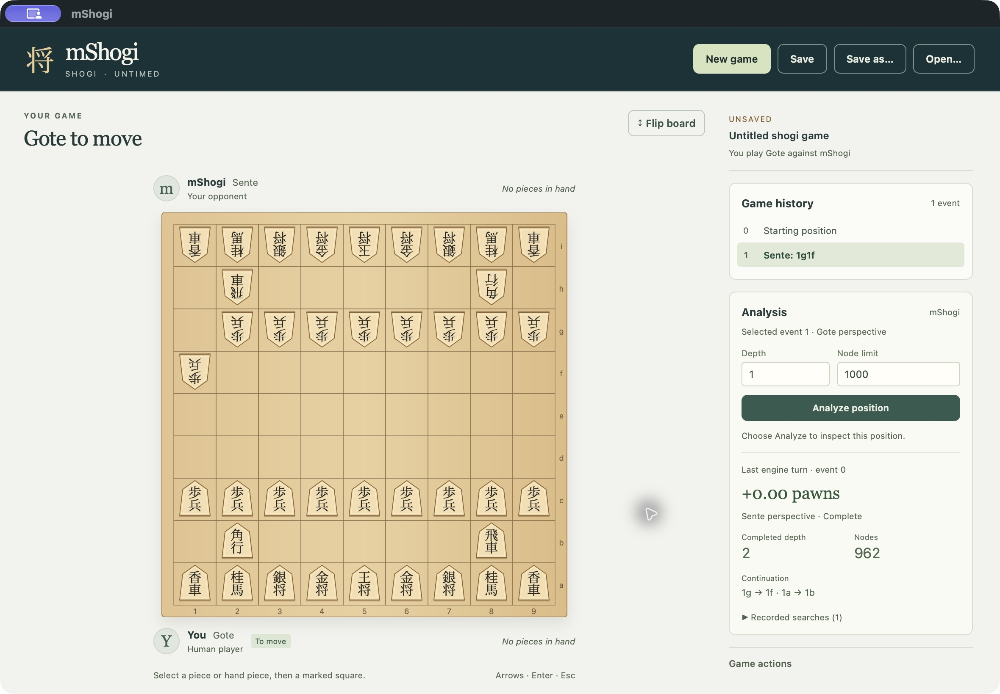

## Both hands and native promoted pieces

macOS normal package; source `60796ec`.

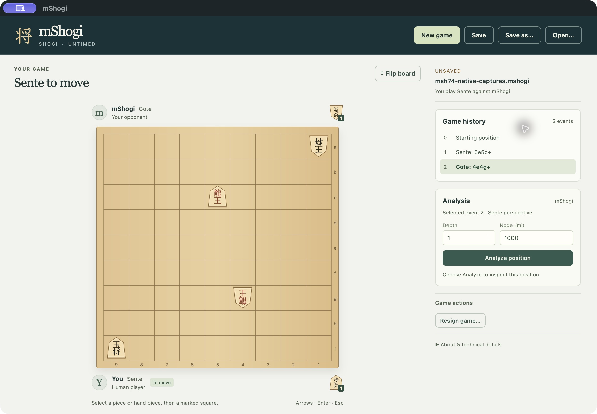

## Drop selection

macOS normal package; source `60796ec`.

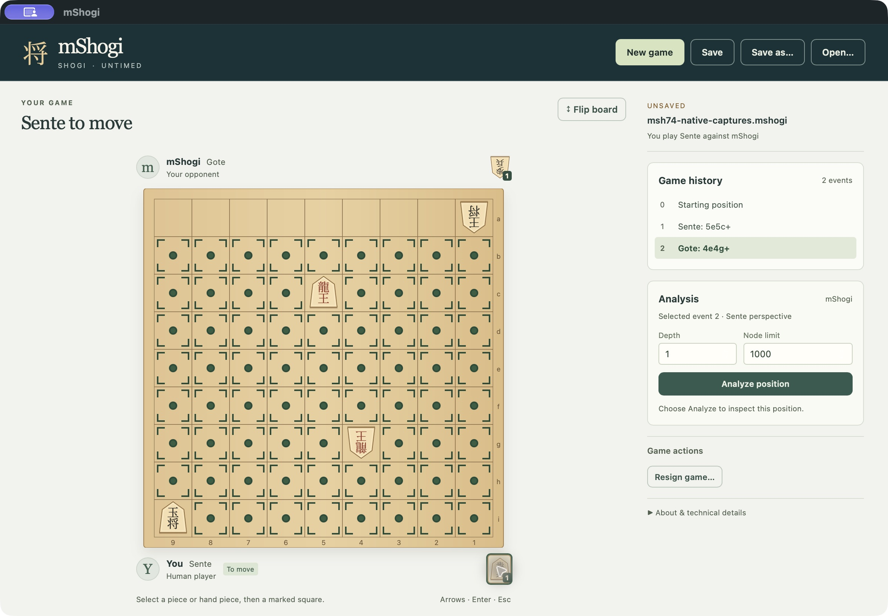

## Optional promotion

macOS normal package; source `60796ec`.

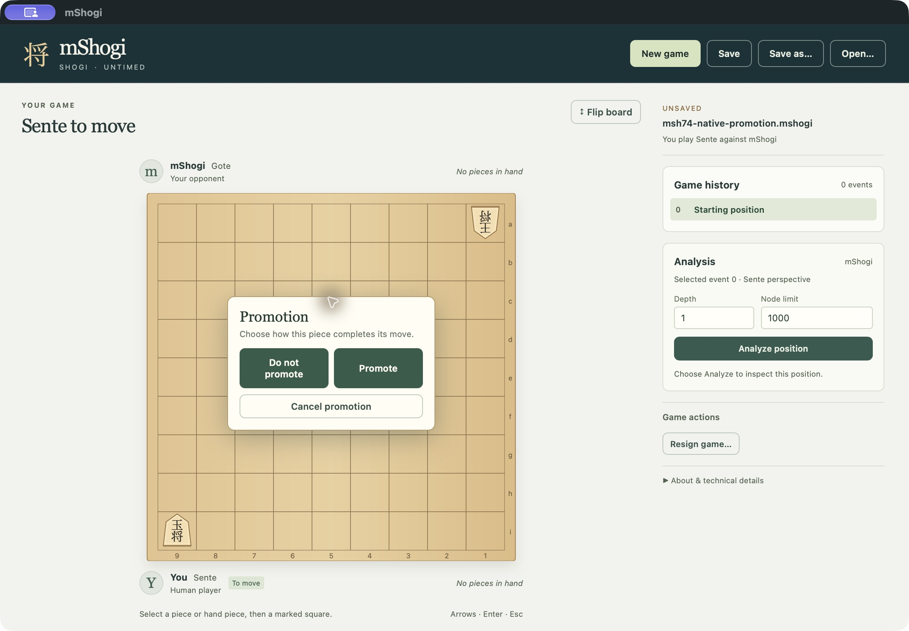

## Historical viewing

macOS normal package; source `60796ec`.

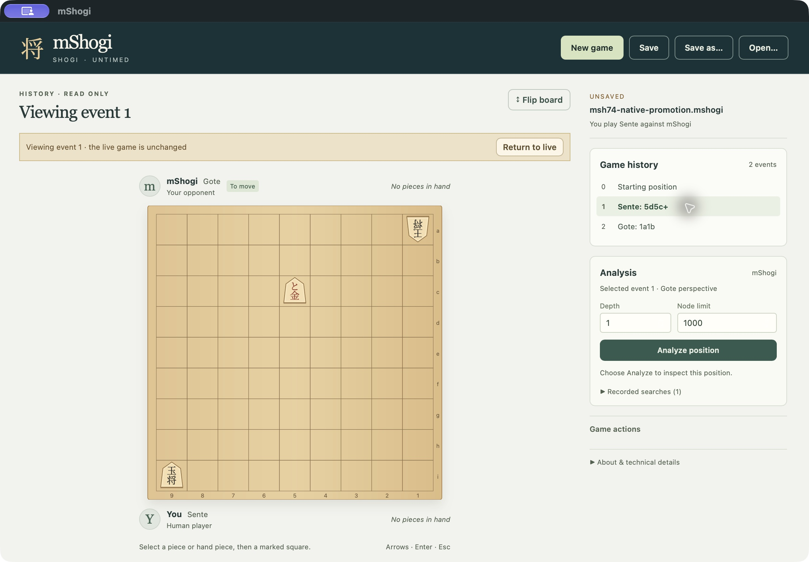

## Actual active bounded analysis

macOS normal package; source `60796ec`.

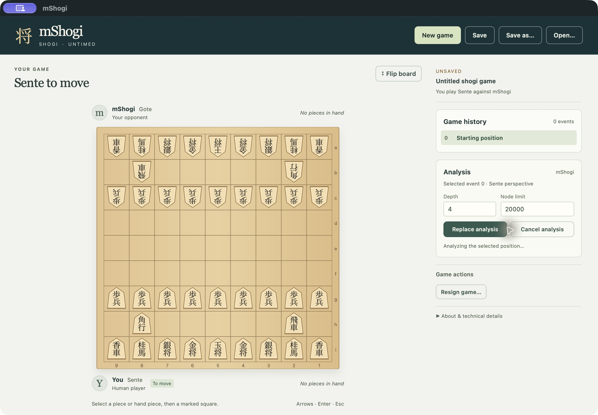

## Concluded game

macOS normal package; source `60796ec`.

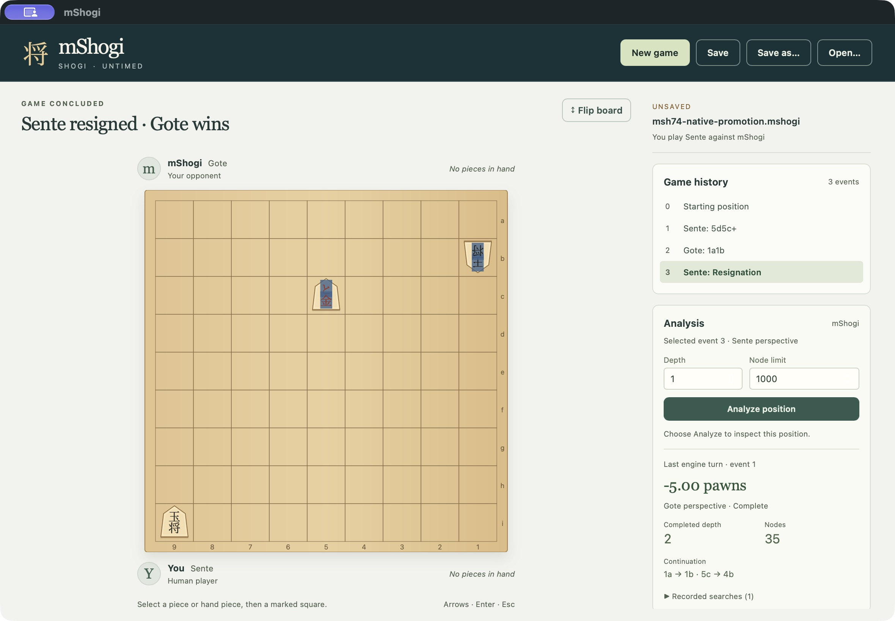

## Linux normal size

Ubuntu 24.04 normal installed package, CI 40408728525; source `5de7441`.

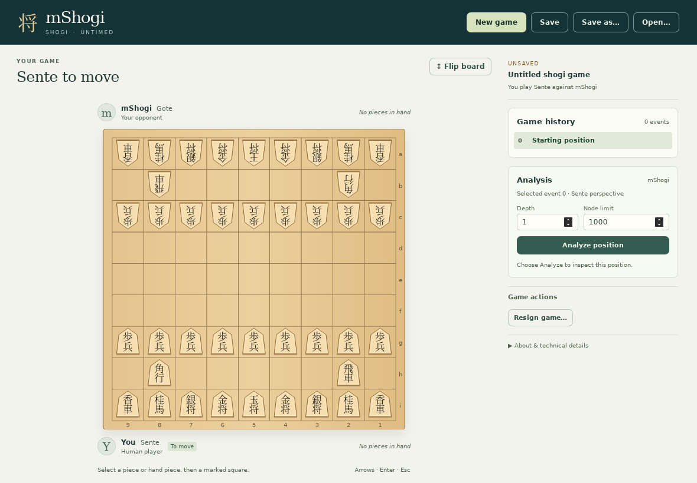

## Linux supported minimum 760 × 650

Ubuntu 24.04 normal installed package, CI 40408728525; source `5de7441`.

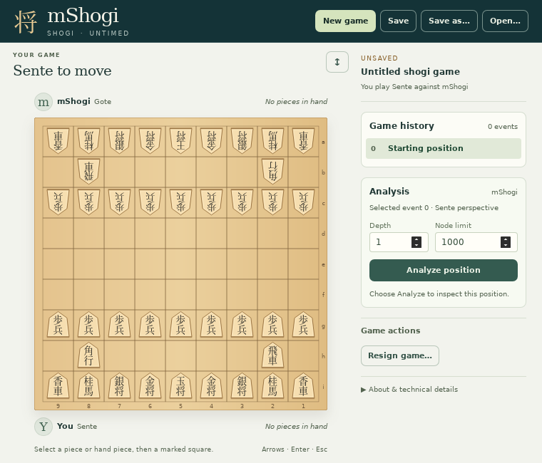

## Windows normal size

Windows Server 2022 normal installed package, CI 40408728525; source `5de7441`.

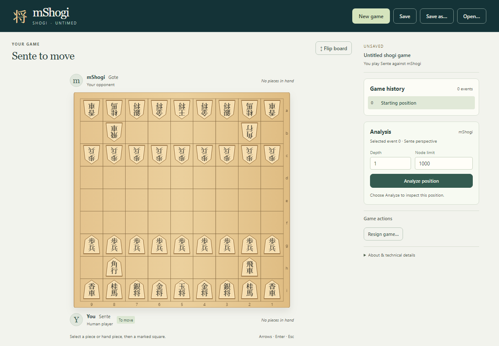

## Windows supported minimum 760 × 650

Windows Server 2022 normal installed package, CI 40408728525; source `5de7441`.

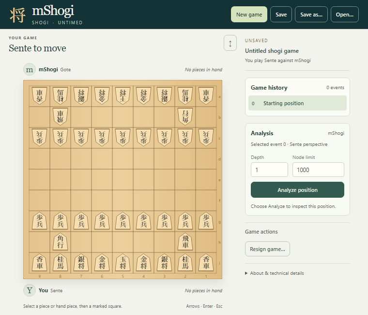

## Corrected fresh-process reopening

macOS normal package; source `a9111ae`. The exact Windows regression archive
is reopened with work stopped.

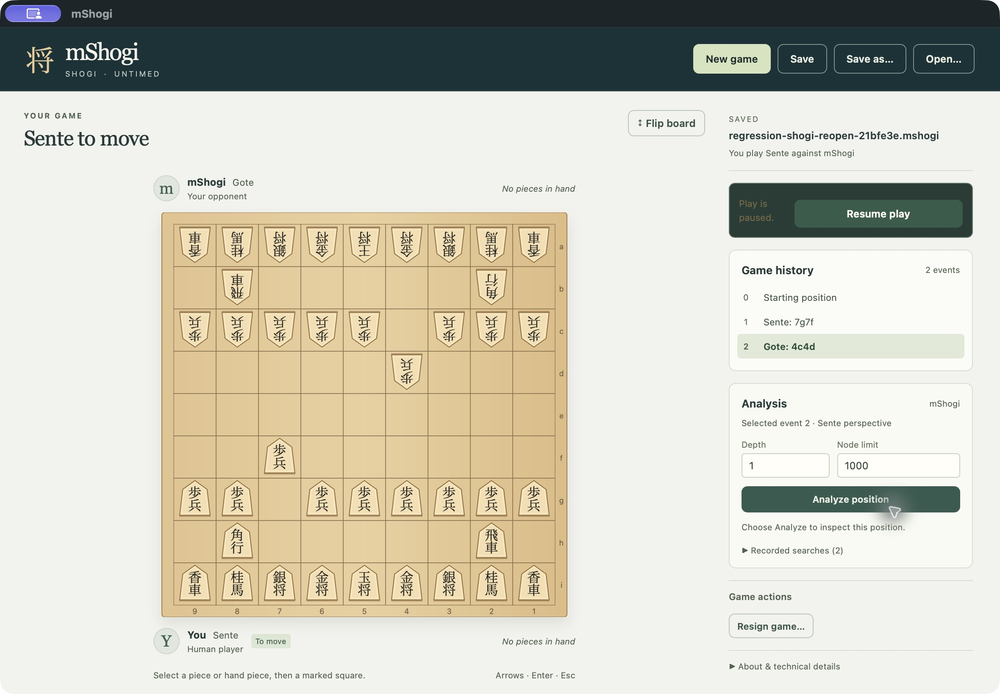
