# Normal Tenjiku desktop continuation

Actual normal `org.mshogi.desktop` application on macOS 27.0.1, arm64. These are native screenshots and accessibility captures, not web mockups. The exact package hashes and tested source are reconciled in [product-verification.json](../../product-verification.json); all six final cross-platform receipts passed at `eca9f9c` and are reconciled there. Each image has an accompanying `.ax.txt` capture and an entry in [artifact-manifest.json](artifact-manifest.json).

The owner approved the traditional-kanji design. The hard application minimum remains 760×650; approximately 960×1000 is a recommended playing size when the display permits. The whole 16×16 board fits at the minimum, but some kanji and secondary route badges remain too small for comfortable reading. Friendly piece names help identification without resolving every small-window accessibility limitation. These normal application captures do not claim fresh minimum-size DOM measurements. Prior fixed-slot QA measurements are preserved; final Linux/Windows native-frame checks passed and retain their separately measured content sizes.

## Normal activation and shared presentation

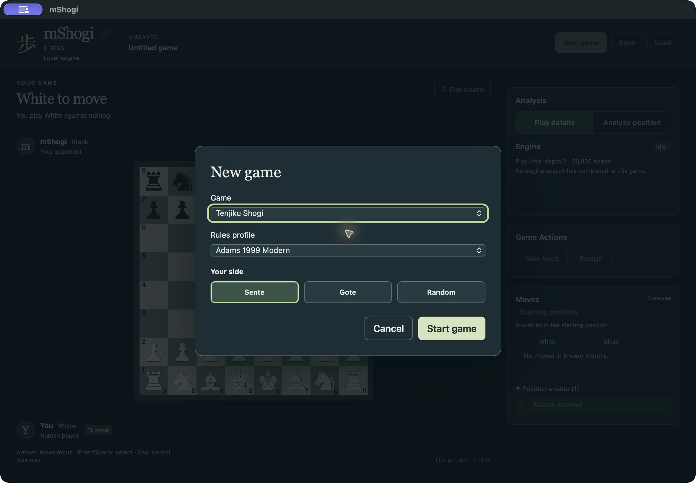

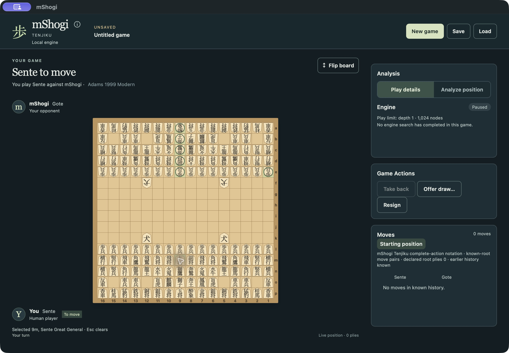

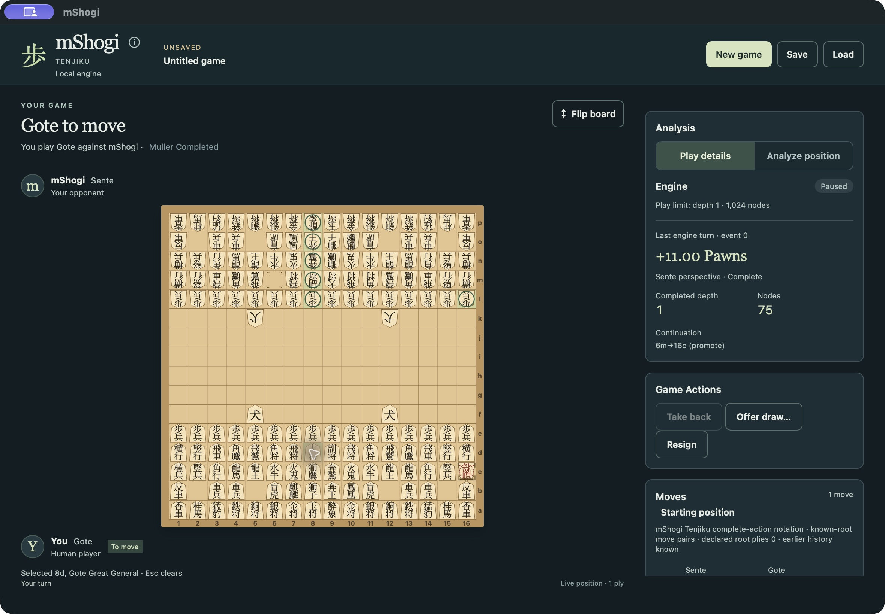

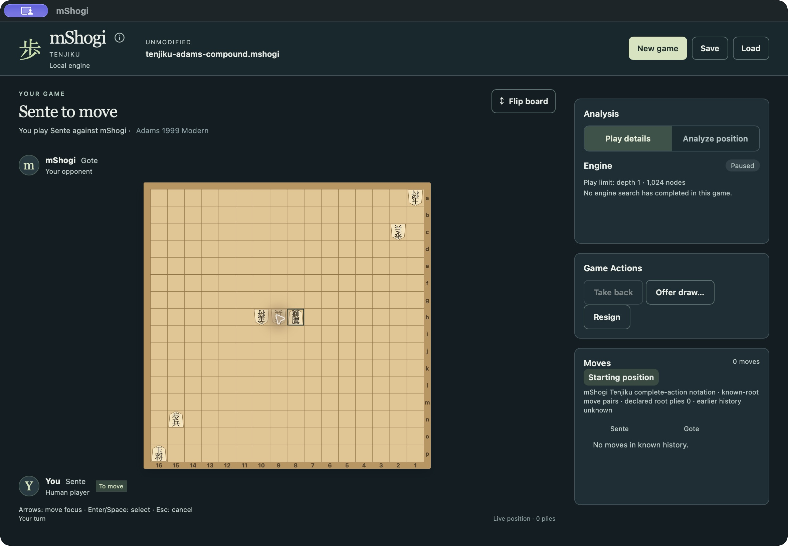

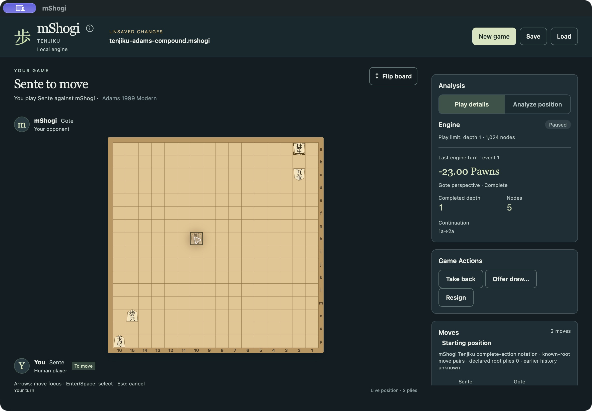

## Genuine play and lifecycle

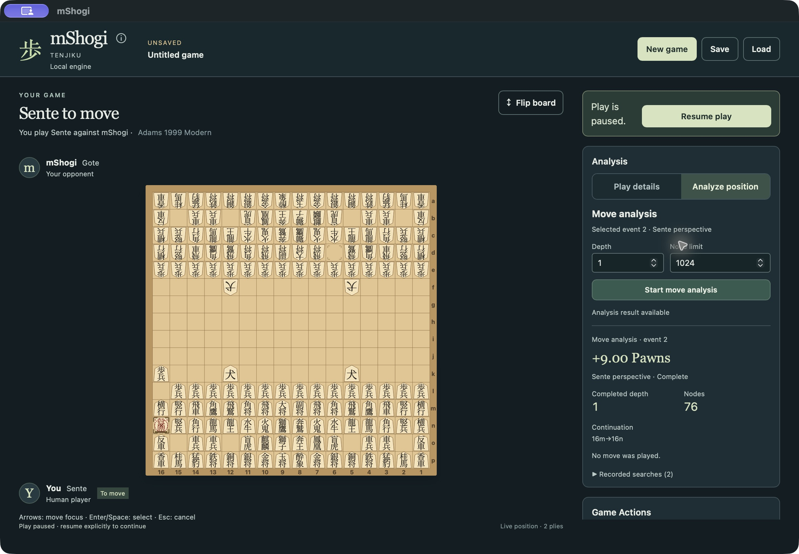

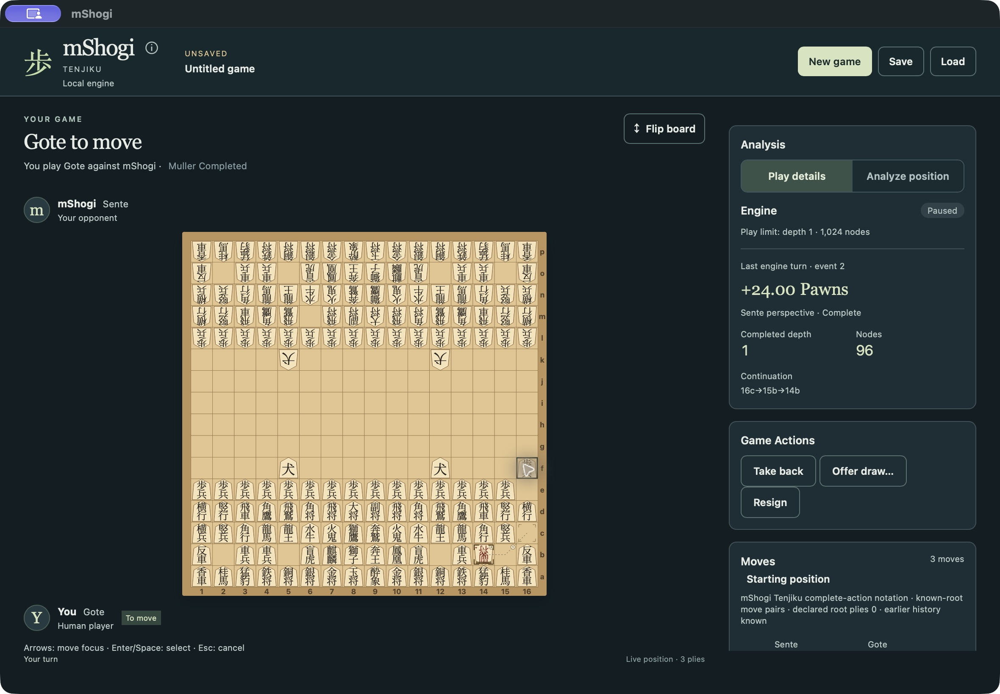

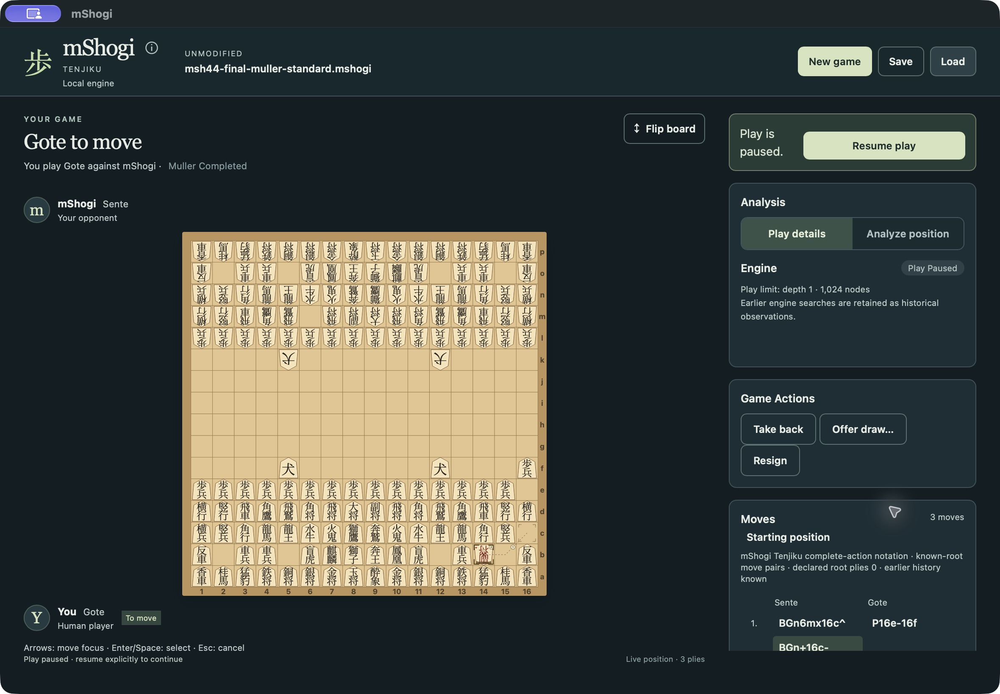

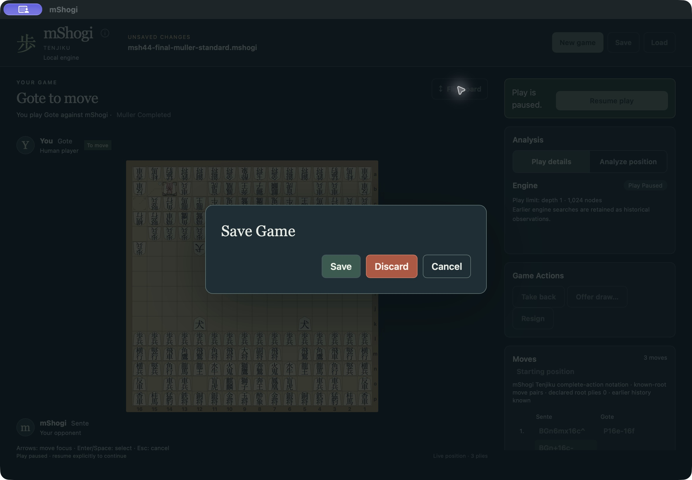

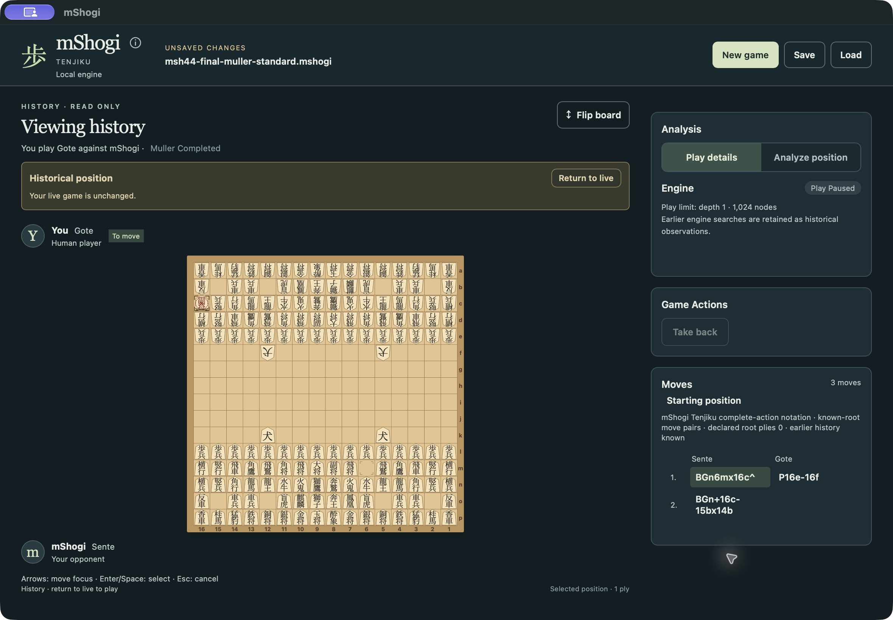

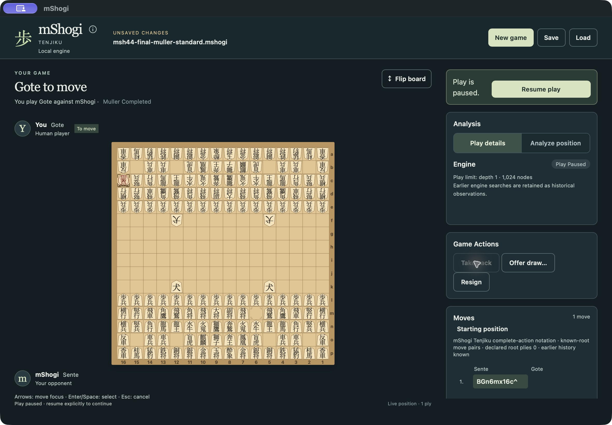

## Complete tactical games

These explicitly imported diagrams have no claim of a complete standard-opening history or competitive strength. Independent fixture expectations and public native replay establish their outcomes. Both normal application games start stopped, Resume the actual supervised engine, execute `FiD8jx8g`, and conclude native RoyalCapture for Sente in one board action.

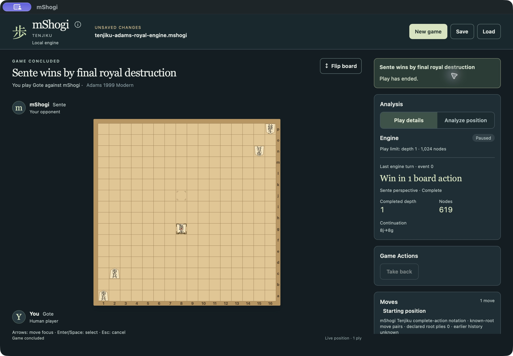

The earlier unextended diagram also allowed the legitimate winning move `FiD8j-1c`, burning Gote's last nonroyal Pawn and ending by BareRoyalLoss. The [superseded capture](superseded-adams-royal-probe-bare-loss.png) preserves that actual observation. The two derived royal-engine fixtures add a remote Gote Pawn at 1a, with explicit independent provenance, to isolate the intended royal-capture case. The frozen rules corpus and native rules are unchanged. The old observation is not counted as a passed RoyalCapture expectation.

## Final-source supplement — 241807f

The original normal journeys above were captured at `0a2fb9d`. The corrected final source is `241807f647583e5ccf87eb3d5e8e8ca2aa192675`: its sole product change is the About six-game list. External verifier corrections follow the actual failed CI observations; native rules, search, session, rendering, New/Load and budgets are unchanged. Earlier complete journeys remain evidence for that unchanged scope.

Before these supplemental captures, an older running process was detected from its five-game About text. That [probe](superseded-running-previous-package-about.png) is explicitly superseded. Native Quit and a read-only process check confirmed it had stopped; the rebuilt normal package was then cold-launched from its exact bundle path. The final host SHA256 is `4e3719fe779a78f7800a31a827fa605dff4e1182f0ac26a41842a7e5e2c35c80`; the engine remains `a3c0cda3e4da2b00b931e0100000387fa9d34835d0e6565587a02f7750dd1567`. The manifest distinguishes the two capture groups.

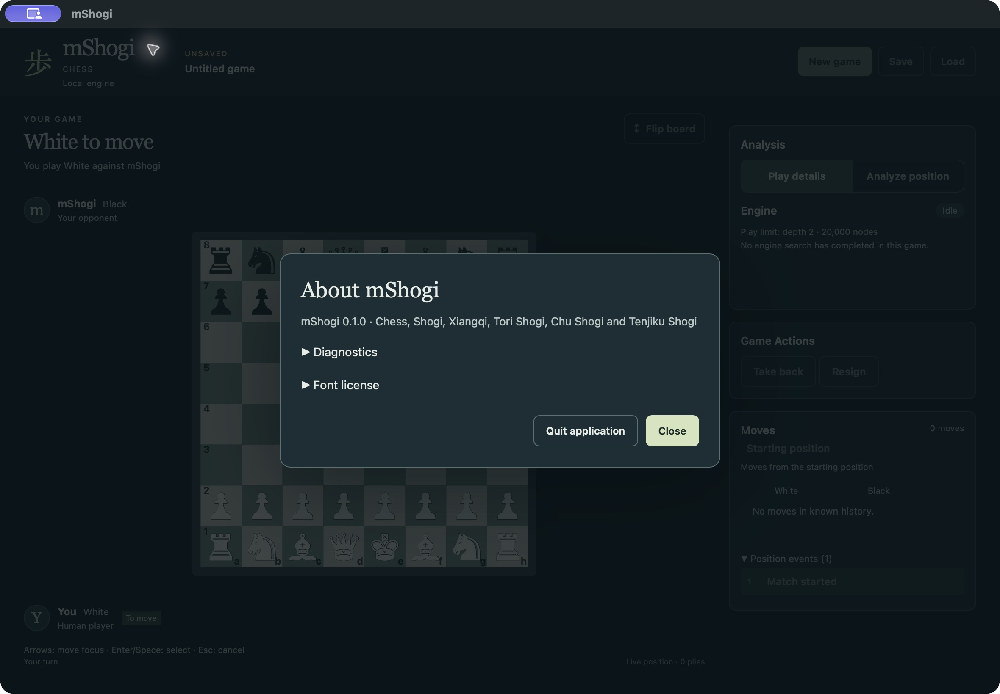

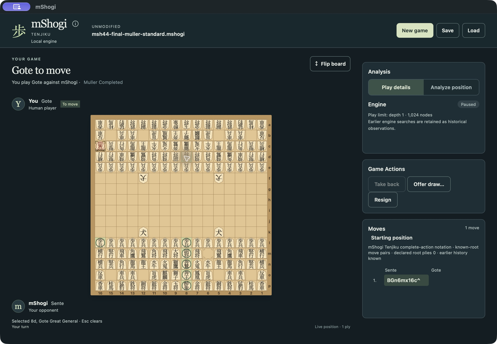

Both final-source royal games used ordinary stopped Open, explicit Resume, a genuine supervised `FiD8jx8g`, native RoyalCapture and Save. Both standard files were opened through normal Load and retained their original bytes. The application was cleanly quit and its process absence verified after the final captures. Final CI/platform acceptance passed at `eca9f9c` and is recorded in the product record.

The final accepted production revision is `eca9f9cfd43cf83ff4e3489292f6c25f8951bb30`. Its post-commit normal package rebuild reproduced all four files of this actual macOS capture package byte for byte; see [the equivalence receipt](final-eca9f9c-package-equivalence.json). No new GUI execution is inferred from that comparison. Required macOS 15 CI and Linux/Windows installed 47-journey campaigns passed separately at that exact source.
