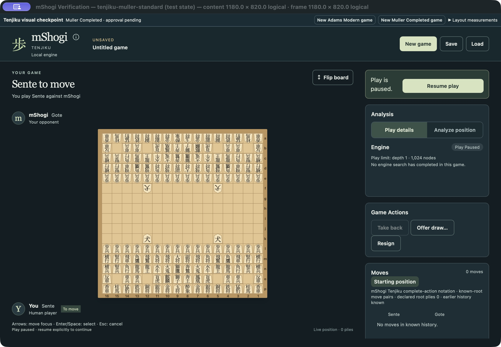
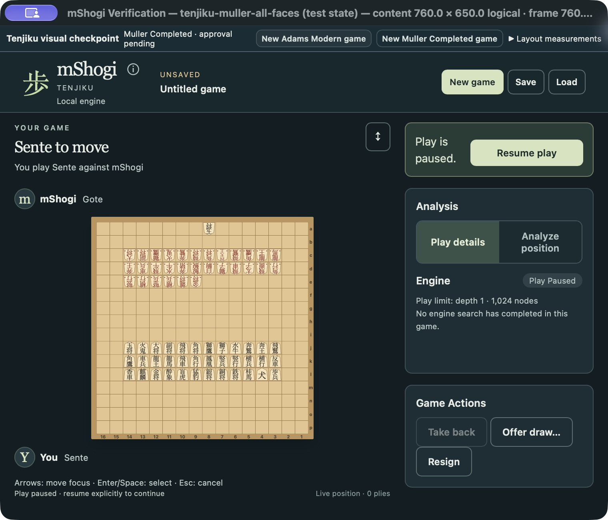
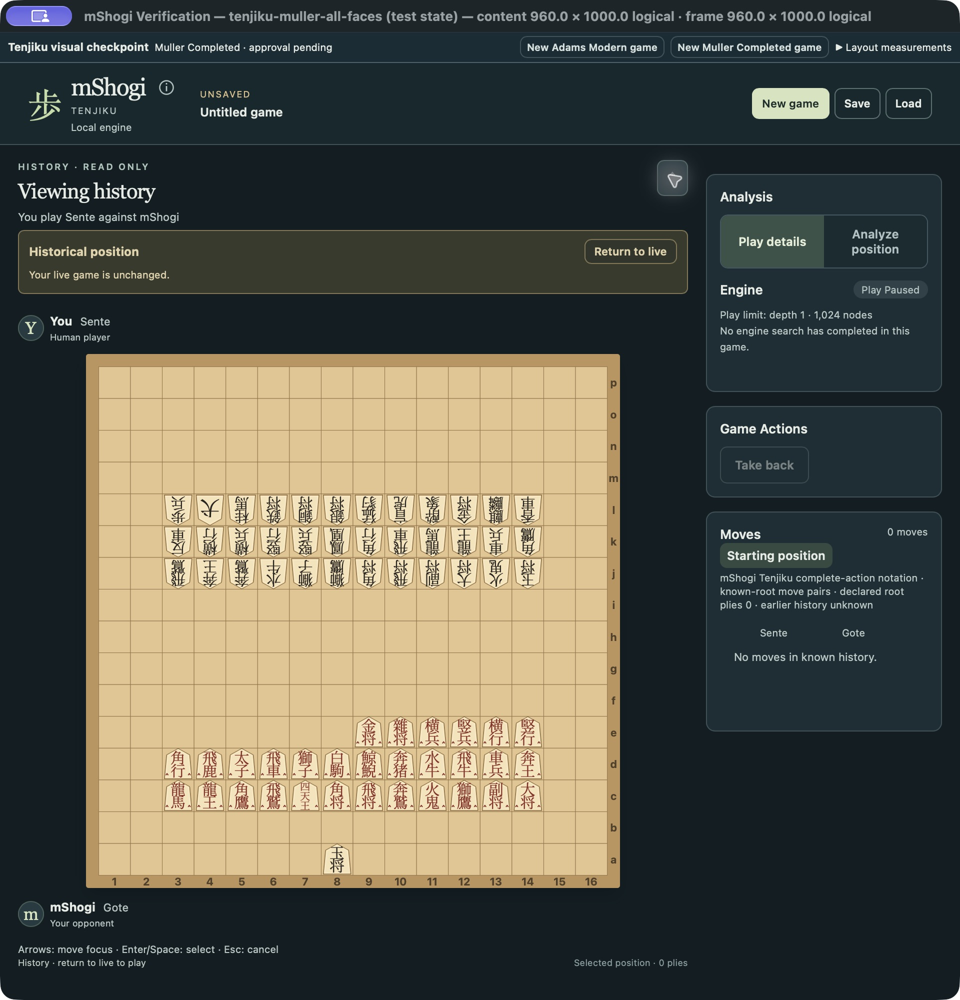

# MSH-44 genuine macOS checkpoint gallery

These are captures of the running fixed QA application, its native accessibility
tree (AX), and read-only measurements of the production board DOM (layout).
This index organizes evidence; it does not grant independent source/art review,
owner approval, normal chooser activation, a new minimum size, or task closure.

The established production visual source is
`aecdccd6152df9cef8736e83ef74d8bc81ae39b2`; those production visuals are unchanged
through `de77909131c5e02a9f8aad4cf90206678f9c0a5e`. The `proposed-960x1000`
all-faces captures use an intermediate effects-fix package with identical board/
art/layout and the QA tall-window option, before final igui wording corrections.
The later `final-` effect/promotion captures use a package whose five recorded file
hashes equal the exact postcommit
`2c00e2107ac74334bce5d55813e5be25666d7c46` rebuild, now staged in the same slot.
The [artifact manifest](artifact-manifest.json) distinguishes all four packages
and capture groups; acceptance remains in [the product record](../../product-verification.json).
Earlier `superseded-large-qa-strip-*` files are retained but excluded here.

Preset names identify the native menu/frame request. Use the adjacent layout
receipt for actual WebView dimensions: 1180×820 yielded 1180×788, 960×720 yielded
960×688, and 760×650 yielded 760×618. All twelve standard receipts below report
256/256 unclipped cells and the exact bundled font loaded. This proves measured
fit, not reading comfort; AX and screenshots provide different evidence.

## Representative actual application captures

Both are native standard starts at the1180×820 preset, from the recorded initial
compact-strip build; their board artwork/layout is unchanged at final source.

| Adams Modern | Muller Completed |
|---|---|
|  |  |

## Standard root: both profiles, orientations and three sizes

These twelve captures show each profile's native standard starting position.
Sente/Gote denotes the side displayed at the bottom.

| Profile | Bottom | Preset | PNG | AX | Layout |
|---|---|---|---|---|---|
| Adams Modern | Sente | 1180×820 | [View](adams-standard-1180.png) | [AX](adams-standard-1180.ax.txt) | [JSON](adams-standard-1180-layout.json) |
| Adams Modern | Sente | 960×720 | [View](adams-standard-960.png) | [AX](adams-standard-960.ax.txt) | [JSON](adams-standard-960-layout.json) |
| Adams Modern | Sente | 760×650 | [View](adams-standard-760.png) | [AX](adams-standard-760.ax.txt) | [JSON](adams-standard-760-layout.json) |
| Adams Modern | Gote | 1180×820 | [View](adams-standard-gote-1180.png) | [AX](adams-standard-gote-1180.ax.txt) | [JSON](adams-standard-gote-1180-layout.json) |
| Adams Modern | Gote | 960×720 | [View](adams-standard-gote-960.png) | [AX](adams-standard-gote-960.ax.txt) | [JSON](adams-standard-gote-960-layout.json) |
| Adams Modern | Gote | 760×650 | [View](adams-standard-gote-760.png) | [AX](adams-standard-gote-760.ax.txt) | [JSON](adams-standard-gote-760-layout.json) |
| Muller Completed | Sente | 1180×820 | [View](muller-standard-1180.png) | [AX](muller-standard-1180.ax.txt) | [JSON](muller-standard-1180-layout.json) |
| Muller Completed | Sente | 960×720 | [View](muller-standard-960.png) | [AX](muller-standard-960.ax.txt) | [JSON](muller-standard-960-layout.json) |
| Muller Completed | Sente | 760×650 | [View](muller-standard-760.png) | [AX](muller-standard-760.ax.txt) | [JSON](muller-standard-760-layout.json) |
| Muller Completed | Gote | 1180×820 | [View](muller-standard-gote-1180.png) | [AX](muller-standard-gote-1180.ax.txt) | [JSON](muller-standard-gote-1180-layout.json) |
| Muller Completed | Gote | 960×720 | [View](muller-standard-gote-960.png) | [AX](muller-standard-gote-960.ax.txt) | [JSON](muller-standard-gote-960-layout.json) |
| Muller Completed | Gote | 760×650 | [View](muller-standard-gote-760.png) | [AX](muller-standard-gote-760.ax.txt) | [JSON](muller-standard-gote-760-layout.json) |

## All faces and once-promoted identities: imported inspection roots

These are explicitly imported artwork diagrams, **not positions reached from
standard play**: 67 stable physical identities cover all 44 movement faces,
30 once-promoted originals and King/Prince distinctions. Both orientations
retain native ownership; the complete 四天王 name remains three characters.

| Profile / bottom / preset | PNG | AX | Layout |
|---|---|---|---|
| Adams / Sente / 1180×820 | [View](adams-all-faces-1180.png) | [AX](adams-all-faces-1180.ax.txt) | [JSON](adams-all-faces-1180-layout.json) |
| Adams / Sente / 960×720 | [View](adams-all-faces-960.png) | [AX](adams-all-faces-960.ax.txt) | [JSON](adams-all-faces-960-layout.json) |
| Adams / Sente / 760×650 | [View](adams-all-faces-760.png) | [AX](adams-all-faces-760.ax.txt) | [JSON](adams-all-faces-760-layout.json) |
| Adams / Gote / 1180×820 | [View](adams-all-faces-gote-1180.png) | [AX](adams-all-faces-gote-1180.ax.txt) | [JSON](adams-all-faces-gote-1180-layout.json) |
| Adams / Gote / 760×650 | [View](adams-all-faces-gote-760.png) | [AX](adams-all-faces-gote-760.ax.txt) | [JSON](adams-all-faces-gote-760-layout.json) |
| Muller / Sente / 1180×820 | [View](muller-all-faces-1180.png) | [AX](muller-all-faces-1180.ax.txt) | [JSON](muller-all-faces-1180-layout.json) |
| Muller / Sente / 760×650 | [View](muller-all-faces-760.png) | [AX](muller-all-faces-760.ax.txt) | [JSON](muller-all-faces-760-layout.json) |
| Muller / Gote / 760×650 | [View](muller-all-faces-gote-760.png) | [AX](muller-all-faces-gote-760.ax.txt) | [JSON](muller-all-faces-gote-760-layout.json) |

The 760 preset yields a 278px board, 16.548px cells and a 5.295px minimum glyph
em in the all-faces receipts. That density is a concrete unresolved owner
readability decision. No minimum, board zoom, scrolling policy or glyph name
has been changed to remove the concern.

## Actual compound entry and paired Demon effects

These journeys start from labeled native custom roots. They demonstrate real
selection and completed native actions, rather than standard-start reachability.

| Journey | PNG | AX | Layout |
|---|---|---|---|
| Adams Lion partial route, 1180 | [View](adams-compound-partial-1180.png) | [AX](adams-compound-partial-1180.ax.txt) | [JSON](adams-compound-partial-1180-layout.json) |
| Adams Lion partial route, 760 | [View](adams-compound-partial-760.png) | [AX](adams-compound-partial-760.ax.txt) | [JSON](adams-compound-partial-760-layout.json) |
| Adams keyboard focus during compound entry, 760 | [View](adams-compound-keyboard-focus-760.png) | — | — |
| Adams completed Lion action, 1180 | [View](adams-compound-completed-1180.png) | [AX](adams-compound-completed-1180.ax.txt) | [JSON](adams-compound-completed-1180-layout.json) |
| Adams Demon: two of three landings selected | [View](adams-area-burn-partial-1180.png) | [AX](adams-area-burn-partial-1180.ax.txt) | [JSON](adams-area-burn-partial-1180-layout.json) |
| Adams Demon: third landing committed, 1180 | [View](adams-burn-demon-death-1180.png) | [AX](adams-burn-demon-death-1180.ax.txt) | [JSON](adams-burn-demon-death-1180-layout.json) |
| Adams Demon completed state, 760 | [View](adams-burn-demon-death-760.png) | [AX](adams-burn-demon-death-760.ax.txt) | [JSON](adams-burn-demon-death-760-layout.json) |
| Muller Demon: two of three landings selected | [View](muller-area-burn-partial-1180.png) | [AX](muller-area-burn-partial-1180.ax.txt) | [JSON](muller-area-burn-partial-1180-layout.json) |
| Muller Demon: third landing committed, 1180 | [View](muller-burn-demon-death-1180.png) | [AX](muller-burn-demon-death-1180.ax.txt) | [JSON](muller-burn-demon-death-1180-layout.json) |
| Muller Demon completed state, 760 | [View](muller-burn-demon-death-760.png) | [AX](muller-burn-demon-death-760.ax.txt) | [JSON](muller-burn-demon-death-760-layout.json) |

Both Demon journeys actually enter `FiD8j-7i-7h-8h`. Partial AX receipts say no
action has been submitted. Completed receipts identify one complete move:
Adams removes the Pawn at 8g before the mover dies at 8h; Muller retains that
Pawn while the mover dies. The opposing Demon at 9h survives in both. These
earlier AX captures establish occupancy and move labels; final accessibility
effect-summary recaptures belong to the subsequent draft verification.

## Igui and native outcome from custom roots

| Journey | PNG | AX | Layout |
|---|---|---|---|
| Muller stationary target selection, 1180 | [View](muller-igui-target-selection-1180.png) | [AX](muller-igui-target-selection-1180.ax.txt) | [JSON](muller-igui-target-selection-1180-layout.json) |
| Muller confirmed completed igui, 1180 | [View](muller-igui-completed-confirmed-1180.png) | [AX](muller-igui-completed-confirmed-1180.ax.txt) | [JSON](muller-igui-completed-confirmed-1180-layout.json) |
| Muller completed igui, 760 | [View](muller-igui-completed-760.png) | — | — |
| Muller actual resignation outcome, 1180 | [View](muller-native-resignation-outcome-1180.png) | [AX](muller-native-resignation-outcome-1180.ax.txt) | [JSON](muller-native-resignation-outcome-1180-layout.json) |
| Muller outcome at 760 | [View](muller-native-outcome-760.png) | — | — |

## Standard-start play, analysis, history and files

These captures retain standard-root provenance. Engine turns and analysis use
the actual bundled native engine; no custom outcome fixture or mock result
substitutes for those observations. File receipts describe the observed UI
journey; archive integrity and exact-source verification remain in the primary
verification record.

| Journey | PNG | AX | Layout |
|---|---|---|---|
| Adams human action and real engine reply | [View](adams-human-engine-1180.png) | [AX](adams-human-engine-1180.ax.txt) | [JSON](adams-human-engine-1180-layout.json) |
| Adams read-only analysis | [View](adams-readonly-analysis-1180.png) | [AX](adams-readonly-analysis-1180.ax.txt) | [JSON](adams-readonly-analysis-1180-layout.json) |
| Adams analysis cancellation | [View](adams-cancelled-analysis-1180.png) | [AX](adams-cancelled-analysis-1180.ax.txt) | — |
| Adams historical prefix | [View](adams-history-1180.png) | [AX](adams-history-1180.ax.txt) | [JSON](adams-history-1180-layout.json) |
| Adams Take back | [View](adams-takeback-1180.png) | [AX](adams-takeback-1180.ax.txt) | — |
| Save the real Adams game | — | [Save receipt](adams-saved-real-game.ax.txt) | — |
| Reopen Adams with execution stopped | [View](adams-reopened-stopped-1180.png) | [AX](adams-reopened-stopped-1180.ax.txt) | [JSON](adams-reopened-stopped-1180-layout.json) |
| Fresh Muller after saving Adams | [View](fresh-new-muller-after-saved-adams.png) | [AX](fresh-new-muller-after-saved-adams.ax.txt) | — |
| Muller human/engine play, Gote displayed below | [View](muller-human-engine-gote-view-1180.png) | [AX](muller-human-engine-gote-view-1180.ax.txt) | [JSON](muller-human-engine-gote-view-1180-layout.json) |
| Muller read-only analysis, Gote view | [View](muller-readonly-analysis-gote-view-1180.png) | [AX](muller-readonly-analysis-gote-view-1180.ax.txt) | [JSON](muller-readonly-analysis-gote-view-1180-layout.json) |
| Muller read-only movement inspection | [View](muller-readonly-inspection-gote-view.png) | [AX](muller-readonly-inspection-gote-view.ax.txt) | — |
| Adams dirty Quit guard | [View](adams-dirty-quit-guard.png) | [AX](adams-dirty-quit-guard.ax.txt) | — |

## Proposed taller window: actual live and historical measurements

The 960×1000 QA menu option is an inspection proposal, not a new product minimum
or an approved policy. Actual WebView content measured **960×968**. These are
the imported all-faces diagram and its read-only root history view, not a
standard-start game. Each receipt reports 256/256 unclipped cells and the
bundled font loaded. Historical notice space reduces the board.

| View | Board | Cell | Minimum glyph em | PNG | AX | Layout |
|---|---:|---:|---:|---|---|---|
| Live, Sente below | 598px | 35.595px | 11.390px | [View](muller-all-faces-proposed-960x1000.png) | [AX](muller-all-faces-proposed-960x1000.ax.txt) | [JSON](muller-all-faces-proposed-960x1000-layout.json) |
| History, Sente below | 534px | 31.786px | 10.171px | [View](muller-all-faces-history-proposed-960x1000.png) | [AX](muller-all-faces-history-proposed-960x1000.ax.txt) | [JSON](muller-all-faces-history-proposed-960x1000-layout.json) |
| History, Gote below | 534px | 31.786px | 10.171px | [View](muller-all-faces-history-gote-proposed-960x1000.png) | [AX](muller-all-faces-history-gote-proposed-960x1000.ax.txt) | [JSON](muller-all-faces-history-gote-proposed-960x1000-layout.json) |

For comparison, an earlier native window enlargement measured 1728×981 WebView
content, a 592px board, 35.238px cells and 11.276px minimum glyph em:
[PNG](adams-all-faces-gote-native-zoom-1728x1013.png),
[AX](adams-all-faces-gote-native-zoom-1728x1013.ax.txt),
[layout](adams-all-faces-gote-native-zoom-1728x1013-layout.json).
“Native zoom” in that filename means the operating system's window enlargement;
no board-scale control is introduced. Owner judgment of the taller-window
proposal, minimum-size readability and the finished artwork remains unresolved.

### Current minimum and measured taller History proposal

Both images are explicitly imported all-faces diagrams. The current minimum
comparison is Sente orientation; the proposal shows the tighter read-only History
view with Gote below. Complete per-build provenance appears in the manifest.

| Current760×650 preset | Proposed960×1000 preset, History |
|---|---|
|  |  |

## Final accessible effects and actual optional promotion

These captures verify the corrected native effect descriptions in the running
app's accessible move history. The paired Demon result fixtures apply the same
native direct action to the independently authored burn root; the earlier
three-stage pointer journeys above separately establish complete route input.
They are imported contract roots, not standard-root continuations.

| State | PNG | Actual AX |
|---|---|---|
| Adams burn then mover destruction | [View](adams-burn-accessible-effects-final-1180.png) | [AX](adams-burn-accessible-effects-final-1180.ax.txt) |
| Muller mover destruction, adjacent Pawn retained | [View](muller-burn-accessible-effects-final-1180.png) | [AX](muller-burn-accessible-effects-final-1180.ax.txt) |
| Actual stationary capture, origin retained | [View](muller-igui-accessible-effects-final-1180.png) | [AX](muller-igui-accessible-effects-final-1180.ax.txt) |
| Actual optional-promotion dialog at1180 | [View](adams-promotion-dialog-final-1180.png) | [AX](adams-promotion-dialog-final-1180.ax.txt) |
| Same dialog at760 | [View](adams-promotion-dialog-final-760.png) | [AX](adams-promotion-dialog-final-760.ax.txt) |
| Actual Promote result at760 | [View](adams-actual-promotion-final-760.png) | [AX](adams-actual-promotion-final-760.ax.txt) |
| Take back, then Do Not Promote at1180 | [View](adams-actual-promotion-refusal-final-1180.png) | [AX](adams-actual-promotion-refusal-final-1180.ax.txt) |

The promotion root has a Sente Pawn at8f. Actual8f→8e offers two complete
actions. Promote produces `P8f-8e^` and native GoldGeneral(promotedPawn);
after Take back, refusal produces `P8f-8e` and retains Pawn. No rule is derived
from those labels. The igui wording says “stationary origin” because an
otherwise legal stationary mover can subsequently be destroyed by native effects;
that edge has a separate both-profile native regression.

The layout JSONs preserve the summary prefix returned by the read-only QA
measurement panel. The UI automation accessibility output truncates the long
textarea before its per-glyph/ancestor arrays; those arrays are not claimed as
stored receipts. The summary's visible-cell count checks every actual cell
against viewport and clipping ancestors. It does not measure occlusion or prove
reading comfort.

## Launch the prepared fixed-slot application

The actual postcommit `2c00e21` QA package is prepared at the existing slot:

```sh
open '/Users/johnweathers/Development/Personal/mShogi/desktop/src-tauri/target/verification/macos/mShogi Verification.app'
```

To choose a fresh standard profile while the app is stopped, run from the primary
checkout before opening it:

```sh
python3 desktop/scripts/macos-verification.py select qa tenjiku-adams-standard
# Or: tenjiku-muller-standard / tenjiku-muller-all-faces
```

Use the two clearly labeled QA New buttons for an intentionally fresh profile.
The normal chooser continues to offer the existing five games; Tenjiku
New/Load remain gated. Use the native Verification window
size menu for the three accepted presets and the proposed960×1000 inspection
preset; the latter is not a changed minimum. The fixed bundle identity is
`org.mshogi.desktop.verification.r6.shogipromotion`. Strict signature verification
passed; no new access prompt was observed during completed journeys, and no
approval store or security policy was edited. Adhoc rebuilds may still trigger a
platform-controlled prompt.

## Route-cue reading concern remains explicit

Independent review of actual partial Lion1180/760, keyboard760, completed
Lion1180 and completed three-stage Demon760 found functional entry supported:
continuation targets, coordinate footer, Complete/Cancel and focus remain visible;
completed Moves preserves the exact ordered action. There is no completed
Lion760 capture in this gallery.

The secondary numeric badges are very small. From the shared12SVG-unit completed
label style and measured boards, their em is about2.85px at1180 and1.99px at760.
The taller proposal's History board still gives only3.81px. Partial19-unit labels
are about4.51/3.14px at the current normal/minimum sizes. These are source-derived
calculations, not a new per-badge measurement. The taller proposal improves kanji
and targets; it does not by itself establish readable badge numerals. This
visual concern remains for owner review and resolution before final acceptance.
