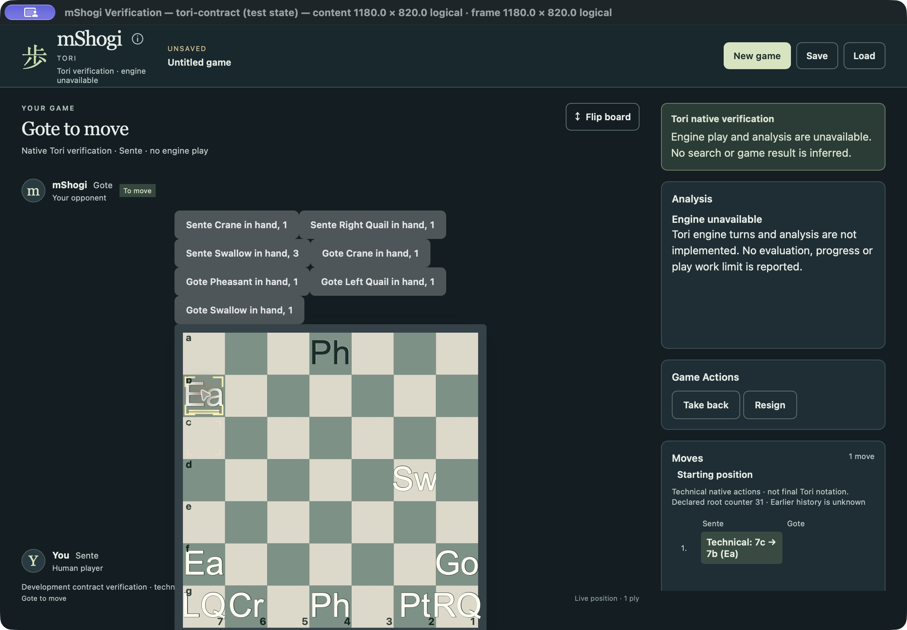

# MSH-132 verification and MSH-77 handoff

Baseline `c89802e3e6961eaf8448e59794998e61a277da91`; source/package consumer
`52b0390cac09faf727a0c5ed74c1fd673f468a11`, `codex/rewrite`.
An unrelated documentation-only timing investigation `0f8b390` arrived in the
primary checkout during work and was preserved. Native rules/search/profile,
103 immutable fixture expectations and original native ownership are unchanged.
[Current presentation contract](shared-presentation.md).

## Acceptance and ownership

| MSH-132 | Supporting evidence |
| --- | --- |
| AC1 native geometry/faces/hands/choices | Six new Rust presentation checks; native-generated standard/custom/Gote/capture/drop payloads; all-nine-face DOM check and complete forced-action/drop tests. Native permissions/inspection, no frontend rules. |
| AC2 single shared frontend/interaction | Existing ProductApp/session/controller/choice owner; full frontend342 checks, native token/host lifecycle regressions, inspection reply retirement and actual packaged pointer/keyboard/Escape. |
| AC3 exact prefix/history/status/cues | Native selected/live typed metadata; Play-only projection, Stop/Resign same-ply event distinctions, Play→Stop→Play/Gote-first, repetition obligations vs forfeit, u64 counter precision; actual packaged Take back/history/Return/capture/drop cues. |
| AC4 complete consumer inventory | [97-row audit](evidence/shared-presentation-audit.json):13 runtime fields+82 requirements reuse actual MSH-131 verdicts; notation1field/1requirement explicitly pending MSH-42. Fresh native38tests retain713PASS/14consumerfields; no duplicate counting. |
| AC5 tests/review/package compatibility | Native/session/host/frontend/Clippy/format, actual QA GUI and normal package checks below; independent native and frontend reviews PASS. CI status recorded separately below. |
| AC6 honest capability/product handoff | Zero Tori engine capabilities; actual server UnsupportedMode and pending projection; chooser only3games; normal Open/NewGame blocked, separate stable QA exposure. MSH-77/42/46 remain open, no complete Tori delivery claim. |

The entire supplemental manifest is reconciled row by row with
`desktop-runtime-consumer-acceptance.json`, exact independently expected source
references and runtime test names. The historical planning manifest's “pending”
labels remain unchanged. The actual runtime evidence, not a rewritten planning
input, establishes13/82. The semantic/frontend checks support those results and
are not95 additional conformance passes. Original native713/103 remain fixed.

## Local native and frontend execution

macOS27.0.1 arm64; stable Rust1.99.1; bundled Node24.19.0. Commands and outcomes:

```text
cargo test --locked -p mshogi-desktop-session --all-features
cargo test --locked -p mshogi-desktop-session --all-features presentation_tests --lib -- --nocapture
cargo test --locked -p mshogi-core tori:: --lib -- --nocapture
cargo clippy --locked -p mshogi-desktop-session --all-targets --all-features -- -D warnings
cargo fmt --all -- --check
cargo fmt --manifest-path desktop/src-tauri/Cargo.toml --all -- --check
cargo test --locked --manifest-path desktop/src-tauri/Cargo.toml --all-features --bin mshogi-desktop
cargo clippy --locked --manifest-path desktop/src-tauri/Cargo.toml --all-targets -- -D warnings
node24 node_modules/typescript/bin/tsc --noEmit # cwd desktop
node24 node_modules/vitest/vitest.mjs run    # cwd desktop
python3 -m unittest discover -s desktop/scripts -p test_macos_verification.py -v
```

Whole-session checkpoint252PASS (199.97s) includes current Tori/runtime/codec,
Chess/Shogi/Xiangqi archive/capacity/history/Take back/close/process regressions;
the subsequent sixth presentation test independently passes (253 discovered).
Native38PASS preserves713 executed assertions, deterministic sequences and real
long native limits. Standalone all-feature host14PASS includes real QA Save/Open,
normal Tori rejection, fresh stopped installation, stale picker and close guards.
Workspace and standalone Clippy/format pass;20 existing vendored Tao warnings
are unchanged. Independent full frontend27files/342PASS and TypeScript PASS.
Stable macOS identity helper11PASS.

Actual fixture generation, repeated with zero Git differences:

```text
cargo run --locked -p mshogi-desktop-session --example write_frontend_fixtures -- desktop/src/__fixtures__
cargo run --locked -p mshogi-desktop-session --features desktop-verification --example write_tori_frontend_fixtures -- desktop/src/__fixtures__
```

Eighteen Tori DTO files come from the real DesktopController, native actions,
inspection and selected histories. The actual UnsupportedMode is returned by the
real internal server subprocess. Pending state is projected without polling that
completion, avoiding a scheduler/sleep race. Deadline DTOs alone use explicitly
labeled elapsed-clock injection through the actual FileWorker classifier; they
verify typed capacity/file presentation, **not timed replay performance**.
The real oversized Open fixture checks actual native byte refusal/nonmutation.
Normal fixture generator and unchanged game payloads remain deterministic.

## Independent review and corrected intermediate checks

Separate read-only `tori131_review` reviewed the completed native/presentation/
worker/gate diff and independently executed six native presentation tests;
`tori77_boundary_review` reviewed the completed frontend/host boundary and
independently ran TypeScript plus all342 frontend checks. Root alone built and
integrated. Both final verdicts PASS, no unresolved material finding. Final documentation review also corrected an
overly loose “advisory” description: T06 departure obligations bind native
admission without themselves being conclusions.

Resolved findings: ValidationBudget recovery must not promise Save completion;
unsupported Tori pending transport must not advertise implemented thinking;
frontend disabled=false cannot override native board-action refusal; pending
fixture capture must not depend on a500ms sleep. Tests now cover each.
Initial intermediate helper compile errors, unused imports/type narrowing,
private per-row geometry test access and stale resource-copy expectations were
fixed. Three existing mocked thinking states were internally inconsistent
(human turn and engine_turn=false); they now explicitly represent nonhuman
turn/engine_turn=true. Production guards were not weakened. A new test initially
assumed a forced-cycle prefix was quiet: immutable TORI-H-FORCED-FULL explicitly
expects in_check_at8=true; corrected that test assumption, never native rules or
fixture expectations. System/Homebrew Node failed before testing because of a
missing library; pinned bundled Node24 runs correctly. Historical failures stay
recorded here; they are not final passed attempts.

## Actual packaged macOS interaction and isolation

[Package/identity/GUI report](evidence/shared-presentation-package.json) records
source, exact normal and stable QA host/engine/signature hashes, archive readback,
normal fixture exclusion and interaction scope. Build commands:

```text
npm --prefix desktop run desktop:build -- --bundles app --features desktop-verification --config src-tauri/tauri.verification.conf.json
python3 desktop/scripts/macos-verification.py prepare qa
python3 desktop/scripts/macos-verification.py select qa tori-contract
python3 desktop/scripts/macos-verification.py inspect qa
npm --prefix desktop run desktop:build -- --bundles app
python3 desktop/scripts/package-smoke.py desktop/src-tauri/target/release/bundle/macos/mShogi.app --report /private/tmp/msh132-normal-package.json
```

Node24 was placed first in PATH for npm. The initial sandboxed helper could not
inspect processes; the authorized ordinary helper was rerun with process access.
It did not bypass its running-app check. One fixed QA identity/path was reused;
no new approval prompt was observed. No security settings or saved approvals
changed. The normal app was built and inspected, not newly GUI-launched.

Actual QA CUA pointer/keyboard/native-picker interaction at1180×820:
Falcon7c→7b capture/forced Eagle (no choice dialog), Swallow hand2→3; Gote Left
Quail hand read-only destination click and Esc focus; Take back retains capture;
Right Quail Enter/Esc then drop5e; starting-prefix inspection and Return to live;
Gote flip; actual atomic Save and Load, UNMODIFIED, exact root/drop/settings,
no Resume/search capability. External saved-file readback is8287B, four ordered
controls plus one retained native capture branch. Its native replay/installation
was performed by actual Load, not inferred from JSON parsing alone.

The same QA instance then displayed exactly Chess/Shogi/Xiangqi in New Game,
started Chess and played e2e4→actual bundled-engine a7a5 (depth2,642nodes,score0).
Native Cmd-Q Cancel kept the game; second Cmd-Q Discard quit through the native
guard. CUA's final “App quit” result is expected termination, not a crash.
This is semantic packaged verification, **not final Tori UI approval or a new
Windows/Linux Tori GUI campaign**. The technical hand rows/letters/layout are
unfinished; MSH-42 must supply deliberate Tori product rendering and full-board
visibility within the accepted common shell.



Normal build frontend checks exclude verification modules/markers; package smoke
also exercises actual UCI/internal move/analysis/Full engine behavior. Additional
specific checks establish absent Tori fixture selectors/injection/bootstrap in
the normal host and absent generated Tori fixture data in its frontend. Shared
semantic DTO/renderer-dispatch strings legitimately remain. Host admission and
chooser tests, not string absence alone, prove the normal activation boundary.

## Replay deadline and coordinating acceptance

MSH-131's real long record remains313906B/196404document units with finite extra
runtime reconstruction; its recorded isolated Save4141ms/Open5704ms are reused.
Concurrent or slower execution can exceed the unchanged15-second validation
budget even within deterministic quotas. This is operational resource refusal;
no accepted history is truncated, no game conclusion follows and no timing
promise is added. The corrected recovery says keep the document open if Save
cannot finish; it avoids a structural-limit reset or guaranteed-retry claim.
MSH-77 should retain this supported-workload qualification in final acceptance.
No new algorithm/performance work is silently started here.

| Original MSH-77 criterion | Acceptance handoff, not closure |
| --- | --- |
| AC1 typed dispatch/capabilities/compatibility/stale work | Accepted native85 +130codec +131actual13/82/runtime/process +132native DTO/shared frontend/normal gates. Unsupported actual execution stays unscored. |
| AC2 metadata/complete choices/no frontend rules |132 contract/tests and actual packaged capture/drop/inspection/history using sole native owner; no common native board model imposed. |
| AC3 lossless canonical admission/resources |130immutable current envelope,131runtime/install/SaveOpen/lineage/identity/reserved close plus132typed deadline/structural presentation. Earlier codec/runtime evidence retained. |
| AC4 real fixtures/interaction/regression/ownership |713native+13runtimefields+82requirements,97-row audit,132frontend/native/package evidence and exact-source CI. C-NOTATION1/1 remains42, not a77 pass. |

MSH-77 still owns its independent final integrated four-criterion acceptance;
this task does not activate or close it. MSH-42 retains engine/search, console,
final notation, product board/hand artwork, player journeys and full delivery
review. MSH-46 and MSH-88/89 retain shared six-game/all-game platform integration
and acceptance. M4 stays open; no future task is started by this handoff.

## Exact-source CI

Native run41427941953 and Desktop run41427942000 both completed **SUCCESS** at
`52b0390cac09faf727a0c5ed74c1fd673f468a11`; all six platform jobs passed.
Final task/document integration changes no production source.


Native [CI41427941953](https://github.com/jweathers777/mShogi/actions/runs/41427941953)
completed successfully on Ubuntu24.04, Windows2022 and macOS15 at the exact source.
Each platform passed253session checks in workspace and isolated all-feature runs,
plus generated DTO freshness, format/Clippy/build/smoke and native regressions.
[Native CI index](evidence/shared-presentation-native-ci.json) records actual job
and step dispositions. These runner timings are correctness evidence, not local
latency benchmarks. Desktop [CI41427942000](https://github.com/jweathers777/mShogi/actions/runs/41427942000)
also passed Windows2022, Ubuntu24.04 and macOS15. All platforms passed342frontend
checks, strict types, standalone host normal/verification tests, normal package
construction/instrumentation exclusion and bundled-engine checks. Windows and
Linux passed the actual installed/packaged existing Chess/Shogi/Xiangqi GUI
regression campaign, including Save/Load, Take back, history, recovery, analysis,
close and Quit. macOS CI establishes package/host checks; local CUA above supplies
actual Tori contract GUI evidence. No Windows/Linux Tori GUI claim follows.
[Desktop CI index](evidence/shared-presentation-desktop-ci.json) records actual
step dispositions. Historical platform failures/MSH-111/MSH-112 are not erased
by this successful current-source compatibility campaign.
