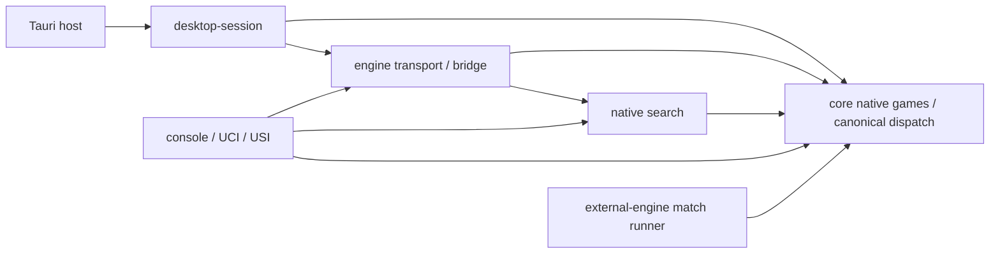

# MSH-106: architecture after complete Xiangqi delivery

Reviewed source: **`2f17510e4c5b8c3b92a051adfa070b4d5d834b21`**, main
`codex/rewrite`, 2026-10-30. Primary analyst/integrator: Codex.
The accepted [MSH-45 game delivery](../m4/xiangqi/delivery-acceptance.md) is an
input, not an assessment to reopen. This report is diagnostic: **no production
change, refactor authorization, new game implementation or milestone gate**.

## Verdict and decision summary

The architecture has sound native ownership and useful shared infrastructure.
Three games actually use typed native dispatch, strict canonical payloads,
serialized host admission, supervised execution, a common desktop composition
and complete-save admission. There is no demonstrated need for a universal
rules engine, common Position/Action, plugin ABI or identical module layout.
No new rules/semantic correctness blocker was established by source review.
A newly observed existing Linux GUI verification failure (V01 below) remains
untriaged; it is not silently treated as a passing campaign or a proven
architecture defect.

The most useful near-term work is around **interaction and lifecycle ownership**:

1. Before another desktop game copies existing state logic, consolidate a narrow
   native-choice selection/inspection lifecycle, retaining game renderers and
   native complete actions/routes.
2. Give production Chess one frontend session/operation owner rather than the
   current shared-plus-legacy subscriptions. Preserve legacy adapters and IPC
   compatibility where still needed.
3. At the next relevant native admission extension, consider typed capacity
   facts and a small common runtime/document installation boundary. Do not
   merge archive formats or game journals merely to share code.
4. Measure transaction/replay, snapshot and search-node costs before changing
   validation, caching, representation or search algorithms for speed.

These are advisory proposals for owner prioritization. None becomes an
unrecorded prerequisite for Tori/Chu/Tenjiku or a mandatory MSH-106 refactor.
The existing [review roadmap](../architecture-health-roadmap.md) is unchanged.

## Scope, method and evidence limits

Compared actual delivered Chess, Standard Shogi and Xiangqi source, public
symbols, call paths, manifests and focused test boundaries. Root inspected
execution/search/protocol/dependencies and representative desktop/native paths.
Read-only research delegates `/root/arch106_native` and `/root/arch106_desktop`
inspected their respective native and desktop/session/archive boundaries.
A fresh separate reviewer assesses this synthesis as recorded below. Root
alone edits durable documentation/task records and integrates.

Source anchors below refer to the reviewed revision, not guaranteed future
line numbers. A source pointer establishes ownership or a concrete structural
observation; it is not a new correctness test, performance measurement or GUI
execution. Existing completion evidence is reused for unchanged behavior:
[MSH-103 independent records](../m4/xiangqi/delivery-reviews/README.md), its
[final reconciliation](../m4/xiangqi/delivery-reviews/final-reconciliation.md),
[MSH-114 correction](../desktop/evidence/msh114/README.md), and completed M2/M3
and Standard Shogi evidence linked from their task records. Passing tests do
not prove good architecture. Functional search does not establish strength.

Tori, Chu and Tenjiku native consumers are unavailable at this checkpoint.
Their historical implementation is not rules authority or evidence that a new
shared mechanism already handles their semantics. Real compound-action
coverage remains the labeled synthetic fixture, not delivered Chu/Tenjiku.
No new Windows/Linux Xiangqi GUI or assistive-technology result is claimed.

## 1. Actual dependency and authority map

Offline `cargo metadata --locked --offline --no-deps --format-version 1`
(and the separate desktop host manifest) establishes these normal dependencies:



`mshogi-core` and `mshogi-search` have no Tauri, React, console I/O or Python
dependency. Core uses pinned serde/serde_json for native codecs, not a frontend
rules layer. The console's desktop-session dependency is **dev-only** for
consumer tests, not a normal product back-edge. The runner owns persistent
external-engine processes and game-specific match replay; it does not call the
desktop or replace mShogi's own search. The Tauri application is deliberately a
separate Cargo workspace and depends on desktop-session.

The webview invokes host commands; it receives native facts/choices. Tauri
[`main.rs`](../../desktop/src-tauri/src/main.rs#L193) owns the outer controller
mutex, command/file reservations and native close lifecycle. The Rust
[`DesktopController`](../../crates/mshogi-desktop-session/src/lib.rs) owns
accepted session mutations and result application. The engine child executes
substantial work; transport success is not native command acceptance.

### Native responsibility comparison

Paths in this table are within `crates/mshogi-core/src/`.

| Responsibility | Chess | Standard Shogi | Xiangqi |
| --- | --- | --- | --- |
| Position and native sides | `chess/mod.rs:173 Position`: 64 squares, turn, castling/EP/counters | `shogi/mod.rs:328 Position`: 81 squares, hands, native turn/declared counter/origin | `xiangqi/mod.rs:271 Position`: 90 intersections, native sides/counters; `Side` owns palace/river conventions |
| Complete action and effects | `chess/action.rs:40 Action`; private `Resolved:161` derives castling rook, EP victim, promotion and counters | `shogi/action.rs:8 Action::Move/Drop`; private `apply_structural:150` derives promotion/capture demotion/hands | `xiangqi/action.rs:7 Action`; `ActionEffects:52`, opaque `ResolvedAction:93` bound to before-state |
| Candidates and attack/movement | `chess/generate.rs:60/79/94`, `attack.rs:30 attackers` | `shogi/action.rs:260 geometrically_reaches`, `legal.rs:31 attackers`, `:63 pseudo_legal_actions` | `xiangqi/legal.rs:163 is_attacked`, `:174 pseudo_legal_actions`; native cannon screens, horse legs, elephant eyes, facing Generals |
| Complete legality and local status | `chess/legal.rs:72 legal_actions`, `:104 classify`; local status separate from match result | `shogi/legal.rs:105 legal_actions`, `:124 apply`; pawn-drop mate, legal defenses and king safety | `xiangqi/legal.rs:204 legal_actions`, `:231 local_status`, `:247 resolve_action`; invalid diagram domains error rather than pretend no moves |
| Checked transition and exact reversal | `chess/action.rs:203/242 apply/undo` | `shogi/legal.rs:124/162 apply/undo`, private structural helper | `xiangqi/legal.rs:264/268`, `action.rs:197 undo`; exact before/after guard |
| Known history | `chess/game.rs:80 Game`; repetition includes legal EP; `apply:173/undo:189` | `shogi/game.rs:312 Game`; checks, occurrences, root and commands | `xiangqi/game.rs:334 Game`; commands/events, piece identities, warnings/obligations, claims and snapshots |
| Match/adjudication authority | `chess/adjudication.rs:262 AdjudicatedGame`; `matchplay.rs:263 ChessMatch`, `submit:392` owns timestamp/clock/terminal order | `shogi/game.rs:420 submit`, `:520` native automatic outcomes; declaration eligibility is advisory until a formal command | `xiangqi/game.rs:728 submit` plus `conduct.rs`; native claimant/audit, repetition warning/loss/draw and pending exact adjudication |
| Identity and undo domains | Native board/repetition/history distinct from match version and host execution | `GameContext:236` complete commands; `GameUndo:323`; host separately retires execution | `GameContext:237`, `RuntimeToken`; `undo:886` retires lineage; committed command prefix `:925` differs from immutable event view `:963` |
| Canonical parse/replay | `chess/record.rs:302 from_json`, `:379 replay_history`; full match validation `matchplay.rs:617/622` | `shogi/record.rs:146/158`: strict parse/replay and comparison of derived events/conclusion | `xiangqi/record.rs:150/157`: strict parse, native commands, compare complete derived ledger; `:224 to_game_with_undo` |
| Diagnostics | `chess/perft.rs:82/94 perft/divide` | `shogi/perft.rs:39/44`; complete move/drop alternatives | `xiangqi/perft.rs:55/59`; explicit diagnostic depth bound, no history/no-win truncation |
| Exact native analysis | `chess/completeness.rs:115 mate_reachability`: cooperative mating, not ordinary evaluation | No artificial Chess Full/tsume operation advertised | `xiangqi/exact.rs:120 ExactVerdict`, `exact_request.rs:125/147 begin/accept`; natural-board witness/no-win/Unknown, not forced-win minimax |

**Preserve these distinctions.** Structural diagram validity, local legality,
known imported history and proven historical reachability are not synonyms.
Chess claim/intended-move and clock semantics, Shogi drops/promotion/formal
declaration, and Xiangqi conduct warnings/claimants are native-owned. Native
semantic undo does not authorize revived runtime work.

[`native.rs`](../../crates/mshogi-core/src/native.rs#L111) supplies the already
useful shared boundary: `GameKind`, immutable `RulesProfile`/edition,
`NativeSchema`, `CanonicalRecord`, native-qualified `NativeSide` and tagged
command/reply dispatch. `CanonicalRecord::from_json:187` routes a `RawValue`
payload to its native parser; known tags never fall through to another game.
Do not replace this with an intermediate map that erases duplicate fields.

One important asymmetry is intentional: Chess `GameRecord` includes historical
observations, while full `ChessMatch` replay owns commands/clocks/admission.
Shogi/Xiangqi records are already native command ledgers. A parsed canonical
wrapper is not universally a reconstructed live match. Consumers must use the
appropriate native replay authority, not reinterpret Chess observations as
commands. The common wrapper documents that boundary; it needs no universal
live-game trait.

## 2. Engine, execution, protocol and match architecture

| Responsibility | Actual source and consumers | Assessment |
| --- | --- | --- |
| Transparent native evaluation | `mshogi-search/src/chess.rs`, `shogi.rs::evaluate`, `xiangqi.rs::evaluate` | Native material/position/hand meanings and side perspective stay explicit; static score is not an outcome. |
| Search backup/iteration | `search.rs::search_with_stop/ChessTree/negamax`; `shogi.rs::search_with_stop/NativeTree/minimax`; `xiangqi.rs::run/minimax/descend` | Full-width correctness baselines use native histories and legal choices; no generic public search framework is required. |
| Limits and uncertainty | Shogi `MAX_DEPTH=4`, `MAX_NODES=20000`; Xiangqi `MAX_DEPTH=3`, `MAX_NODES=512`; native search statuses and exact evidence | Different measured operational ceilings are deliberate; no limit raised here. Xiangqi pending adjudication clears score/decision; failure/Unknown never yields fallback result. |
| Native search scheduling | Chess `coordination.rs::SearchCoordinator`; console `usi.rs::Worker`, `xiangqi_uci.rs::Worker` | Replaceable pending/completed work, stop flags and context checks; duplicated small USI/Xiangqi worker is a candidate mechanical seam, not proof all protocols are one. |
| Structured execution | `mshogi-engine/src/shared.rs::SharedRequest/SharedPurpose/SharedResult/SharedResponse::matches`; `wire.rs`, `server.rs` | V3 coexists with legacy Chess V2. Full context equality includes purpose/history/request/session/generation/limits; game-specific choices/results remain distinct. |
| Capabilities | `shared.rs::execution_capabilities`, `SharedRequest::valid_limits`; native session `CommandCapabilities` | Advertise actual operations. Chess Full is explicitly named; no Shogi Full or Xiangqi exact child/desktop capability is invented. |
| Process supervision | `bridge.rs::EngineBridge/submit_wire/Process/worker/run`; one supervisor, replaceable request/result, bounded pipe helpers and diagnostic retention | Good shared execution owner. Cancellation/replacement kills child off the UI path; cleanup uncertainty is explicit, not hard-real-time success. |
| Console and standards | `mshogi-console/src/main.rs` dispatch; `session.rs`, `shogi_session.rs`, `xiangqi_session.rs`; `uci.rs`, `usi.rs`, `xiangqi_uci.rs`; `record_io.rs` | Independent human shell versus protocol stdout. Native action/claim/declaration translations differ; record file handling is already shared. |
| External matches | `mshogi-runner/src/process.rs::Engine`; `run.rs::GameRun`, `shogi.rs::Controller`, `xiangqi.rs::Controller` and native report/replay | Low-level pipe/process ownership shared; high-level log/watchdog/handshake scaffolding repeats. Timed Chess and native terminal/provenance contracts justify different controllers/reports. |

Chess negamax can use side-to-move backup because its search adapter explicitly
represents claims. Shogi and Xiangqi use native-root-perspective backup with
same-turn terminal commands; Xiangqi also propagates unresolved adjudication.
Do not remove those distinctions to make recursion look identical. Shared
`SearchStatus` for generic completed/node/stopped work is sensible reuse;
sharing score/outcome/declaration semantics is not implied.

The child `server.rs` replays native canonical input before search. Legacy
Chess uses its coordinator inside the child; Shogi/Xiangqi execute their native
search synchronously there. The outer bridge supplies independent termination
for parse/replay/search. This extra Chess scheduling is not a measured latency
problem. Process-per-request isolation and its potential startup overhead should
be profiled before persistent-process changes, which would require preserving
cleanup, generations and cancellation semantics.

Concrete duplication: `usi.rs` and `xiangqi_uci.rs` contain byte-identical
73-line mailbox/worker blocks after normalizing **only the thread-name literal**.
Both are real consumers of replaceable pending/completed work with a native
search callback. The UCI/USI command grammar, native result conversion, search
limits and game policies are not thereby identical. Runner controller logging/
write/deadline loops also repeat, but the risk/benefit of extracting them is
lower than repairing frontend ownership; `process.rs` already centralizes the
most sensitive pipe mechanics. Keep MSH-112's actual early-exit classification
race separate from speculative architecture improvements.

## 3. Desktop and native lifecycle map

| Responsibility | Actual owner at this revision |
| --- | --- |
| Product game choice, unsaved replacement and close guard | `desktop/src/product/ProductApp.tsx:25` |
| Actual common composition/theme | `ApplicationShell.tsx:78`, `GameArea:48`, `PlayerArea:37`, `GamePositionStatus:20`, `NativeEnginePanel:10` |
| Game product adapters | Chess `desktop/src/App.tsx:96`; `ShogiApp.tsx:14`; `XiangqiApp.tsx:25` |
| Snapshot/operation ownership | Shared `useGameSession.ts:6`; legacy Chess `desktop/src/useNativeSession.ts:6`; `NativeBoard.tsx:24` shared freshness comparison |
| Geometry/artwork versus interaction | Chess/synthetic `Board.tsx:55`; Shogi `ShogiBoard.tsx:31`; Xiangqi `XiangqiBoard.tsx:21` |
| Read-only native inspection | `useMovementInspection.ts:7`, `movementInspection.ts`; `shared_inspection.rs::DesktopController::shared_inspection` |
| Analysis/history/recovery | Shogi/Xiangqi `NativeSessionPanels.tsx`; Chess `App.tsx`, `Analysis.tsx`, `Document.tsx` and native session adapters |
| Take back | Shared `TakeBackControl.tsx`; native Chess `takeback.rs`, Shogi `shared.rs::take_back_target`, Xiangqi `shared_xiangqi.rs` native decision-prefix consumer |
| Runtime state/dispatch | `lib.rs::DesktopSession`; `shared.rs::SharedState/ShogiSession/shared_token/shared_command`; `shared_xiangqi.rs::XiangqiSession` |
| Atomic file worker | `persistence.rs::FileWorker/execute/atomic_write`; bounded receipt/candidate work off the UI path |
| Chess archive | `persistence.rs::Archive/decode_chess_v1/preflight_reserved/validate_takebacks`; `takeback.rs` |
| Shogi archive | `shared_archive.rs::ArchiveV2/decode_shogi/envelope`, native replay/journal and candidate admission |
| Xiangqi archive | `shared_xiangqi_archive.rs::XiangqiArchive/XiangqiDraft/check_capacity`, exact observations and weighted replay |
| Capacity before acceptance | `capacity.rs`, native archive admission; actual encoded bytes/events/controls/observations/replay costs and reserved stop/close headroom |

The common shell is **actual shared composition**, not merely common widgets:
header/document controls, live heading, player/board area and stable sidebar
analysis/history/actions/technical slots. The native boards retain Chess squares,
Shogi pentagons/kanji/rotated ownership/hands, and Xiangqi intersections/river/
palaces/Red-Black pieces. Do not redesign the accepted shell during consolidation.
Supported full-board visibility remains a product requirement, including future
large variants; shared geometry is not permission to require scrolling or zoom.

TypeScript filters supplied native action IDs/ordered choices for interaction;
it does not decide legality, captures, royal safety or outcomes. Promotion/drop
and partial-route selection are UI state until one native complete action is
submitted. Read-only opponent/historical inspection is enabled independently
of live action admission, with hollow/non-actionable markers. The shared visible
wording remains `Inspecting {side} {piece} · Esc clears`, with distinct accessible
read-only announcements. Native inspection retains exact selected history,
including Xiangqi immutable intra-command views; ordinary analysis requires a
committed canonical prefix. None should be reduced to board ply alone.

### Archives: justified format differences versus duplicated orchestration

- Chess emits archive **v1 without Take back lineage, v3 with it**
  (`persistence.rs:1056`). Its native M2 `ChessMatch`, controls, clocks and
  `TakeBackEvidence` preserve abandoned authoritative match/observation lineages.
- Shogi/Xiangqi use tagged desktop **v2** with untouched native record payloads
  and authoritative accepted journal replay. Shogi validates current record and
  settings; Xiangqi additionally retains exact proof observations, warning/claim
  semantics and weighted witness/native reconstruction cost.
- Different schema numbers are compatibility, not a defect. Unified file worker,
  duplicate-preserving dispatch, atomic replacement and bounded diagnostic
  retention are existing useful common boundaries. Do not “upgrade” every file
  to one number or flatten native journals to a FEN/move list.
- Runtime/document epochs, fresh request/generation floors, dirty receipts,
  paused installation and failed-candidate rollback are genuinely shared
  lifecycle responsibilities. They currently live partly in Chess
  `DesktopSession` even when a Shogi/Xiangqi session is active, and are repeated
  in native archive controller integrations. That is a concrete seam to assess.
- Take back is a native decision-prefix transaction, not moving the history
  selection. Selected old positions are read-only; Return to live is explicit.
  Restored lineages cannot revive retired execution, and all accepted discarded
  branches/observations remain persistable. A future shared runtime owner must
  not erase these native lineage representations.

### Verification consistency across actual consumers

| Boundary | Compared existing coverage | Architectural conclusion |
| --- | --- | --- |
| Native rules | Chess independent perft/sequence/differential corpus; Shogi independently expected LegalAll promotion/drop/king-safety choices and sourced history; Xiangqi complete board/reference and sourced WXF history/exact fixtures | Common verification obligations are useful; one game's reference or expected outcome is not another's oracle. Preserve different fixture semantics and native error expectations. |
| Search/execution | Game-specific evaluator/terminal/history/limited-work cases; shared strict-envelope, purpose/context, cancellation/replacement and actual-child tests | Test shared retirement/transport once across concrete games, with separate native score/declaration/claim/Unknown assertions. No need for every native game to expose the same search seam. |
| Desktop interaction | `Board`/`BoardRoutes`, Shogi/Xiangqi board tests, inspection hook, product/session/Take back/capacity tests; native-generated fixtures | Repeated interaction invariants can support P1/P2 extraction with differential tests. Current synthetic compound routes prove the interaction contract only, not a real future game's legality. |
| Archive/runtime | Chess legacy/current codecs and Take back corpus; Shogi/Xiangqi native ledger/journal and mixed exact-capacity tests; cross-game handoff/replacement tests | Retain independent native replay and existing malformed/duplicate/identity/failure cases. A common orchestration helper must not reduce game-specific validation. |
| Packaged product | Retained normal/labeled-QA macOS game journeys; existing installed Windows/Linux Chess/Shogi campaigns and native/package CI are separately recorded | Evidence is intentionally platform-qualified. This architecture review adds no Windows/Linux Xiangqi GUI coverage and cannot replace final all-game MSH-88/46/47 acceptance. |

Small native/controller/frontend tests already isolate real boundaries without
launching a full platform campaign. This is a positive property to preserve
through consolidations; shared tests should add invariant comparisons, not
remove the independently expected native fixture sets.

## 4. Ranked findings and proposed bounded work

Severity here measures practical architecture/maintenance risk, not a new
assertion of rules failure. **A** = advisable before another desktop game;
**B** = before/accompany a concrete later consumer; **C** = measurement-led
optimization; **D** = low priority or acceptable differences. Advisory timing
creates no dependency or implementation authority. Architecture proposals P1–P8 below are
**report proposals, not new Backlog tasks**, pending owner review/prioritization.
No task IDs are reserved or existing prerequisites changed.

### F01 / A / moderate / proposal P1: duplicated native-choice interaction lifetime

**Evidence:** [`Board.tsx:68–180`](../../desktop/src/Board.tsx#L68),
[`ShogiBoard.tsx:36–123`](../../desktop/src/product/ShogiBoard.tsx#L36),
[`XiangqiBoard.tsx:30–101`](../../desktop/src/product/XiangqiBoard.tsx#L30)
independently retain selected origin, inspection request generation/pending
state, token/orientation reset, capture-before-inspection precedence, Escape,
commit guard and focus recovery. Board/Shogi also repeat ordered prefix,
terminal-versus-continuation and completion-choice logic. Existing tests exercise
these same semantic transitions in all three consumers.

**Consequence/benefit:** another renderer is likely to copy a fourth controller;
common interaction fixes require multiple changes. A narrow state/controller
could share retirement/non-actionability/completion invariants. No current
misplayed action or accepted-game defect was demonstrated.

**P1 proposed task — Consolidate native-choice interaction lifetime.** Scope:
current three boards plus the existing synthetic route consumer. Accept opaque
origin/action IDs, native ordered steps and completion alternatives; keep the
rendered geometry, artwork, hand tray, focus-neighbor geometry and completion
presentation in adapters. No universal from/to move model or frontend rules.
Acceptance: all native alternatives/paths retained, partial selection never
commits, pending inspection retires on context/selection/orientation/unmount,
and actionable captures take precedence over inspecting an enemy destination.
Risks: same endpoints/different routes, terminal prefixes, optional/compulsory
promotion, drops, historical disabled play and keyboard focus. Verify existing
`BoardRoutes`, `Board`, `ShogiBoard`, `XiangqiBoard`, `NativeBoard` and
`useMovementInspection` tests, then focused actual packaged keyboard/pointer/
orientation/inspection/promotion/drop journeys. Preserve the approved visuals.
Proposed prerequisite: completed106 plus owner prioritization; independent of
P2 except overlapping frontend work should use one integrator. Recommended
before next desktop renderer, not before unrelated rules/source research.

### F02 / A / moderate / proposal P2: two product session owners for Chess

**Evidence:** [`ProductApp.tsx:26/79`](../../desktop/src/product/ProductApp.tsx#L26)
mounts `useGameSession`, then the Chess branch mounts `App`, whose
[`useNativeSession:97`](../../desktop/src/App.tsx#L97) runs unconditionally even
when the shared snapshot drives rendering. Shared/legacy hooks poll at 180/250 ms,
listen separately and retain independent latest snapshots, busy/error channels
and operation guards. Chess ordinary actions/files still use legacy commands;
Take back and cross-game replacement use the shared product owner. ProductApp
and `Document.tsx` also retain separate document guards; suppressing the legacy
close presentation does not remove its subscription.

**Consequence/benefit:** actual overlapping frontend ownership makes late Save,
close/remount and busy-state reasoning harder. Native reservations and full
identity checks mitigate it; this review does not establish current corruption
or quantify a responsiveness problem. One production owner would simplify the
lifecycle and remove duplicate polling.

**P2 proposed task — Give production Chess one session/operation facade.**
Adapt legacy Chess capabilities through one product owner, preserving legacy
standalone/test clients and IPC shapes; do not migrate archives. Acceptance:
one active product subscription, exact rendered click authority, common busy/
error/document guard lifetime, no delayed clean Save authorizing loss of newer
work, native close retained across replacement/remount. Verify both hook suites,
ProductApp guards, StrictMode cleanup, replaced-document receipts, Take back,
Chess focus and actual packaged native close/quit/save journeys. Risks: legacy
M2/Full analysis compatibility, failure/close timing and snapshot authority.
Proposed prerequisite:106 and owner prioritization; can be separately bounded
from P1. Recommended before cloning either adapter for another desktop game.

### F03 / B / moderate / proposal P3: common runtime/file installation mixed into native adapters

**Evidence:** [`shared.rs:789–962`](../../crates/mshogi-desktop-session/src/shared.rs#L789),
[`shared_archive.rs:966`](../../crates/mshogi-desktop-session/src/shared_archive.rs#L966),
and [`shared_xiangqi_archive.rs:1478`](../../crates/mshogi-desktop-session/src/shared_xiangqi_archive.rs#L1478)
repeatedly manipulate Chess-host counters, retire optional native sessions,
install paused observations, advance identity floors and handle receipt/rollback
state. Game-native validation/replay and common runtime lifecycle interleave.

**Consequence/benefit:** each new adapter must preserve the same runtime and
admission invariants in several branches. A small common installation/document
metadata owner could reduce drift. Xiangqi's draft and weighted replay cost are
intentional; their implementation must not be swapped for Shogi's cheaper
clone path. No failed admitted save or stale-result bypass was found.

**P3 proposed task — Isolate document/runtime installation orchestration.**
First isolate epoch/receipt/dirty/retirement/paused-install responsibilities,
leaving each native codec, replay, settings, lineage and resource costing behind
its adapter. Acceptance: failed candidate/Open keeps current accepted document;
fresh reopen/Take back cannot revive work; consumed response never returns to
thinking; complete byte/event/control/observation/replay admission and stop/
close reservation remain. Verify all three archive corpora, same-board/different-
history, cross-game replacement/cancel, exact observations and actual file/quit
journeys. High regression risk warrants smaller stages and native differential
oracles. Proposed prerequisite:106 and owner-approved scope; no required P1/P2
chain. Timing: before copying lifecycle into Chu/other complex desktop history,
not a new gate on unaffected native work. **Do not unify archive formats.**

### F04 / B / moderate / proposal P4: capacity facts still coupled to diagnostic strings

**Evidence:** [`NativeSessionPanels.tsx:7–26/51–71`](../../desktop/src/product/NativeSessionPanels.tsx#L51)
classifies selected message prefixes; native `CapacityState` contains phase/
message and command boundaries return `String`. Combined native control/
observation diagnostics exist in both archive adapters. MSH-114 correctly
removed numeric-substring inference and preserves truthful generic fallback.

**Consequence/benefit:** current output is correct; F01 is resolved. New native
wording/resources could silently reduce specificity or require another frontend
string adapter. A small typed reason/count/limit carrier would separate native
facts from product copy without a general error framework.

**P4 proposed task — Add bounded native capacity reason metadata.** Proposal:
explicit byte/event/control/ordinary-plus-exact-observation/replay/identity/
unknown-or-multiple categories alongside bounded technical text. Preserve exact
limits, native precommit admission, stop headroom, Save/Save As and failure
feedback; unknown stays generic. Verify real native payloads, both control-only
zero-observation cases, mixed ordinary/exact256-to257, encoded/event/replay
boundaries and current `NativeCapacity`/native regression oracles. Risk: changing
IPC/snapshot/error compatibility or confusing capacity with engine failure.
Proposed prerequisite:106 and owner prioritization. Routine internal metadata
representation remains autonomous within a later authorized task; any changed
public semantic contract or compatibility promise needs a concrete owner
decision first. No game-delivery prerequisite is added. Timing: next
relevant admission extension, separate from P3; not a reason to redo114.

### F05 / B / low / proposal P5: duplicated protocol worker, broader runner sharing less urgent

**Evidence:** [`usi.rs:33–104`](../../crates/mshogi-console/src/usi.rs#L33) and
[`xiangqi_uci.rs:34–105`](../../crates/mshogi-console/src/xiangqi_uci.rs#L34)
share the actual mailbox/search/retire/shutdown lifecycle. The root's normalized
source comparison confirmed 73 identical lines. Runner `shogi.rs::Controller`
and `xiangqi.rs::Controller` repeat log-byte limits, writes and deadline loops;
`process.rs::Engine` already shares bounded I/O/cleanup.

**P5 proposed task — Share the small protocol search mailbox only.** Keep
native jobs/results/context checks, grammar, deterministic settings, claims/
declarations and outcome conversion in the adapters; preserve one pending and
one completed result and exact retirement. Verify actual UCI/USI subprocess
stop/replacement/new-position/quit/no-completed-iteration cases and native
result distinctions. Risk: completion leakage or blocked shutdown; a tiny
private helper is preferable to a public universal search framework.
Proposed prerequisite:106 and prioritization; useful when adding another real
protocol consumer. Larger runner-controller extraction remains **D** until a
specific change demonstrates cost; preserve timed Chess versus untimed native
reports and MSH-112 diagnosis. Do not merge internal one-shot bridge and
persistent match-engine processes solely because both use pipes.

### F06 / B / moderate / proposal P6: preserve complete native actions for real later consumers

**Evidence:** current native Chess/Xiangqi actions each have one from/to path;
Shogi adds drop/promotion. Shared `PresentedChoice` already carries ordered
steps/completion and the labeled synthetic route fixture covers equal-endpoint
routes. This is not evidence of a delivered real compound-action kernel.

**P6 proposed task — Ratify the next affected variant's complete-action handoff.**
Part of its existing native profile/handoff refinement, after its sourced owner
rules decisions. Require independently expected native complete actions/effects,
canonical route encoding and atomic rejection for actual multistep/route/capture
cases when that game requires them. No invented common royal/check/hands/
promotion convention, mandatory new DSL or change to current game types.
Verify native transitions/replay first, then exact consumer/inspection/selection
fixtures through the real adapters. Risk: designing before rules/fixtures exist.
Timing: the affected Chu/Tenjiku (or other actual) consumer, not a speculative
prerequisite for all Tori work. Existing MSH-81/82/83 and game-delivery ownership
remain; this proposal does not duplicate or reorder them.

### F07 / C / measurement risk / proposal P7: measure history, validation and execution costs before optimizing

**Evidence:** Shogi `game.rs:420–489` clones complete before/candidate/after
state; Xiangqi `transaction_copy:525–544` clones history/snapshots and
`submit:862` encodes candidate saveability. Native `record.rs:187–207` replays
and compares cumulative events. Search iterates legal transitions and PVs;
Xiangqi restores a complete record per root and compares restoration after
iterations. `shared.rs:1194–1418` and `shared_xiangqi.rs:474` build native
presentation/record/observations for polled snapshots. These are concrete
allocation/reconstruction sites, **not newly measured bottlenecks**.

Existing [MSH-97 measurements](../m4/xiangqi/engine-evidence.md) show standard
root 512 visits completing depth1 in about 305.5 ms on its recorded hardware and
history-dependent variation; they justify conservative current limits, not an
attribution of time to any one clone, serialization or dispatch branch.

**P7 proposed task — Profile representative native/runtime costs before tuning.**
Prefer the already planned MSH-48/M5 pilot and current game benchmark ownership,
not a competing strength task. Separate legal generation, apply/undo/history
length, replay/encoded admission, snapshot/transport and search-node costs on
fixed sources/hardware/corpora; include stop latency and actual memory/work.
Only measured follow-ups may propose incremental encodings/checkpoints, native
move-generation changes, snapshot caching, persistent children or search reuse.
Preserve exact-history cache keys, atomic transitions, MSH-61 complete-save
admission and cancellation. Risks: invalid history/outcome cache reuse, hidden
resource cost and lost responsiveness; no speed/strength guarantee without
measurements. Dependencies: applicable existing pilot/architecture gates,
including109 before substantial M5 optimization; no changes to those gates here.

### F08 / D / low / proposal P8: stale temporal comments; healthy explicit differences

**Evidence:** `mshogi-core/src/lib.rs:4–17` still describes adjudication as
subsequent work; `native.rs:28` says Xiangqi execution is unavailable despite
actual capabilities/server97. `chess/game.rs` has historical next-milestone
wording although its history-only ownership remains correct. This is source
documentation drift, not runtime misadvertisement or reopened delivery.

**P8 proposed task — Refresh current ownership/capability comments.** Small
source-documentation-only change; replace temporal promises with current
responsibilities, retain historical task evidence and point execution support
to the actual capability function. Verify rustdoc links and native public
boundary comments against actual symbols. Proposed prerequisite106/prioritization;
no product tests or refactor justified solely by this cleanup.

Other reviewed differences are **D/acceptable**, without corrective tasks:
explicit game/profile dispatch, native side/action/outcome types, per-game exact
algorithms, board renderers, versions/codecs and small presentation vocabulary/
limit branches. Large files and repeated filenames alone are not defects.

## 5. Acceptable architecture and invariants to retain

- Native rules/command admission is authoritative. Shared presentation does not
  become another rules engine or decide an outcome from a score/fast miss.
- No universal Position/Action, negamax, royal/check, notation, hand,
  declaration or repetition model is justified by the three current games.
  Their explicit types are not defects to normalize.
- Strict RawValue parsing, native replay and mismatched game/profile/schema/
  transport rejection are sound existing abstractions. A parsed Chess history
  observation remains distinct from a validated live match.
- Full submitted-context equality and monotonic request/session/process/
  selection retirement are shared semantics already implemented. Semantic undo
  must not restore execution identities; same board does not mean same history.
- Chess Full mating and Xiangqi natural-board exact reachability have different
  goals and native result meanings. Unknown/exhaustion/cancel is unscored;
  positive existential witness is not forced-win strength. Shogi advertises no
  fake Full capability.
- The supervised native child, bounded queues/diagnostics/watchdogs and cleanup
  uncertainty isolate substantial work. Native match runner and one-shot
  internal bridge need not have one process policy.
- Shared shell/status/inspection language, exact native complete choices and
  non-actionable historical/opponent inspection are good existing reuse.
  Native board geometry/artwork/hands remain adapter responsibilities.
- Atomic file worker, authoritative replay, current stopped reopen, historical
  observations, exact prefix selection, Take back lineage and precommit
  saveability/headroom are preserved. Codec version equality is not a goal.
- Existing focused native/controller/frontend/protocol/capacity/packaged layers
  test different responsibilities. Keep independent fixture expectations;
  a common test harness must not turn implementation output into its own oracle.

## 6. Verification, independent assessment and handoff

### Actual newly performed static checks

Environment: Darwin 27.0.0 arm64; Rust 1.99.1, Python 3.11.0; PATH Node 23.11.0
recorded only (no frontend commands run); pinned Backlog 1.55.1 rather than
installed global 1.55.0. No product tests, builds, benchmark or GUI campaign was
run for this review. Source lookup mistakes for anticipated filenames were
corrected using actual file inventory; absent files are not architecture defects.

- Clean integration2f17510; fetched remote aligned0/0; no competing active task
  owner; other worktrees preserved. MSH-45 dependency is Done and remains intact.
- Actual `rg --files`/`rg -n`, scoped reads and manifest inspection across the
  map above; no filename-symmetry test or module-size threshold imposed.
- Offline workspace/host Cargo metadata succeeded. Normal dependency graph
  confirms core/search isolation; console→desktop-session is dev-only.
- Read-only Python extracted the actual USI/Xiangqi mailbox blocks and compared
  them after replacing only their diagnostic thread names:73 lines identical.
- Reused accepted game delivery reviews, fixtures, actual packaged evidence and
  CI; did not rerun suites as a substitute for architecture analysis.
- Final documentation validation passed:24 local links/line anchors resolve;
  evidence JSON parses;114 task IDs are unique/resolved with no missing, self,
  duplicate-edge or cyclic dependencies. Backlog doctor and diff checks pass.
  Historical roadmap content is preserved verbatim;107–109 gates and all
  completed delivery records, product code, workflows and packages are unchanged.

### Existing CI status and new verification observation V01

At exact reviewed2f17510, native run
[40994147428](https://github.com/jweathers777/mShogi/actions/runs/40994147428)
completed successfully on all three systems. Existing desktop run
[40994147366](https://github.com/jweathers777/mShogi/actions/runs/40994147366)
was initially in progress, then completed with macOS/Windows success and
**Ubuntu failure**. Linux native/frontend checks, package construction/smoke,
external proxy boundary preparation and verification-package construction passed;
its installed Chess/Shogi GUI step failed. The retained assertion is:

```text
Required GUI phases failed: verification-standard: ('.square[aria-label^="e2,"]', None)
```

`gui-smoke.py:1221` aggregates the phase failure. The selector helper near395
constructs that query; these facts do not establish why the element was absent.
No expensive rerun or app/driver correction was attempted. Exact job results,
failed step, raw-log SHA256 and a small original-log excerpt are retained in
[existing CI metadata](evidence/msh106/existing-ci-status.json) and
[failure excerpt](evidence/msh106/linux-failure-excerpt.txt). Full original job
logs/artifacts remain attached to the linked run. This is inspection of existing
automated evidence, not newly executed local GUI interaction.

**V01 / proposed P9 — Triage the Linux verification-standard selector failure.**
Cause and product impact are unestablished. In a separate bounded assignment,
inspect that phase's original screenshot/DOM/driver/host evidence, source and
package identity; distinguish observation/timing, fixture/selector, transport
and actual application failure. Add only a controlled reproduction/regression
justified by that evidence; never replay ambiguously delivered mutations,
weaken phase assertions or turn a rerun success into a fix. Preserve MSH-111's
Done diagnosis and earlier failure history; this selector failure is not proven
to be the same driver reset. MSH-112's native runner classification is a
different existing issue. Timing: before relying on the affected Linux campaign
for final MSH-88/46/47 acceptance, without inventing a new variant dependency.
This is a verification follow-up proposal, not a confirmed architecture defect,
new task or implementation authorization inside106.

Exact c80a95a native
[40965828435](https://github.com/jweathers777/mShogi/actions/runs/40965828435)
and desktop [40965828489](https://github.com/jweathers777/mShogi/actions/runs/40965828489)
previously passed all three systems with identical production source. Both that
success and the later2f17510 failure remain valid observations; neither proves
a cause or fix. CI is not architecture-quality proof or new Xiangqi Windows/
Linux GUI evidence. MSH-45 acceptance/evidence remains untouched.

### Independent review and disagreements

Research delegates inspected source, not just earlier agent summaries. A fresh
`/root/arch106_independent` independently read the complete owner request,
AGENTS/design/roadmap/task and the full report, then inspected Cargo direction,
native RawValue dispatch, Shogi/Xiangqi legality/game/context/record owners,
shared engine purpose/result/capabilities, native controller/archive capacity
and replay, all three product board interaction loops, shared recovery and
the two product session hooks. It checked concrete source anchors and the
reused MSH-97 measurement, and independently considered missed duplication and
premature abstractions. No new tests/builds/GUI or performance measurements.

**Independent conclusion: no material architectural/product blocker or missing
major review area.** It corroborated the narrow interaction/session/mailbox
recommendations, native-specific types, legitimate archive asymmetry and
measurement-first optimization. Editorial findings were resolved: distinguish
proposal IDs from priority labels, correct `EngineBridge`'s worker function
reference from `execute` to actual `run`, and clarify that routine internal
metadata choices do not automatically require another owner approval. No
material source/rules/product disagreement remains. After the later CI status
arrived, the same reviewer independently checked the exact job metadata,
original failure excerpt, script selector/aggregate anchors and raw log SHA256;
it approved the V01/P9 addendum with architecture acceptance retained. It
confirmed that the unknown cause and earlier successes/failures are qualified
without turning the failure into a proven architecture or Xiangqi defect.
Final integration bookkeeping is recorded in the task.

### Owner decisions and stop

Owner prioritization is needed before converting proposals into implementation
assignments. No unresolved material rules/product decision blocks this review.
Routine internal controller/metadata representation remains autonomous within a
later authorized task. If P3 changes a significant architectural ownership
contract rather than internal placement, or P4 changes public semantic/error
or compatibility guarantees, present the concrete proposed contract and
tradeoffs before that affected implementation. The recommended bounded versions
preserve existing behavior and compatibility. P1/P2/P5 likewise authorize no
changed interaction/product convention. This report neither requests a
procedural approval to finish nor preapproves refactor implementation.

No dependency/gate is added to existing variant delivery or research. MSH-107
waits for complete Chu delivery; MSH-108 retains its46/106/107 gates; MSH-109
retains108/48 before substantial optimization. M4,46/47 and future game/strength
records remain open. Stop after106. Follow-up proposals are unimplemented and
all completed delivery evidence remains unchanged.

The final CLI query `backlog task list --status Ready --ready --plain` returns
**No tasks found** after106 completion. No subsequent assignment was activated;
owner prioritization/scoping of these proposals or existing future-game work
remains separate from this diagnostic completion.
