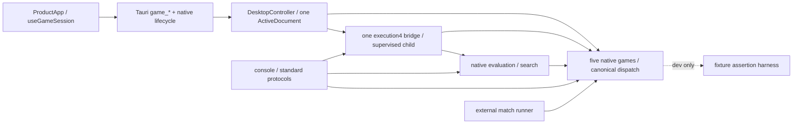

# MSH-107: architecture after complete Chu Shogi delivery

Reviewed source: **`a8581f09107648d03e3016786b41c267ace88bca`**, primary
`codex/rewrite`, 3 November 2026. Analyst/integrator: Codex. Five delivered games:
Chess, Standard Shogi, Xiangqi, Tori Shogi and Chu Shogi. Tenjiku is prospective.
This diagnostic changes documentation and task evidence only.

## Verdict

**Architecturally healthy; no material redesign recommended and no demonstrated
architectural blocker to Tenjiku implementation.** The accepted A-10 ownership
model survived two additional games and real Chu compound actions. Native rules,
histories and outcomes remain independent, with one application/session,
execution family, current document envelope and frontend interaction lifetime.
The most useful bounded follow-up is to measure and reduce unnecessary retained
undo data during ordinary replay, then assess cancellation and inspection costs.
These are recommendations, not new dependencies or authorization to refactor.

No new rule correctness defect, serious architectural blocker or current
saveability violation was established. This does not certify every rule again,
prove hard real-time responsiveness, establish playing strength, or deliver
Tenjiku. Its selected complete profile and independently expected effect-order
fixtures remain work for MSH-83/87/79/44. The modern-complete direction in
[design](../design.md) supersedes historical-acquisition-first recommendations
in older research; this review starts neither research nor implementation.

## Baseline, method and prior-review reconciliation

The clean primary checkout and local tracking ref started at a8581f0, the
accepted MSH-43 integration. Origin is `git@github.com:jweathers777/mShogi.git`.
MSH-107 was Ready, unassigned and dependent only on Done MSH-43; no In Progress
or In Review task owner was found. Root claimed it as `@codex` in the primary
checkout. Three unrelated existing worktrees were preserved; none was created.
Global Backlog1.55.0 was used for initial reads only; verified pinned1.55.1 was
used for all task writes.

Source inspection covered the production symbols and consumers below, Cargo
normal/dev/build dependencies including the separate Tauri workspace, current
fixture/test boundaries and existing accepted measurements. Two read-only
research agents inspected native and shared boundaries; a third fresh reviewer
independently assessed the map, findings and coverage. Their conclusions are
qualified in the evidence section. No external engine or new historical source
campaign was needed.

| Earlier record | Current disposition at a8581f0 |
| --- | --- |
| [MSH-106 F01/F02](architecture-health-106.md), duplicated board interaction / dual frontend owner | Resolved by R4/R5; all five real games now consume the surviving owners. |
| MSH-106 F03/F04, runtime/install duplication / diagnostic-string resource facts | R2/R3/R4 provide current envelope, active native document and structured resource facts. Native validators intentionally remain different. |
| MSH-106 F05, protocol mailbox duplication | Low-priority advisory remains; external USI/Xiangqi protocol workers are distinct from the one internal execution family. No new extraction obligation. |
| MSH-106 F06, real compound handoff | Chu now supplies actual native routes, effects, royals and product consumers; synthetic coverage is no longer the only compound evidence. Tenjiku effects still require its own handoff. |
| MSH-106 F07/F08, measurement / stale comments | Retain measurement discipline; current risks and remaining source-comment drift are recorded below. |
| [MSH-115](architecture-target-115.md), [approved migration](../architecture-migration-plan.md) | Accepted pre-release target, not the old compatibility-preservation proposal, governs this review. |
| R1–R6: [116](execution-migration-116.md), [117](desktop-envelope-117.md), [118](native-application-118.md), [119](frontend-application-119.md), [120](native-choice-controller-120.md), [121](architecture-acceptance-121.md) | Current source confirms one-owner endpoints and retirement of obsolete production paths. Historical stage restrictions and three-game lists describe their own revisions. No bridge is needed for Tori/Chu. |
| MSH-106 V01/P9 and later MSH-122 | Retain historical failures and accepted later baseline; no cause is inferred from a later passing GUI campaign. MSH-112 remains separately owned. |

## Current dependency and authority map

`cargo metadata --locked --offline --no-deps --format-version 1` confirms:
core normally depends only on serde/serde_json; search normally depends only on
core; engine depends on core/search; desktop-session on core/engine; console on
core/search/engine, with desktop-session **dev-only**. Runner normally depends
on core, serialization and hashing, not desktop. The standalone Tauri workspace
normally depends on desktop-session/Tauri/dialog; tauri-build is build-only.
Core/search have no dependency on React, console I/O or Python. Conformance
harness is core's dev dependency, not a runtime alternate rules engine.

### Five-game native responsibility map

In this table paths are within `crates/mshogi-core/src/`; line anchors refer
only to a8581f0. Different native layouts are intentional.

| Responsibility | Chess | Standard Shogi | Xiangqi | Tori Shogi | Chu Shogi |
| --- | --- | --- | --- | --- | --- |
| Authoritative state | `chess/mod.rs:173 Position` | `shogi/mod.rs:328 Position`, board/hands/counters | `xiangqi/mod.rs:271 Position`, intersections/native sides | `tori/mod.rs:380 StructuralState`, `:400 Position`, native hands/rights | `chu/position.rs:612 StructuralState`, `:620 Position`, original base/movement face, root provenance |
| Complete action / derived effects | `chess/action.rs:40 Action`, private resolution derives EP/castling/promotion | `shogi/action.rs:8 Action::Move/Drop`, native demotion/hands | `xiangqi/action.rs:7 Action`, `:93 ResolvedAction` tied to before-state | `tori/mod.rs:578 Action`, `transition.rs:71 Effects` | `chu/legal.rs:10 Action` ordered route/promotion; `:70 Effects` ordered victims, native Lion protection |
| Candidates / movement | `chess/generate.rs:60/79/94`, `attack.rs::attackers` | `shogi/action.rs:253` geometry, `legal.rs:63` candidates / attackers | `xiangqi/legal.rs:107` geometry, `:174` candidates; cannon screens/legs/eyes | `tori/transition.rs:12` movement, `legal.rs:223/335` candidates | `chu/legal.rs:612/725/767` native movement descriptors/routes, `:243` local choices, `:304` capture influence, `:331` inspection |
| Legality / atomic apply / undo | `chess/legal.rs:72`, `action.rs:203/242` checked resolve/apply and exact reversal | `shogi/legal.rs:105/124/162`, own king safety/drop-mate | `xiangqi/legal.rs:204/247`, `action.rs:180/197` commit/reversal | `tori/legal.rs:236/245/249`, admitted local owner, instance/branch undo/redo | `chu/legal.rs:448` route/capture/Lion-law resolution; `:354/382/411` apply/undo/redo; capture-based, no imported self-check |
| History / admission / adjudication | `chess/game.rs:80 Game`; `adjudication.rs:262 AdjudicatedGame`; `matchplay.rs:263/392 ChessMatch::submit` claims/clocks/actors | `shogi/game.rs:312/420/492 Game`, CSA repetition/declaration/terminal commands | `xiangqi/game.rs:334/739/897 Game`, identities/warnings/claimants; `conduct.rs:321`, `assessment.rs`, `exact_request.rs` | `tori/game.rs:300/414/495/664 Game`, must-vary admission, native outcomes, complete command reversal | `chu/game.rs:328 GameData`, `:359 Game`, `:488` history legality, `:614` commands, `:833/862` reversal; `:981/1032/1075` finite immediate-threat replies/capture-all |
| Exact canonical replay | `chess/record.rs:379` history; `adjudication.rs:446` adjudicated replay; `matchplay.rs:617` full match commands/times | `shogi/record.rs:158`, native command/event/conclusion reconciliation | `xiangqi/record.rs:157`, exact event ledger; committed command prefix differs from immutable intra-command view | `tori/record.rs:216`, strict native reconstruction | `chu/record.rs:149`, native root/events/every derived field compared; fresh authority |
| Perft / diagnostics | `chess/perft.rs:82/94` | `shogi/perft.rs:39/44` | `xiangqi/perft.rs:55/59`; exact diagnostics separate | `tori/perft.rs:140/151`, typed bounded traversal | Production `mshogi-console/src/chu_session.rs:427`; local/history-free traversal. Independent fixture adapter `chu/conformance.rs:102`; not history adjudication evidence. |

All five are delivered; Tenjiku has no current native enum variant or product
capability. Chess/Shogi/Xiangqi native authorities remain semantically unchanged
by R1–R6; this review inspects their current consumers without rerunning their
whole conformance campaigns. Tori and Chu are real new consumers, not renamed
synthetic fixtures. Chess full match persistence cannot be replaced with its
history-only GameRecord. Chu's absence of a public core `perft.rs` is not a defect.

### Evaluation, search and execution

Files here are within `crates/`. `mshogi-search/src/chess.rs:57 evaluate` and
`search.rs:106/166/233` implement private, claim-aware adjudicated negamax.
`shogi.rs:70/176/345` uses native material/hands and minimax with formal
same-turn declaration choices. `xiangqi.rs:54/197/213/398` retains native history,
ordinary fast assessment, separately requested exact-root behavior and unresolved
states. `tori.rs:54/139/259/287` and `chu.rs:60/141/259/286` use concrete native
Game reconstruction, full-width minimax, native terminal scores and exact undo.
All use native legal transitions; no board-only transposition reuse collapses
history. Material never establishes a conclusion. Similar Tori/Chu recursion is
not evidence that Chess claims, declarations and Xiangqi Unknown share semantics.

`mshogi-engine/src/shared.rs::ExecutionContext/ExecutionRequest/ExecutionResult`
and `execution_capabilities:22` supply one protocol4 family with durable
observation schema1. `server.rs` dispatches native work; `bridge.rs::EngineBridge`
uses one submit/poll slot, bounded I/O, process watchdog/cleanup and retirement.
Context binds native profile/edition/schema, complete canonical history, purpose,
selected event/board count/native side, limits and request/session/process IDs.
The native result is still a proposal until controller admission. Ordinary Xiangqi
child capabilities advertise turn/ordinary analysis only; its native/console
exact operation is separate from that capability family. Chu
`engine/src/chu.rs::ChuResult::validate_with_work` checks native continuation and
leaf/terminal consistency, not heuristic optimality. Ordinary analysis cannot
commit play or create an adjudication. Failed/incomplete work supplies no fallback.

External `console/src/{uci,usi,xiangqi_uci}.rs`, game-selected shell files and
runner `process.rs` are real separate consumers: protocol grammar, timed Chess
matches and untimed native matches need not share controllers. Chu's complete
notation/internal interface is delivered without inventing a UCI/USI encoding.

### Test and conformance boundaries

The binding [engine-independent policy](../testing/conformance-policy.md) requires
selected profiles, independently established expectations, exact reversal/replay,
meaningful properties/metamorphic/adversarial checks and independent review.
Another engine is optional investigation, never a build or conformance gate.
Native corpora remain separate from search oracles and product integration:

| Game | Actual independent/correctness consumer boundaries inspected or reused |
| --- | --- |
| Chess | `core/tests/{fen_corpus,legal_actions,sequences,perft,game_history,game_record,adjudication,matchplay}.rs`, native selected-profile fixtures; search tree/claim tests; separate engine/console/desktop tests. Earlier external comparisons are historical observations, not prospective prerequisites. |
| Shogi | `core/tests/{shogi_legal,shogi_history,shogi_record}.rs` and native fixture corpus; search declaration/history/solved-tree tests, actual USI/child and current session/archive tests. |
| Xiangqi | `core/tests/{xiangqi_board,xiangqi_history,xiangqi_game_boundary,xiangqi_exact,xiangqi_inspection_prefix}.rs`, independent WXF expectations; native exact positive/negative/Unknown separate from ordinary search and product evidence. |
| Tori | `core/src/tori/{conformance,local_conformance,game_conformance}.rs` and separate `mshogi-conformance` fixture assertion harness; 713 accepted native assertions, native property/rotation/negative/reversal cases, search tests and actual shared consumers. |
| Chu | `core/src/chu/{conformance,game_conformance,local_tests,game_tests}.rs`, 1076 accepted native assertions across240 native rows; complete-action mutation/reversal/history/property cases, independent search oracles in `search/src/chu/tests.rs`; ten product-consumer rows reconciled in delivery. |

Counts above are accepted historical scope, not newly rerun tests. A parser or
fixture loader pass is not a native assertion pass. Perft does not establish
history adjudication, correct search, speed, strength or packaged integration.
No verification asymmetry found here warrants forcing identical test filenames
or treating old software as the rules oracle. Tenjiku must supply its own
independently expected native examples before claiming the same coverage.

### Application, persistence and presentation

| Responsibility and actual consumer | Current owner / assessment |
| --- | --- |
| Accepted live state | `mshogi-desktop-session/src/lib.rs:1164 DesktopController`, `:287 RuntimeMetadata`, `:343 ActiveDocument::{Chess,Shogi,Xiangqi,Tori,Chu}`. Exactly one variant; Chess's private `DesktopSession` is its payload, not dormant metadata for other games. Worker candidate copies and read-only selected prefixes are not competing accepted owners. |
| Commands/install/lifecycle | `shared.rs` native `SessionOperation` dispatch, `shared_transaction.rs` candidate commit, `persistence.rs:1664 DesktopController::install_document` installation; `lifecycle.rs::ApplicationLifecycle` reservations and exact close approval. One host `game_*` family in `desktop/src-tauri/src/main.rs`; no old Chess hook/host forwarder. |
| Current document | `document.rs::DocumentEnvelope::parse/encode`, format `mshogi.desktop.document.v1`; raw native payload identity and recursive duplicate rejection. `persistence.rs::ChessDocument`, shared Shogi/Xiangqi archives, `tori_document.rs::ValidatedToriDocument`, `chu_document.rs::ValidatedChuDocument` preserve native journals/settings/observations/retired lineages. One envelope is not one rules replay algorithm. |
| Capacity and file work | `persistence.rs::FileWorker`, `finish_validation_budget:360`, atomic writer; `capacity.rs`/`resource.rs` typed usage/failure facts. Chu `chu_document.rs::validate:601/reserve:811` charges retained records, journal replay, exact observation targets/PV, runtime installation and ending/Close reserve before acceptance. Failed/stale work preserves accepted bytes, history, dirty authority and prior file. Save/Load does not reset structural capacity. |
| Frontend session / shell | `desktop/src/product/ProductApp.tsx:26` mounts one `useGameSession`; `useGameSession.ts:21/23` serializes native snapshot acceptance and polls at completion+180ms. `ApplicationView`/`ApplicationShell` own shared composition and dialogs; `GameFrame` owns common player/board/status slots; `NativeSessionPanels`/`GameCapabilities` compose native content. No frontend legality or outcome computation. |
| Board / complete choices | `GameBoard.tsx` explicitly selects native renderer/command adapter. Tori uses Shogi geometry with native metadata; Chu `ChuBoard.tsx` decorates `NativeBoard→Board`. All reach `interaction/useNativeChoiceController.ts`. Native `steps:string[]`, terminal prefixes and completion alternatives distinguish equal endpoints, returns and promotion; the controller owns partial selection, submission latch, inspection generations and focus. It interprets supplied paths, not movement rules. |
| Inspection | `shared_inspection.rs::shared_inspection:48` checks exact token and calls native movement; `shared_chu_presentation.rs::inspect:183` supplies local read-only routes. `useMovementInspection` validates native identity; the shared choice controller alone owns request lifetime. No stale/historical inspection grants move authority. See F03 for cost boundary. |
| Moves, effects and large-board metadata | `moves.rs::CompletedActionGeometry` separates selected native history from actionable choices; `shared_chu_presentation.rs` projects ordered captures, native King/Prince/face/protection/repetition metadata. Chu choices and presentation are built on worker refresh and cloned on polling (`snapshot:277`). Bundled licensed Chu kanji/CSS decorate the shared shell; arbitrary native files/ranks support larger geometry. |
| Capability discovery | Core `native.rs::GameKind/RulesProfile/NativeSchema/CanonicalRecord/NativeSide`; engine operation dispatch; native `CommandCapabilities` and frontend supported chooser. Five real games only. Chess Full and Xiangqi exact evidence do not become Chu/Tenjiku operations by inheritance. Stale source comments are advisory F04. |

Explicit enum matches across native identity, execution, archive, commands and
rendering implement genuine boundary translations; they are not five session
owners. Large `shared.rs`/`lib.rs` files alone do not justify another facade or
universal plugin interface. `GameBoard` parses native JSON action data only at
its typed command-adapter edge; it does not infer victims, promotion or legality.

## Chu integration stress: reviewed and sound

- **12×12 and ordered choices:** 144 native coordinates, alternate equal-endpoint
  routes, intermediate/final captures, return routes and terminal-prefix choices
  travel intact from native Action through records/execution/presentation and the
  common controller. Partial entry never publishes a partial turn.
- **Lion law and royal semantics:** local Lion protection and ordered victims
  stay native. Game history/repetition includes required rights; King/Prince
  survivors and capture-all/finite mate queries do not become Chess single-king
  safety or separate attacks incorrectly combined into one complete action.
- **History and real draw agreement:** `Game::legal_actions/submit` admit must-vary
  departure before fourth occurrence. Actual offer/opposing consent/refusal and
  narrow material replies remain native commands/events, not automatic search
  consent. Reopen and exact historical prefix exclude future obligations.
- **Execution and observations:** a complete Chu engine observation is journalled
  before its exact re-admitted action in one candidate. Wrong history, purpose,
  process or selection rejects; analysis stays read-only. Take back/Open replace
  runtime identities, retain retired histories and leave intentional stops stopped.
- **Resource and product integration:** native512KiB/512 events/4M work and desktop
  16MiB/4096 retained events/8192 controls/256 observations/12M work/15-second
  cooperative worker budget remain explicit. Native and outer work have different
  scopes; source does not simply multiply one universal per-event charge. Actual
  ending/Close reservations retain saveability at accepted boundaries.

These are source-backed responsibilities supported by accepted game evidence,
not new exhaustive correctness or three-platform results from this review.

## Prioritized findings and bounded recommendations

Severity describes architecture/maintenance/operational risk. **None below is a
proven current rule defect or mandatory Tenjiku prerequisite.** Proposal labels
are report proposals, not new task IDs; no new tasks or graph gates are created.

### F01 — Moderate performance risk: repeated replay retains unnecessary undo history

**Location/consumer:** core `chu/record.rs:138–149/179–195` routes ordinary
`from_json/to_game` and `to_game_with_undo` through the same replay collecting a
`Vec<GameUndo>`. Each undo owns complete growing `GameData` (`chu/game.rs:328–346`:
events, keys, plies, snapshots). Ordinary parse/reconstruction discards that
vector only after the replay. Engine root/context parsing, desktop document
validation/installation and selected-prefix reconstruction are real consumers.
This retains repeated full growing history snapshots, including at least quadratic
retention of event entries across undo handles before the native caps;
peak memory and attribution to elapsed time have **not** been measured here.
Xiangqi already distinguishes `record.rs:157/159 replay_with_undo(..., false)`
from undo-retaining reconstruction. Tori collects undo tokens (`record.rs:237`),
but its `game.rs:281 GameUndo` is compact instance/node/length metadata, not
Chu full GameData. The cost claim is specifically about Chu; the Xiangqi seam
is a native precedent for bounded P1, not a required common replay abstraction.

Further amplification is visible in `shared_chu.rs:327` candidate restore,
`chu_document.rs:453` current reconstruction, `validate:601` journal/observation
replay and `shared_chu.rs:256` installation. Search transitions clone and encode
complete saveable candidates (`chu/game.rs:637/745/768–830`, search `chu.rs:168/273`).
These checks protect real semantics; their repeated execution is not itself
wrong resource accounting. The12M budget measures the defined supported reopen
path, not every transient CPU operation or a universal wall-time guarantee.

**Existing measurements, reused:** [Chu engine contract](../m4/chu/engine-v1.md)
records debug selected-history decode773ms at12 actions/12 observations and
5112ms at32/32; 32/32 encodes651611 bytes and534616 aggregate units; retained
Take back increases this to675048 bytes/541771 units. These are particular local
fixtures, not performance regressions or maximum document promises. Native
history and repeated observation roots cause retained-event/byte growth as well
as replay costs. Save/Open validates the complete retained document.

**Proposal P1:** separately scope replay-cost measurement and a no-retained-undo
reconstruction mode while retaining the actual undo-returning API. Expected
benefit: lower transient memory for existing Chu consumers and avoid copying a
needless retention pattern into Tenjiku. Measure release/debug time, allocations/
peak memory, native work, file costs and cancellation over representative long
histories, observations, branches and selected prefixes. Compare exact native
transcripts/canonical bytes, malformed/forged rejection and fresh identities;
exercise apply/undo separately, atomic failure, prior-file/dirty integrity and
ending/Close headroom. Recalibrate any deterministic accounting deliberately;
do not weaken policy, skip authoritative replay or raise limits. Broad search
copy/serialization optimization belongs with MSH-48/109 evidence and later
bounded implementation, not this diagnostic or a strength claim.

### F02 — Moderate latency risk: cooperative checks do not interrupt one native replay

**Location/consumer:** document worker `persistence.rs:285–290` supplies a stop/
15-second predicate. Chu decode `chu_document.rs:347–376` checks between bounded
native parser calls; native `chu/record.rs::replay` has no stop predicate. Internal
bridge `bridge.rs:454–467` deserializes a complete response synchronously inside
its worker before returning to cancellation/watchdog checks (`:405/:478`). That
deserialization can replay the echoed canonical Chu history. Child termination
cannot interrupt Rust replay already running in the parent bridge thread.

**Evidence/risk:** bounded native bytes/events/work and off-UI execution remain
sound; there is no claim of unbounded computation. The single engine/document
worker can nevertheless delay superseding work while one replay finishes.
Current deterministic tests establish deadline classification and correct
committed-Save handling, not maximum observed stop latency. Accepted delivery
already qualifies noninterruptible native calls; this is not a newly demonstrated
15-second contract failure. Tenjiku's effects/branching could widen a single call.

**Proposal P2:** measure largest admitted individual replay and cancellation/
replacement latency, then introduce native replay stop checkpoints or a bounded
parse/validation handoff only if justified. Expected benefit: bounded cooperation
within expensive units, preserving one owner/family. Verify cancel during parse,
late result retirement, replacement/new-game/close, no ghost Thinking, typed
budget versus cancellation, strict duplicate/identity rejection and successful
atomic Save after its commit point. Never publish a partially validated result.
No hard-real-time promise or persistent-child redesign is proposed.

### F03 — Moderate unmeasured responsiveness risk: native inspection holds controller lock

**Location/consumer:** host `main.rs::game_inspection/inspect_game:190–205` calls
`with_controller`; session `shared_inspection.rs:48` computes native choices while
that lock is held. Chu presentation `inspect:183` invokes local native inspection;
`chu/legal.rs:331` derives complete hypothetical routes, then projects them.
This immutable query preserves state and exact token authority. Cached ordinary
Chu snapshots avoid recalculating all choices on every180ms poll.

**Risk:** a costly piece query delays serialized snapshot/command/close access.
No measured UI stall at delivered sizes was found; Tenjiku compound/area choices
may grow substantially. Frontend choice controller also serializes its semantic
context and filters supplied alternatives (`useNativeChoiceController.ts:45–96`);
complete-choice count, not board size alone, determines much of this work.

**Proposal P3:** measure per-origin native inspection, snapshot encoding/transfer
and browser choice/render cost on representative maximum-branch positions. If
needed, copy an immutable native query input under the lock, execute off-lock and
check the exact token on completion; retain the one inspection lifetime. Expected
benefit: responsive common controls without a frontend rules implementation.
Verify historical/opponent advisory scope, no mutation/action authority, changed
selection/orientation/document/unmount rejection, both keyboard/pointer routes,
full boards and real complete alternatives. Paging/truncation must never silently
remove legal choices; any proposed resource refusal needs its own concrete policy.

### F04 — Low maintainability/advisory cleanup: narrow duplicate mechanisms and stale comments

**Concrete sharing:** `tori/record.rs:286–338` and `chu/record.rs:236–288` contain
identical recursive duplicate-field syntax visitors. Two actual consumers share
these syntax semantics. A private core helper could prevent drift while native
limits/errors/schemas/replay/equality remain game-owned. Test nested duplicate
and escaped-equivalent keys, enums, trailing JSON and numeric cases against both
parsers. This is safe bounded proposal P4 when touching those consumers, not a
universal record/rules framework requirement.

Within Chu, real commit history projection (`game.rs:647–678`) and private finite
reply simulation (`:1035–1068`) repeat attack/check/Ply/key/obligation derivation.
Their event/counter/adjudication responsibilities differ intentionally. No mismatch
was found. Proposal P4 may separately isolate only the identical native projection
if maintenance requires it; independent Lion/Prince/capture/obligation fixtures
must compare real and hypothetical semantics without recursively adjudicating
mate. Tori/Chu minimax resemblance and existing USI/Xiangqi mailboxes remain
advisory MSH-109/actual-protocol-consumer opportunities, not all-game abstractions.

Core `native.rs:30–35` still calls Xiangqi execution unavailable, Tori desktop
gated and Chu execution unsupported until43. Actual capability dispatch and
product consumers contradict only those comments. Refresh them in a separately
scoped mechanical documentation cleanup; no missing runtime capability follows.
Expected benefit is accurate future navigation, not speed or stronger play.

## Tenjiku readiness and concrete limits

Prospective requirements are read from the boundary-stress table in the
[later-game inventory](../m4/later-game-sources.md), [research ledger](../m4/research/tenjiku.md)
and inactive MSH-83/87/79/44, under current design authority. No linked historical
paper was newly fetched, no unselected rule was adopted, and no source gap was
converted into a new architectural gate.

| Requirement | Existing seam / constraint / required future evidence |
| --- | --- |
|16×16 board | Native files/ranks/orientations and grid interaction already handle arbitrary supplied geometry; R5's labelled synthetic256-square consumer exercised fitting and routes. Actual Chu adds real144-square evidence. This proves a presentation seam, not finished Tenjiku kanji readability or all256 pieces at minimum window size. |
| Complete compound routes / multiple captures | `NativeChoice.steps` and `CompletedActionGeometry.steps/captures` are ordered vectors; canonical native payloads and result variants can retain richer complete actions. Chu's at-most-two landings (`chu/legal.rs:460`) and landing-derived victims are **Chu-specific**, not limits to copy into Tenjiku. Native Tenjiku actions/effects must preserve selected full routes and atomic rejection. |
| Fire Demon and unusual effects | No shared resolver assumes only one capture, but current projected `MoveEffect` means secondary from/to movement and captures mean ordered victims. Off-route burns, simultaneous removals, promotion/effect ordering or cause metadata may need a small tagged native projection extension after the profile is selected. Do not encode burns as fictional route landings or infer them in TypeScript. Required native pre/post/undo/replay fixtures must independently settle order. |
| Royal identity/history | Native tagged state/commands/records already preserve multiple Chu royals, Lion rights and history-sensitive admission. Tenjiku still owns its royal identity, rights, repetition and simultaneous-outcome semantics; importing Chu or Chess conclusions would be wrong. |
| Native-derived presentation / real choices and inspection | Common shell, native capability content, exact selected prefix and one choice/inspection controller are suitable. New native face/glyph/effect/royal data are expected explicit extensions, not architecture failure. Measure choice explosion and inspection before declaring equivalent responsiveness (F03). |
| Canonical replay / retained history | Raw native dispatch and one current envelope can add a native variant without old-file compatibility obligations. Exact native events, observations, abandoned branches and replay must remain authoritative. F01/F02 are concrete implementation-pattern risks, not proof Tenjiku exceeds a budget. |
| Resource admission / saveability | Add a measured native cost model and outer aggregate accounting for its actual replay/derived effects, native record sizes, observation roots, installation and real ending/Close reserves. Existing Chu512 events/4M and desktop12M are not Tenjiku defaults to inherit. No constants or accepted policy change here. |
| Bounded native search / supervision | One execution family can add actual native result/purpose/limits with private history-aware search. Need independently solvable search examples, safe incomplete/Unknown behavior, measured functional budgets and actual cancellation/replacement. Fire effects do not imply a new process architecture or competitive M5 optimization. |
| Finished traditional-kanji product | Current Chu bundled licensed glyph and native face renderer establish the asset/renderer pattern. Tenjiku needs its own selected variant glyph coverage, promoted faces/ownership, native notation and actual minimum/normal packaged windows on all three systems. Synthetic fitting cannot satisfy this. |

**Disposition:** no finding requires a general refactor before MSH-83/87. Resolve
material gameplay choices in the existing profile/handoff assignments. Carry F01–F03
as risks requiring measurement and check them against the real Tenjiku consumer;
make a bounded follow-up mandatory only if concrete acceptance evidence requires
it. All-six architectural closure remains MSH-108 after MSH-46, not this review.

## Verification, independent assessment and handoff

One structured [verification record](evidence/msh107/verification.json) records
commands, results, environment, source and limitations. New focused checks on
macOS27.0.1/26A434 arm64, Rust/Cargo1.99.1 and bundled Node24.19.0:

- Offline Cargo metadata for both workspaces: PASS, dependency map above.
- Core `native_chu_envelope` and `chu_consumer`: **3 passed**.
- Desktop-session `runtime_tests`: **8 passed** (historical three-game runtime
  suite; do not relabel it five-game replacement coverage).
- Actual Chu compound result→journal→action→roundtrip: **1 passed**.
- Validation-budget classification and committed-Save deadline checks: **2 passed**.
- Shared choice controller, ChuBoard, ChuExecution and ChuContract frontend files:
  **45 passed** across4 files.

Tests support those bounded behaviors, not architecture quality by themselves.
No new broad native regression, three-platform CI/GUI campaign, benchmark,
playing-strength match, external engine comparison or assistive-technology
certification was run or required for this documentation-only diagnostic.
Required new CI jobs: **none**. Existing exact-source evidence is reused with its
original limits: [R6](architecture-acceptance-121.md), [Tori delivery](../m4/tori/delivery-review.md)
and [Chu delivery](../m4/chu/delivery-review.md), including their structured
records. Chu native source equivalence through bd4bf61 and actual Windows f904 /
Linux bd4 39-phase campaigns, distinct local macOS GUI and package evidence are
recorded there; the latest overall Desktop workflow is not invented as all-green.
Historical failures, cancelled jobs, optional comparisons and MSH-112 remain intact.

Fresh read-only reviewer `/root/independent_review` **approved** the final map,
findings, proposals and coverage. It independently inspected the user/task/design/
roadmap and106/115/R6 context; five native boundaries, critical Chu legal/game/
record/search paths, controller/document/replay/inspection/deadline ownership,
host handlers, frontend controller/renderers and manifests. It read all three
new focused logs and independently verified four evidence size/SHA256 entries and
the59-test total. Retained logs remove only final blank lines for Git whitespace
checks; original stdout hashes remain in the record. It performed no tests,
benchmarks or GUI actions itself.

Resolved review comments: installation authority is `persistence.rs::install_document`,
not the archive-routing module; retained snapshots have at least quadratic event
retention rather than an asserted exact total-memory bound; explicit all-five
conformance ownership was added; Xiangqi's non-retaining replay and Tori's compact
undo token qualify the Chu-specific proposal. Final wording calls unmeasured
latency/inspection risks measurement-led, not measured defects. Static link
verification also corrected a nonexistent boundary-stress filename to the actual
inventory table. No material error or unresolved review disagreement remains.
MSH-108 receives this map, dispositions and risk/verification obligations without
activation or dependency changes. No refactor implementation or follow-up ticket
is started. Recommended next assignment is **MSH-83**, bounded complete-profile
reconciliation under the current modern-playable direction, then its existing
native/shared delivery chain. The dependency-ready Ready queue currently returns
no tasks; this recommendation requires a later assignment/refinement, not automatic
implementation. Stop after MSH-107.

### Acceptance coverage

| Original MSH-107 criterion | Evidence |
| --- | --- |
|1 every delivered game / Chu semantics /106 | Five-game native map, Chu stress, prior-review dispositions; Tenjiku readiness and108 handoff. |
|2 current map / exact revision / real consumers | a8581f0 source, native responsibility table, dependency/execution/application maps; delivered/unchanged/unavailable explicitly separated. |
|3 duplication / premature abstraction | F01–F04, native semantic distinctions and actual shared consumers. No common Position/Action/rules DSL proposed. |
|4 coherent independently testable responsibilities | Native crate direction, distinct game APIs, search/private state, current owner/candidate separation and test/conformance boundaries. |
|5 concrete prioritized findings / sound areas | F01–F04 with source, consumer, risk and evidence; Chu/sound ownership sections and separate correctness/search/performance/strength/product claims. |
|6 bounded recommendations / benefits / regressions | P1–P4 proposals in findings, native Tenjiku handoff limits, no demonstrated blocker and no automatic refactor gate. |
|7 diagnostic only | Documentation/task-only diff, no policy/constants/production change or other task activation. |
|8 actual evidence / independent assessment | Structured record and final reviewer disposition; exact commands/source/environment, reused evidence, not-run limitations. |

The task record carries final AC/DoD checks, actual integration references and
completion verdict. Completion does not close M4, MSH-46/47/108 or any Tenjiku/M5 work.
