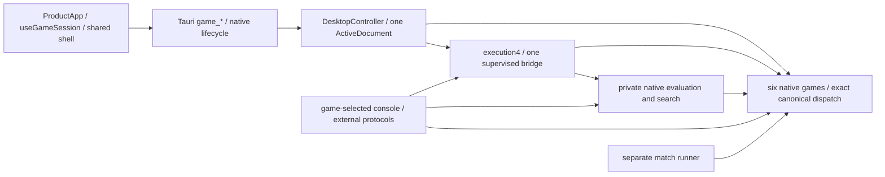

# MSH-108: architectural health after complete six-game delivery

Reviewed production/source integration: **`1d3920227bc376b5cc1694928597e7b5a1d5a864`**,
primary `codex/rewrite`, 5 November 2026. This is a diagnostic review. It changes
documentation and task evidence only. Fresh final independent assessment is
**approved**; normal evidence integration and final task closure are pending.
The findings below do not authorize a refactor or close M4.

## Verdict and scope

**The six-game architecture is coherent. No material architectural changes are
recommended as a prerequisite to M4 closure or the existing M5 pilot.** No
demonstrated current correctness or architectural blocker was found. Real Chu
and both Tenjiku profiles fit the accepted native/application boundaries without
a second rules engine, application owner or speculative variant framework.

There are useful bounded performance and maintenance investigations: Chu ordinary
replay retains unnecessary undo snapshots; supervisor response decoding has a
synchronous cancellation boundary; repeated history/context reconstruction and
complete-choice processing deserve measurement before M5 optimization. These
are specific advisory findings, not proof of incorrect rules, broken saveability,
a violated deadline or a requirement to refactor every similar-looking module.

All six games are delivered: Chess, Standard Shogi, Xiangqi, Tori Shogi, Chu
Shogi and Tenjiku Shogi. Tenjiku has two immutable whole profiles,
`mshogi.tenjiku.adams1999-modern.v1` and
`mshogi.tenjiku.muller-completed.v1`, not independent rule toggles.
This report assesses ownership and current consumers; it does not recertify
every rule, claim competitive strength or accept the entire M4 milestone.

The starting tree was clean and origin-aligned. MSH-108 was Ready/unassigned,
with46/106/107 Done; it was activated as `@codex` in the primary checkout. The
unrelated `codex/tenjiku-historical-access` worktree was preserved. No new
worktree, app launch, refactor or platform campaign was needed. Compatible
Backlog1.55.1 was used for task mutations; PATH1.55.0 was not used to write records.

## Authority, evidence and previous-finding reconciliation

Design A-01–A-10, the [conformance policy](../testing/conformance-policy.md) and
the current [shared delivery record](../m4/shared-integration/README.md) govern.
The [MSH-89 contract review](../m4/shared-integration/contract-review-89.md)
already reconciles native identity, compatibility, capacities and real packaged
integration. Here those conclusions were checked against actual source and
extended with a six-game responsibility/performance diagnostic.

The exact accepted runtime/platform campaign source is
`bc92bfe5e3b20e9e999df12cbf54b91682c71b8d`. Its difference from this reviewed
integration in runtime/test/frontend/host/observer/workflow inputs is only four
neutral `GameKind` rustdoc descriptions. The immutable
[MSH-88 record](../m4/shared-integration/verification.json), MSH-89 report/index
and MSH-46 acceptance are reused with their actual sources and qualifications.
This diagnostic neither rewrites them nor creates a second platform ledger.

| Earlier finding / recommendation | Current classification and concrete disposition |
| --- | --- |
| [106 F01/P1](architecture-health-106.md), duplicated board interaction | **Resolved** by [R5/120](native-choice-controller-120.md). Chess, Shogi/Tori, Xiangqi and Chu/Tenjiku adapters now all reach `useNativeChoiceController`; none owns another selection/inspection lifetime. |
| 106 F02/P2, two Chess frontend sessions | **Resolved** by [R4/119](frontend-application-119.md). One `ProductApp` mounts one `useGameSession`; `ApplicationView` supplies the common shell. The old `App/useNativeSession` production path is absent. |
| 106 F03/P3, common lifecycle mixed with dormant Chess/native overlays | **Resolved at the ownership boundary** by [R3/118](native-application-118.md). One `ActiveDocument` and `RuntimeMetadata`; no dormant Chess payload for other games. Concrete New paths intentionally differ from the sole validated current-file Load installer. Remaining native adapters are acceptable, not evidence that every command must call one function. |
| 106 F04/P4, resource facts inferred from strings | **Resolved**: `resource.rs::ResourceFact/ResourceFailure` and frontend `nativeCapacityReached/NativeRecovery` consume typed native facts. Unknown/multiple causes remain explicit; error text is not a rules or capacity oracle. |
| 106 F05/P5, protocol worker duplication | **Advisory improvement remains**, narrowed to actual identical USI/Xiangqi mailbox mechanics. External grammar/timing/results and the internal one-shot execution family retain different consumers. See F04 below. |
| 106 F06/P6, synthetic-only complete compound handoff | **Resolved** by actual Chu and both Tenjiku native actions/effects/history, search, records and desktop consumers. Synthetic256-square/route cases remain labelled supplementary evidence. |
| 106 F07/P7, measure history/replay/node costs | **Still present but acceptable / advisory**. Actual later native/document/choice measurements now qualify the risk. They do not attribute total runtime to one clone or establish strength; see F01–F03. |
| 106 F08/P8, stale temporal comments and justified native differences | **Partially resolved**: the four stale `GameKind` comments were corrected in89. Some module/stage comments remain stale; F04 records their low-risk scope. Different native types, renderers and layouts remain acceptable. |
| 106 V01/P9, historical Linux selector failure | **Resolved as a delivery verification gate**, with original failure preserved and later accepted P9/R6/88 actual-platform evidence. No retrospective cause or runner-race fix is inferred from passing runs. |
| [115](architecture-target-115.md), pre-release policy correction | **Implemented accepted target** through [R1/116](execution-migration-116.md), [R2/117](desktop-envelope-117.md),118–120 and [R6/121](architecture-acceptance-121.md). Old advice to retain development readers/facades is **no longer applicable** after owner A-09/A-10. Necessary native semantics survived; obsolete internal encodings did not. |
| [107 F01](architecture-health-107.md), ordinary replay retaining undo | **Advisory remains for Chu; addressed in Tenjiku**. Chu retains growing full `GameData` undo snapshots; Tenjiku ordinary replay explicitly does not retain undo handles. Xiangqi already separates the paths; Tori handles are compact. See F01. |
| 107 F02, noninterruptible replay units | **Partially improved**, not universally resolved. Tenjiku native/document APIs have cooperative stop checkpoints; ordinary supervisor Serde decoding still uses default uninterrupted canonical replay. See F02. |
| 107 F03, synchronous inspection / choice cost | **Measured and narrowed; advisory remains**. Native query/serialization, offline mutex and DOM samples now exist. They are different measurements and do not establish worst-case end-to-end UI latency. See F03. |
| 107 F04, helper duplication / stale comments | **Partially resolved / low advisory**. `GameKind` wording is current; strict duplicate visitors and external protocol mailboxes remain narrow opportunities. Native projection/search differences do not justify forced unification. |
| 107 prospective Tenjiku stress table | **Delivered, no longer a readiness prediction**: actual16×16/156-piece/two-profile native, execution, documents, console and traditional-kanji product evidence now exists. It is not upgraded to unlimited scalability or complete accessibility. |

The [architecture-health roadmap](../architecture-health-roadmap.md) retains
108 before47 and the separate48/109 M5 diagnostic sequence. No recommendation
above adds a dependency, reopens a completed rules decision or makes a future
large historical variant a current design requirement.

## Current dependency and ownership map

Fresh offline Cargo metadata for both workspaces confirms normal dependency
direction: core→serde/serde_json; search→core; engine→core/search;
desktop-session→core/engine; console→core/search/engine. Console's desktop-session
dependency and core's conformance-harness dependency are **dev-only**. The match
runner→core/serialization/hashing, not desktop-session. The standalone Tauri host
normally depends on desktop-session/Tauri/dialog; tauri-build is build-only.
No core/search runtime depends on React, Tauri, console I/O, Python, Node or an
external game engine. Fixture assertion machinery is not another rules engine.

### Native state, complete actions and transitions

Paths below are relative to `crates/mshogi-core/src/`; one-based anchors refer
to the reviewed source, not a historical report. Native layout differences are
intentional. Position, history and runtime authority are separate concepts.

| Game | State / original and promoted identity | Complete actions, movement and effects | Legality and exact transition owner |
| --- | --- | --- | --- |
| Chess | `chess/mod.rs:173 Position`: board, turn, castling/EP/counters. Promotion changes native kind; no need to preserve Shogi-style original base identity. | `action.rs:40 Action`, `:161 Resolved`: derive capture, EP, rook movement, promotion and rights. `generate.rs:94 candidates`; `attack.rs:30 attackers`. | `legal.rs:72 legal_actions`; `action.rs:203 apply/:242 undo`. Local value-based reversal is not a host execution token. |
| Standard Shogi | `shogi/mod.rs:218 Piece/:328 Position`: base kind, promoted flag, hands and turn. Captures demote into the native hand resource. | `action.rs:8 Action::Move/Drop/:150 apply_structural/:253 geometrically_reaches`; `legal.rs:31 attackers/:63 pseudo_legal_actions`. | `legal.rs:105 legal_actions/:124 apply/:162 undo`; native king safety and finite pawn-drop-mate response logic. |
| Xiangqi | `xiangqi/mod.rs:271 Position`; native General/piece identities and intersections; no promoted-face abstraction imported from Shogi. | `action.rs:7 Action/:52 ActionEffects/:93 ResolvedAction`; screens, horse legs and elephant eyes in `legal.rs`. | `legal.rs:174 pseudo_legal_actions/:204 legal_actions/:247 resolve_action/:264 apply_resolved`; `action.rs:180 commit_resolved/:197 undo` bind before/after values. |
| Tori | `tori/mod.rs:139 Face/:259 Piece/:380 StructuralState/:400 Position`; handed Quails, native promotions and hands retain identity. | `mod.rs:578 Action`; `transition.rs:71 Effects/:139 resolve_structural`; `legal.rs:213 attackers/:223 legal_actions`. | `legal.rs:236 apply/:245 undo/:249 redo`; native instance/branch reversal, private clone authority and complete effects. |
| Chu | `chu/position.rs:135 Base/:275 Face/:410 Piece/:612 StructuralState/:620 Position`; original base and once-promoted face remain distinct. | `chu/legal.rs:10 Action/:70 Effects/:243 legal_actions/:304 capture_influence/:331 inspection/:448 resolve`; ordered Lion landings/victims/returns/rights. | `legal.rs:354 apply/:382 undo/:411 redo`; capture-based rules do not inherit Chess self-check. Multiple native royals and Lion protection remain native. |
| Tenjiku, both profiles | `tenjiku/position.rs:7 Profile/:388 StructuralState/:419 Position/:424 standard/:591 install`;256 cells,156 initial pieces, serial/base/promoted/refusal data and root provenance. | `legal.rs:18 Action/:110 EffectPhase/:141 Effects/:250 LocalPosition/:306 legal_actions_metered/:354 geometry_actions_from_metered/:373 inspection_metered/:1101 resolve`; ordered travel/igui, ranked jumps and native burn/destruction/promotion effects. | `legal.rs:465 apply_with_stop/:494 undo/:523 redo`; `game.rs:507 legal_actions_with_stop/:566 submit_with_stop` adds full-history admission. No frontend victim list or route endpoint defines legality. |

### History, replay, diagnostics and native outcomes

| Game | Full game/history/adjudication owner | Canonical replay and diagnostics |
| --- | --- | --- |
| Chess | `chess/game.rs:80 Game/:173 apply/:189 undo`; `adjudication.rs:262 AdjudicatedGame/:399 apply/:417 undo`; `matchplay.rs:263 ChessMatch/:392 submit`. Claims/intended claims, policy, clocks and actors are not board moves. | `record.rs:302 from_json/:379 replay_history`; `adjudication.rs:446` adjudicated replay; `matchplay.rs:617` complete request/reply replay with between-event stop checks. `perft.rs:82/94` is position traversal, not match adjudication. |
| Shogi | `shogi/game.rs:312 Game/:420 submit/:492 undo`; native repetition/check history and formal declaration/invalid-declaration semantics. | `record.rs:146 from_json/:158 to_game` validates derived prefixes/events. `perft.rs:39/44`; console `shogi_session.rs:269` labels local counts. |
| Xiangqi | `xiangqi/game.rs:334 Game/:739 submit/:897 undo`; conduct, warnings, obligations/claimants and pending assessments stay native. Committed prefix `:936` differs from immutable intra-command prefix `:974`. | `record.rs:157 replay_with_undo/:224 to_game_with_undo/:228 to_game`; ordinary replay avoids undo retention. `perft.rs:55/59`; console `xiangqi_session.rs:453` separates exact proof from installed outcomes. |
| Tori | `tori/game.rs:300 Game/:414 legal_actions/:495 submit/:664 undo`; must-vary admission, repetition forfeit and stalemate loss remain its own rules. | `record.rs:205 from_json/:209 to_game/:216 replay`; every event/final redundant field checked. `perft.rs:140/151` has typed depth/visit bounds; console diagnostics exclude game history/outcomes explicitly. |
| Chu | `chu/game.rs:328 GameData/:359 Game/:488 legal_actions/:614 submit/:833 undo/:862 redo/:981 adjudicate/:1032` finite reply simulation. Native multiple-royal/capture-all, repetition obligations and actual draw commands. | `record.rs:138 from_json/:142 to_game/:149 replay`; derives complete events/effects and fresh authority. Production local traversal is console `chu_session.rs:427`; `chu/conformance.rs:102` is the separate fixture consumer. Absence of core `perft.rs` is not a defect. |
| Tenjiku | `tenjiku/game.rs:173 RepetitionKey/:208 RuntimeToken/:214 GameContext/:282 Game/:425 event_prefix/:460 record_prefix_with_stop/:848 undo/:944 adjudicate`; native royal survival, simultaneous outcomes, profile history and first-recurrence prohibition. | `record.rs:17 GameRecord/:193 from_json_with_stop/:208 to_game_with_stop/:215 replay`; derived ordered effects/events and redundant fields revalidated. `perft.rs:191/210` bounded stop-aware traversal; notation/console expose complete routes/effects without another resolver. |

Malformed/stale boundary rejection is atomic. Native domain events such as a
false declaration or WXF audit/penalty are not reinterpreted as generic
transport rejection. Local semantic undo, saved/repetition identity and monotonic
host request authority are intentionally different; reopening/Take back retires
runtime work even when it restores the same semantic board/history.

### Evaluation, search and execution

All six searches call native legality/submit/undo. None implements a second
adjudicator or board-only transposition table. Evaluators are transparent native
baselines, not learned or measured-competitive engines.

| Search within `crates/mshogi-search/src/` | Current boundary and important distinction |
| --- | --- |
| Chess `chess.rs:57 evaluate`; `search.rs:106 search_with_stop/:166 ChessTree/:233 negamax` | Private `AdjudicatedGame` clone; claims compete at zero where native policy allows; terminal precedence and unwind preserved. |
| Shogi `shogi.rs:70 evaluate/:176 search_with_stop/:329 descend/:345 minimax` | Native Game clone/history; formal same-turn declaration is not blindly negated as an ordinary alternating move. |
| Xiangqi `xiangqi.rs:54 evaluate/:197 search_with_stop/:213` exact-root operation `/:370 descend/:398 minimax` | Canonical private reconstruction, unresolved assessment clears decision/score/PV; exact Unknown is not a draw or ordinary search result. |
| Tori `tori.rs:54 evaluate/:139 search_with_stop/:259 Tree/:287 minimax` | Private native reconstruction, complete push/pop and restoration checks; native terminal semantics. |
| Chu `chu.rs:60 evaluate/:141 search_with_stop/:259 Tree/:286 minimax` | Complete native routes/history and undo before propagating interruption; unconcluded NoBoardActions is an unscored error, not invented mate/stalemate. |
| Tenjiku `tenjiku.rs:66 evaluate/:148 search_with_stop/:269 Tree/:282` Game adapter | Profile-qualified private full-history Game, native terminal band/root perspective, bounded full-width iterations and exact semantic/snapshot restoration. No completed iteration means no fabricated move/score/outcome. |

`mshogi-core/src/native.rs:41 RulesProfile/:165 CanonicalRecord/:271
from_json_with_stop` dispatches concrete native payloads with strict profile,
edition/schema and duplicate-field checks. `mshogi-engine/src/shared.rs:22
execution_capabilities/:92 ExecutionContext` carries complete history, purpose,
target, limits and request/session/process identity. Protocol4 and durable
observation schema1 are separately versioned. `server.rs:16 serve_once` dispatches
six concrete search operations; `bridge.rs:76 EngineBridge/:105 submit/:135
cancel/:188 worker` owns one pending/completed supervised family and cleanup.

Responses remain proposals until exact context/family and native continuation
validation. Tenjiku `engine/tenjiku.rs::TenjikuResult::validate_with_work` validates
PV/leaf/terminal consistency, not heuristic optimality. Read-only analysis cannot
commit play; incomplete/failed work is not a native outcome. Old same-board,
wrong-profile/history or retired process results cannot acquire current authority.
F02 below qualifies cooperation during response deserialization.

The standalone game-selected console (`mshogi-console/src/main.rs:239/273`) uses
these same authorities. UCI/USI and Xiangqi's actual external protocol adapters
remain separate grammars. Chu/Tenjiku complete notation/internal execution do not
invent an unsupported UCI/USI route encoding. The external match runner has its
own timed/untimed reporting and does not own the desktop runtime.

### Application, documents, capabilities and frontend

| Responsibility / actual consumer | Current owner and assessment |
| --- | --- |
| Accepted runtime and document | `desktop-session/src/lib.rs:290 RuntimeMetadata/:346 ActiveDocument/:1207 DesktopController`. Exactly one native variant; private Chess `DesktopSession:312` is only its payload. `shared.rs:908 SharedState` holds cache/admission bookkeeping, not another game. Worker candidates and historical query copies are not accepted owners. |
| Admission/lifecycle/install | `shared.rs:1219 shared_command`, `shared_transaction.rs:36 finish_native_transaction`, bounded candidate/admission/file workers and `lifecycle.rs::ApplicationLifecycle`. `persistence.rs:1664 install_document` is the sole validated current-file Load transaction with fresh floors/headroom, stopped work and historical observations. Admitted Shogi/Xiangqi New paths deliberately differ under the same owner. |
| Current records/envelope | `document.rs:16 DocumentEnvelope/:26 parse/:57 encode`, one `mshogi.desktop.document.v1` version1, native RawValue payload and strict identity. Concrete Chess/Shogi/Xiangqi/Tori/Chu/Tenjiku document codecs retain native replay/journals/settings/observations/branches. One outer format is not one rules replay algorithm. |
| Compatibility | Native Chess M2/schema1 and Full/schema2 remain supported at their documented core/analysis scopes. Console restore is M2 move/history scope; desktop live restore is untimed M2. Historical bounded Full analysis remains supported. Development desktop archives1/2/3 and execution1/2/3 remain intentionally retired; unsupported/lossy conversions reject. No legacy reader is restored here. |
| Capacity / atomic I/O | Native per-game budgets plus common16MiB/256 observations/8192 controls; typed `resource.rs` facts. Cooperative15s worker classification in `persistence.rs:357` preserves already committed Save; same-directory exclusive temporary file/flush/sync/rename is the commit boundary. Failed validation/install preserves accepted history/identities/dirty/path/prior file; I/O receipt revisions may advance honestly. |
| Capability discovery | Concrete `GameKind/RulesProfile/NativeSide`, engine operation lists, `shared.rs:192 CommandCapabilities/:504 SharedSnapshot` and supported-only frontend chooser. Ordinary turn/analysis for all six; Chess Full and Xiangqi exact remain separate meanings. Presence of a generic tag never advertises an unimplemented mode. |
| Frontend session and shell | `desktop/src/product/ProductApp.tsx:26/27` mounts one `useGameSession`; `useGameSession.ts:6/19/35/54` owns polling, receipt acceptance, serialized operations and exact rendered authority. `ApplicationView.tsx:14/39` supplies one `ApplicationShell`; `NativeSessionPanels.tsx:28/63/98` owns history/recovery/analysis, `GameCapabilities` native actions, `GameFrame` common board/player/status slots. |
| Board / choice / inspection lifetime | `GameBoard.tsx:12` chooses square/intersection/kanji/hand adapters. All reach `interaction/useNativeChoiceController.ts:44`, whose ordered-prefix/completion/submission/generation/focus lifetime uses opaque native choices. `useMovementInspection` validates supplied identity/read-only scope without another generation owner. No frontend legal generator or effect adjudicator. |
| Native inspection and presentation | Host `main.rs:195/202/425` invokes `shared_inspection.rs:46` under the controller lock. Chu/Tenjiku native inspection supplies complete read-only choices; ordinary large-game snapshots cache worker-built choices and polling clones them. `shared_tenjiku_presentation.rs:121 choice/:169 inspect/:252 tenjiku_snapshot` preserves stationary targets, original faces/royals and ordered effects. F03 qualifies cost. |

Tagged matches at codec, execution, session, presentation and command boundaries
are necessary translations between real consumers, not six applications. Large
source modules warrant navigation/isolated-test attention but are not defects
merely because their filenames differ. There is no case for a universal native
Position/Action/history/search/event model: claims/clocks, hands/declarations,
WXF conduct, Lion rules and profile-dependent Fire Demon effects differ materially.

## Tenjiku stress assessment

- **State and identity:**16×16 is256 cells with156 initial pieces, not256 pieces.
  Original serial/base, promoted face and refusal rights are native fields.
  The selected whole profile survives root/current/retired/observation histories
  and search nodes. Repetition keys intentionally differ from full search/saved
  identities; no board-only cache shares results between incompatible histories.
- **Complete action versus effects:** ordered landings distinguish equal endpoints
  and returns; stationary captures carry a target without fictitious movement.
  Ranked interveners/destination admission, Lion/Hawk/area routes, burn victims,
  mover destruction and surviving promotion are resolved natively. Frontend
  geometry projects these facts; it does not infer them from SVG locations.
- **Royal/history semantics:** multiple royals, simultaneous survival/loss and
  history-dependent admission stay in Game. Neither Chess single-king safety nor
  Chu repetition policy is silently inherited. Canonical replay rederives effects
  and outcomes, including both profiles' distinguishing cases.
- **Undo and cooperation:** compact `GameUndo` (`game.rs:243`) and shared immutable
  snapshot ownership (`:287`) avoid Chu's retained full-undo replay pattern.
  `record.rs:208/215` ordinary replay uses `retain_undo=false`; explicit undo
  reconstruction remains available. Native/prefix/PV/document APIs carry stop
  predicates. Transactions still copy event/key vectors (`game.rs:546`); complete
  observation contexts and branches still cost real bytes/work. F01/F02 remain
  qualified, not blanket resolved.
- **Resource ownership:** native1MiB/1024 events/512M units are separate from
  whole-document16MiB/4096 retained events/8192 controls/256 observations/160M units
  and the15s worker deadline. `tenjiku_document.rs:688 validate/:941 reserve`
  charge native records, retained branches, journal/selected-prefix/PV replay and
  fresh installation. Native `game.rs:779 capacity_usage_with_stop` and document
  reservation exercise all eight actor combinations of actual ending commands,
  early/final Close and widest identities. `:665 with_reserved_close` consumes
  prepared Close without replay on Quit. The rejected provisional600M policy
  remains failed historical evidence, not a new accepted allowance.
- **Actual product:** search/result observation precedes the accepted engine Play
  in one admitted candidate; analysis remains read-only. The real traditional-kanji
  board uses `TenjikuBoard→NativeBoard→Board` and the same choice owner.156 piece
  identities,256 targets and dense routes are actual consumers; synthetic dense
  stress roots remain labelled. Owner760×650 minimum/readability qualifications
  are retained; about960×1000 is recommended only. No comprehensive screen-reader
  or future larger-variant scalability claim follows.

## Current findings and bounded recommendations

Severity below describes observed structure/operational risk. **No finding is a
demonstrated M4 correctness or architectural blocker.** Proposal labels are
report-local recommendations, not new tasks, reserved IDs or dependencies.
Apply: "Generalize when multiple real consumers demonstrate the same semantics,
not merely similar-looking code."

### F01 — Moderate advisory: replay/context/transaction cost, with game-specific undo retention

**Evidence and consumers.** Chu `record.rs:142–149/173–192` ordinary reconstruction
collects every `GameUndo`; each owns growing prior `GameData` (`game.rs:328–345`),
including events/keys/plies/snapshots. This retains at least quadratic event-prefix
entries before caps. Engine root reconstruction, document validation, selected
prefixes and history analysis are actual consumers. Peak memory and attribution
of elapsed time to this retention remain unmeasured. Do not generalize this
specific retention pattern to compact Tori tokens, Xiangqi's no-retained-undo
ordinary path, or Tenjiku's already separated replay.

Repeated canonical reconstruction and candidate saveability are also real costs:
Shogi before/after undo snapshots, Xiangqi/Chu native transaction copies and
Tenjiku `copy_for_transaction`, retained observation contexts and repeated
prefix/PV validation. They protect current semantics; their existence does not
prove bad accounting. Search ancestry storage and ordinary replay retention are
different costs.

**Disposition / proposal P1.** Carry a bounded Chu replay-cost/no-retained-undo
investigation into an owner-selected follow-up or the existing48/109 measurement
sequence. Keep the explicit undo-returning API. Separately profile native node,
history/context, document and memory costs for other actual consumers before
choosing changes. Expected benefit is lower transient replay memory/work; no
speed or strength gain is promised. Affects native replay, console restoration,
search roots and desktop Open/Save/history. Regression risks are changed native
events/bytes, undo ownership, false rejection/acceptance and saveability headroom.
Validate differential exact records/snapshots, forged input rejection, fresh
identities, actual apply/undo, successful representative documents versus typed
near-limit refusal, dirty/prior-file preservation and real ending/Close reserves.
Do not skip authoritative replay, trust imported cached conclusions or raise caps.

### F02 — Moderate advisory: cooperative cancellation has remaining synchronous units

**Evidence and consumers.** Tenjiku stop predicates now reach replay/event,
generation/resolution, prefix and document/PV operations. Chess complete match
replay checks between events. Older native replay paths and strict JSON passes,
serialization and exact undo retain finite synchronous units. Most notably,
`engine/bridge.rs:461` uses ordinary Serde response deserialization;
`core/native.rs:417/422` reconstructs the echoed `CanonicalRecord` through default
`:266 from_json`, whose stop predicate is false. The bridge checks cancellation
and watchdog around, not within, this complete native reconstruction. Killing a
child does not interrupt Rust replay already running in its supervisor thread.

**Risk and disposition / P2.** Metadata cancellation and full-context stale-result
suppression remain sound; a superseding worker request can still wait for a
current finite decode. No measured current deadline breach or unbounded operation
was established. Consider a bounded response-decode/stop-latency investigation
only if measured workloads warrant it, retaining one family and native authority.
Expected benefit is finer cooperation, not different outcomes. Affects engine
supervision and native decoders across games. Risks include partial validation,
incorrect timeout/cancellation classification, leaked processes or accepting a
retired result. Verify cancellation during decode, replacement/New/Close, exact
late-context rejection, watchdog/cleanup, strict malformed/duplicate rejection
and committed-Save handling. Do not invent hard-real-time guarantees or change a
deadline merely to pass a probe.

### F03 — Moderate, measured-and-qualified advisory: synchronous inspection and complete-choice costs

**Evidence and consumers.** Host `game_inspection/inspect_game` holds the same
controller mutex used for commands/snapshots while native inspection derives
choices. Native queries are read-only and token-qualified. Tenjiku ordinary
snapshots cache worker-built choices; polling still clones/serializes results.
Frontend `useNativeChoiceController.ts:44/48/93/108` builds a semantic JSON context,
filters full alternatives and checks exact complete membership. `TenjikuBoard`
looks up native identities/royals for each rendered piece. These are concrete
work sites, not newly timed bottlenecks.

Existing native/DTO/serialization, offline mutex and jsdom samples are described
below; they narrow107's wholly unmeasured concern. They do not measure worst-case
Tauri/WebView latency, isolate browser render allocations or establish a stall
at delivered sizes. Choice count, context size/history and selected piece matter,
not merely board dimension. A larger future variant is not authorization to
prebuild pagination, a plugin framework or a new inspection owner.

**Disposition / P3.** Use existing M5 measurement work to separate native query,
mutex hold/wait, exact choices/effects serialization, IPC and actual WebView
interaction/render cost on representative and adversarial roots. If needed,
copy an immutable query input under the lock and compute off-lock, or reduce
proven duplicate projection work, while keeping the sole inspection lifetime.
Expected benefit is responsive controls under measured load. Affects every
renderer, especially dense Chu/Tenjiku. Risks are stale query authority, incomplete
choices, lost route alternatives and focus/inspection corruption. Verify exact
document/profile/history/selection/orientation retirement, no mutation/action
authority, all routes/completions, pointer/keyboard and actual packaged controls.
Never silently truncate legal choices; a changed refusal policy needs its own
concrete contract decision.

### F04 — Low advisory: narrowly duplicated mechanisms and remaining comment drift

**Evidence and consumers.** Tori `record.rs:286`, Chu `:236`, Tenjiku `:335` and
the desktop envelope have recursive duplicate-key syntax visitors. These share
syntax semantics, but native profiles/errors/limits/replay do not thereby become
one record model. USI `usi.rs:33–104` and Xiangqi `xiangqi_uci.rs:34–105` repeat
the small mailbox/search/retire/shutdown mechanics for real protocol consumers.
Native finite-reply projection and similar minimax recursion retain important
event/turn/adjudication differences; no discrepancy was found requiring unification.

`core/native.rs` availability comments are now accurate after89. Remaining examples
of temporal drift are `core/lib.rs:8–9` calling full adjudication subsequent work,
`:30` saying Tori full-game consumers are later, and
`shared_tenjiku_presentation.rs:1` referring to MSH-44 as future work. Actual
capability dispatch and delivered behavior are not missing because of those comments.

**Disposition / P4.** Optional private syntax/mailbox extraction or mechanical
comment refresh when touching those real consumers. Expected benefit is less
drift and clearer navigation; no performance or strength benefit is established.
Risks are parser acceptance changes, mismatched native diagnostics and stale
protocol completion/shutdown. Focused validation: nested/escaped-equivalent
duplicates, unknown/missing/trailing/numeric JSON across affected parsers; actual
external stop/replacement/new-position/quit/no-completed-iteration cases; source
capabilities/rustdoc for comment-only work. Do not merge internal one-shot and
external persistent processes or impose common game semantics to remove lines.

## Measurements, limitations and M5 readiness

Measurements below are **reused historical observations**, not new benchmarks.
Their commands, source/hash scopes and environments are in the linked single
records. They separate genuine accepted journeys from constructed stress data.

| Existing evidence | Observation useful to this diagnostic | Scope and limitation |
| --- | --- | --- |
| [Chu engine contract](../m4/chu/engine-v1.md),107F01 | Debug selected-history decode773ms at12 actions/12 observations,5112ms at32/32;32/32 encoded651611 bytes/534616 units, retained Take back675048 bytes/541771 units. | Specific accepted local fixture/history costs, not a peak-memory measurement, attribution to undo alone or a regression. Five earlier native/search directories remain unchanged since107's reviewed source. |
| [Tenjiku native record](../m4/tenjiku/native-verification.json) | Release128-action ordinary replay Adams275084µs/Muller278419µs; explicit Muller128 undo tokens40 inline bytes each,5120-byte vector. Native ending journeys reached1024 events. | macOS27.0.1/26A434 arm64 Rust1.99.1; vector excludes Game history/allocator overhead and process RSS is not isolated Game allocation. Current legal/position/record hashes match; Game later added repetition projection/cancellable-prefix support, so native87 timing is not relabelled a current whole-pipeline benchmark. |
| [Tenjiku shared measurements](../m4/tenjiku/shared-verification.json), `performance` | Standard156-origin native inspection totals2424/2373µs; offline mutex probe2808 inspection acquisitions/18 snapshot guards/6 contention pairs, maximum ordinary guard0.950416ms, worker1.024750ms, main wait1.033333ms. | Release source3a290024…; standard and explicitly synthetic dense roots/both profiles/three probe repetitions. Mutex worker timing includes synchronization send; serialization measured after unlocking. Excludes Tauri/IPC/WebView/deadline guarantees. Current four native files match shared measured hashes; product document/session/presentation later changed. |
| Same shared record, ReactProfiler | Settled DOM72.071/48.310ms for156 pieces/256 targets. | Node24/jsdom, not native WebView rendering or end-to-end interaction latency. |
| [Tenjiku product record](../m4/tenjiku/product-verification.json), preserved continuation measurements | Newer source2c00e210… projection sample standard per-origin maxima209/188µs; one synthetic dense-Hawk Adams sample1272µs. Four complete contexts accepted near152.8M units, fifth typed refusal preserved current acceptance. Open7055771/5664776µs, Save5930886/5615759µs, prepared Close415/430µs. | Local release samples; one genuine depth1 result at128-action root per profile, then explicitly synthetic nonce variants for repeated full-context/PV growth. Real ending/Save/stopped-reopen journeys separately pass. Newer product final sourceeca9f9c… reuses those scoped measurements; not all-boundary guarantees or newly run108 tests. |
| [Tenjiku engine contract](../m4/tenjiku/engine-v1.md) | Release standard depth1:70/74 choices,265.057/278.007ms.716-choice Area/Hawk:323.201/320.698ms.128-history roots:1319.073/1486.816ms. Depth2/2000 exhausted visits after completed depth1; standard about7.5s. | Local macOS27 arm64/Rust1.99.1, both profiles; exact caller restoration asserted. Defaults1/1024, analysis max2/2000 are measured functional bounds, not copied Chu/Tori budgets or competitive-strength results. |

The provisional600M Tenjiku context policy reached the independent15s deadline
around457M workloads and was rejected. Current160M successful representative
journeys and precise near-limit refusals remain distinct. An actual GUI Cancel
observation of983ms includes CUA input/state-observation overhead; it does not
isolate native stop latency. No108 peak-allocation, maximum accepted replay,
browser/WebView profiling, worst-case stop-latency or strength experiment ran.

M5 can work within the existing native/search boundaries: independent native
evaluators, private history-aware search and focused deterministic oracles are
present for all six games. Preserve profile/original-face/history rights in any
learned features or cache identity; same placement alone cannot represent Chess
claims, Shogi checking repetition, WXF conduct, Tori/Chu obligations or Tenjiku
profile/history admission. Benchmark generation/apply/undo/clone/replay/admission
and feature costs separately before selecting incremental storage, search reuse,
learned evaluation or persistent-process changes. No universal framework is needed.

This readiness verdict does **not** begin M5 or bypass its gates:48 remains the
existing experiment pilot;109 depends on108 and48 and must reassess actual pilot
evidence before substantial optimization49–55/104. Future Dai/Tai/Taikyoku direction
is deferred owner intent, not current authorization or evidence of scalability.

## Acceptable areas and unresolved issues

Reviewed and found acceptable: native game-owned rules/effects/history/outcomes;
separate original/promoted identities where meaningful; complete compound choices;
native exact reversal/replay; profile-qualified search and terminal semantics;
one shared application owner per accepted boundary; strict current records and
retirement of development formats; bounded atomic file/admission behavior;
actual ending/Close reserves; real console/protocol consumers; explicit capability
dispatch; shared shell and native renderers without frontend legality.

Conformance/search/application tests are independently isolatable. Examples
inspected, not rerun: Chess same-FEN/different-history search tests; Shogi formal
declaration/history/stop tests; Xiangqi pending/exact Unknown/claimant tests;
Tori/Chu independently solved finite search trees and mutation/reversal/history
fixtures; Tenjiku local/game/record/perft/conformance tests and both-profile
search/PV/resource tests; native envelope, seven-profile same-controller current
Load/stale-authority and frontend complete-route/inspection tests. Equal file
layouts or another engine are not conformance requirements. Fixture loading,
perft, search correctness, speed, strength and packaged integration remain
different forms of evidence.

**MSH-112 remains separately owned, To Do and unfixed.** Current
`mshogi-runner/src/run.rs:295–318` samples exit status after a write error and can
report unscored MissingResponse rather than UnexpectedExit; `process.rs:224`
has a separate bounded EOF/status path. This is consistent with historical
recurrences, not a new controlled reproduction or root-cause proof. Preserve
[R4 recurrence](evidence/msh119/runner-112-recurrence.json) and
[R6 failure](evidence/msh121/checks/native176-linux-failure.log.gz).
Later green runs do not fix the race. Desktop host/session runtime does not
depend on runner; it uses EngineBridge, with its own accepted process/identity
tests. No demonstrated architectural redesign requirement or material shared
application/rules outcome defect follows from that distinct diagnostic issue.
Keep its existing bounded reproduction/classification/cleanup work separate;
do not weaken assertions/timeouts, call it M5 tuning or invent a new closure gate.

Actual three-platform evidence remains MSH-88/46 at its exact tested source:
six required Rust/Desktop jobs passed; Windows/Linux49/49 packaged GUI phases
each, with labelled synthetic phases excluded as real-game proof. LocalmacOS27
actual interaction/four-file package equivalence remains separate from hosted
macOS15 native/build/package CI. Keyboard/accessible metadata are not a complete
screen-reader certificate; development signing is not notarized distribution.
Historical failed/cancelled/superseded jobs and excluded observer attempts remain
preserved. These qualifications are not a reason to repeat that campaign here.

## Verification, independent assessment and acceptance coverage

[evidence/msh108/verification.json](evidence/msh108/verification.json) records the
exact diagnostic source, actual local environment/commands/outcomes, scoped source
equivalence and unchanged evidence references. It contains new diagnostic checks,
not copied platform receipts. Required new CI jobs: **none**. No native rules,
search behavior, protocol4/schema1, current document envelope, resource allowance,
ending reserve,760×650 minimum or user-visible behavior changed.

Two read-only researchers started without integrator chat history:
`msh108_native_map` inspected five native/search boundaries and their unchanged
source since107; `msh108_tenjiku_stress` inspected actual Tenjiku native/search/
execution/document/presentation and scoped historical measurements. They changed
no files and ran no product test/benchmark campaign. Root inspected shared owners,
frontend/host/console/resource consumers, migration dispositions, metadata and
MSH-112. Source anchors were rechecked against current files rather than copied
unchanged from older reports. A separate fresh read-only reviewer,
`msh108_final_assessment`, **approved all eight original criteria and DoD1–3,
with no material factual or coverage gap**. It independently checked source,
earlier-finding dispositions, exact native/document reserves, performance-source
qualifications, six-game coverage, dependencies and unchanged contracts. Its
reviewed HEAD was `1d3920227bc376b5cc1694928597e7b5a1d5a864`; the reviewed report
candidate SHA256 was
`0cd2ebb3c850c4e82042ac51bbb7fe0d1f54450bbc9b2f5604890918486397f1`.
Actual read-only commands, environment and candidate file hashes are recorded in
the diagnostic index. No test/build/GUI/CI/benchmark was run by this reviewer.
DoD4 remains conditional on ordinary evidence integration/push and the durable
completion summary, rather than another product verification campaign.

| Original108 criterion | Evidence supplied by this report |
| --- | --- |
|1 six delivered games and earlier findings | Six-game native/search/application maps;106/115/107 reconciliation; no automatically required advisory implementation. |
|2 exact current responsibilities/consumers | Reviewed1d39202; state/actions/effects/generation/legality/undo/history/adjudication/records/diagnostics/search, dispatch, transport, capacity, capabilities, frontend and dependency maps. |
|3 duplication and premature abstraction | F01–F04, actual syntax/mailbox consumers, explicit native differences and rejected universal models. |
|4 coherent/testable responsibilities without file uniformity | Concrete native/service/frontend ownership and isolated test seams; Chu console traversal is a valid diagnostic consumer. |
|5 source-qualified findings and acceptable areas | Four advisory findings and sound-area inventory; separate rules/search/performance/strength/application/maintenance/future scalability claims. |
|6 benefits/risks/verification/bounded disposition | P1–P4 fields; optional follow-up scope, existing48/109 gates, no manufactured tickets or automatic refactor prerequisites. |
|7 diagnostic-only boundary | Documentation/task-only diff; no rule/contract/limit/behavior changes or substantial restructuring. |
|8 actual checks/reuse/independence/limitations | Structured diagnostic record, research and fresh final independent review, exact reused source/platform/measurement qualifications, explicit checks not run. |

MSH-47 remains To Do/unassigned/unstarted. After108 is Done it becomes
dependency-satisfied under its unchanged26/39/41–46/108 prerequisites and still
owns independent whole-M4 acceptance. This report does not perform47's review,
close M4, start M5 or authorize any recommendation's implementation.
