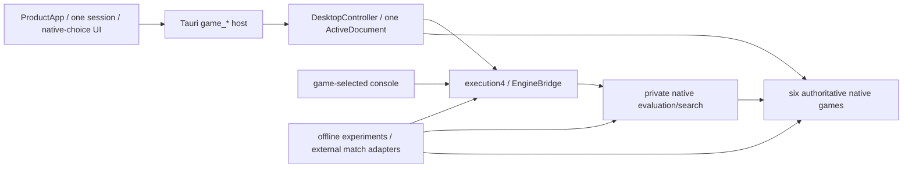

# MSH-109: architecture before substantial M5 optimization

Reviewed source: **`e161cef2935cd9b33449757699dba4ccfa0874dd`**, primary
`codex/rewrite`, 8 November 2026. This is a diagnostic report. It changes no
production behavior, rules, schemas, limits or acceptance requirements.
Independent final assessment is **approved**, with no remaining material findings, in the
[single verification record](evidence/msh109/verification.json).

## Verdict and authority

**The current six-game architecture is coherent. No material architectural
redesign or prerequisite refactor is demonstrated by the delivered MSH-48
consumer or its pilots.** Substantial M5 work can be scoped within the existing
native ownership and execution boundaries after this checkpoint. This is not a
strength, learned-evaluator or M5 completion verdict; MSH-56 remains that gate.

All six games and seven immutable whole profiles remain supported. Tenjiku's
Adams and Muller profiles remain distinct complete contracts. No board-only
search identity, universal rules framework, alternate application runtime or
Python product dependency was introduced by MSH-48. The new experiment adapter
owns offline orchestration, not legality or adjudication.

Design A-01–A-11, A-08's game-specific evaluator/shared infrastructure direction,
A-09's pre-release policy, D-09's unresolved empirical decisions and the
[conformance policy](../testing/conformance-policy.md) govern. Neither keeping
obsolete development interfaces nor deleting justified native differences is an
architecture goal. Deferred larger variants remain outside this assignment.

MSH-108 and MSH-48 are Done. The primary checkout began clean and origin-aligned
at the source above, with no In Progress task. MSH-109 was Ready/unassigned and
was activated for `@codex` there. The unrelated historical-access worktree was
preserved; no temporary worktree was needed. The compatible Backlog 1.55.1 CLI
was used instead of PATH's 1.55.0 for mutations.

## What changed since MSH-108

`git diff` confirms that `mshogi-core`, `mshogi-search`, `mshogi-engine`,
`desktop/src` and `desktop/src-tauri` are byte-identical to MSH-108's reviewed
source `1d3920227bc376b5cc1694928597e7b5a1d5a864`. Their current symbols and
responsibility boundaries below are therefore also directly source-qualified,
not predictions about future variants.

The production changes are the MSH-112 correction inside the existing runner
process/failure boundary and MSH-48's offline experiments. MSH-134's additions to
`desktop-session/src/persistence.rs` are test-gated; its history-view test
synchronization does not add a product persistence branch. Console's new runner
dependency is dev-only. No M4 product behavior is re-accepted by this review.

| Earlier finding | Current disposition |
| --- | --- |
| 106 F01–F04/F06 and 115/R1–R6 ownership migrations, reconciled by108 | Still resolved at their accepted boundaries. Actual native actions, one active document, one envelope, one frontend owner and one native-choice lifetime remain. A-09 supersedes old development-compatibility advice. |
| 107 F01 / 108 F01, replay/retained undo | Still advisory; Chu ordinary replay retains growing undo snapshots, Tenjiku and Xiangqi separate ordinary replay. MSH-48 supplies another real replay consumer, not a measurement of isolated allocation cost. See F01. |
| 107 F02 / 108 F02, cooperation | Still advisory. Stop-aware native Tenjiku paths remain; live bridge response decoding is unchanged. New strict offline observation import does not resolve live supervisor decoding. See F02. |
| 107 F03 / 108 F03, inspection and complete choices | Still a qualified UI-cost advisory. MSH-48 turn times measure different work and cannot resolve it. See F03. |
| 107 F04 / 108 F04, narrow duplication/comment drift | Still low advisory. New experiment dispatch is justified; syntax/mailbox opportunities remain narrower than game semantics. See F04. |
| 108's then-unfixed runner race112 | Resolved by actual correction `44c86b01428ca5f0de56fdb96cbe7e5b013677ea`, controlled ordering tests and accepted platform evidence. This is not merely a passing retry; see [MSH-112](runner-exit-112.md). |
| Later MSH-134 synchronization issue | Done at tested source `f426c67`, with its actual three-platform receipts and [review](history-view-134.md). Historical closure-withheld/unfixed text remains historical, qualified by the final updates. |
| M4 closure / future M5 prediction in108 | [MSH-47](../m4/final-delivery.md) subsequently accepted M4. MSH-48 is now delivered at production source `9a164eb4379231dcb4fca484adb7ec5597e7c991`; this109 report assesses its actual consumer and pilots. |

## Current dependency and responsibility map

Fresh **offline, locked, no-deps Cargo metadata** for both workspaces verifies
normal edges: core→serialization; search→core; engine→core/search;
desktop-session→core/engine; console→core/search/engine; and now
**runner→core/search/engine**, plus serialization/hashing. Runner uses native
search constants/limits and executes internal work through EngineBridge; it does
not bypass supervision. SHA is also a build dependency. Core→conformance,
console→desktop-session and **console→runner** are dev-only. The standalone host
normally depends on desktop-session/Tauri/dialog; tauri-build is build-only.
Core/search have no normal UI, console I/O, Python or opponent-engine dependency.
This corrects108's older runner→core-only map.

### Native state, actions, legality and exact reversal

The paths in the next two tables are relative to `crates/mshogi-core/src/`.
They identify actual source symbols at the reviewed revision, without requiring
identical native layouts.
| Game | State / original and promoted identity | Complete actions, movement and effects | Legality and exact transition owner |
| --- | --- | --- | --- |
| Chess | `chess/mod.rs:173 Position`: board, turn, castling/EP/counters. Promotion changes native kind; no need to preserve Shogi-style original base identity. | `action.rs:40 Action`, `:161 Resolved`: derive capture, EP, rook movement, promotion and rights. `generate.rs:94 candidates`; `attack.rs:30 attackers`. | `legal.rs:72 legal_actions`; `action.rs:203 apply/:242 undo`. Local value-based reversal is not a host execution token. |
| Standard Shogi | `shogi/mod.rs:218 Piece/:328 Position`: base kind, promoted flag, hands and turn. Captures demote into the native hand resource. | `action.rs:8 Action::Move/Drop/:150 apply_structural/:253 geometrically_reaches`; `legal.rs:31 attackers/:63 pseudo_legal_actions`. | `legal.rs:105 legal_actions/:124 apply/:162 undo`; native king safety and finite pawn-drop-mate response logic. |
| Xiangqi | `xiangqi/mod.rs:271 Position`; native General/piece identities and intersections; no promoted-face abstraction imported from Shogi. | `action.rs:7 Action/:52 ActionEffects/:93 ResolvedAction`; screens, horse legs and elephant eyes in `legal.rs`. | `legal.rs:174 pseudo_legal_actions/:204 legal_actions/:247 resolve_action/:264 apply_resolved`; `action.rs:180 commit_resolved/:197 undo` bind before/after values. |
| Tori | `tori/mod.rs:139 Face/:259 Piece/:380 StructuralState/:400 Position`; handed Quails, native promotions and hands retain identity. | `mod.rs:578 Action`; `transition.rs:71 Effects/:139 resolve_structural`; `legal.rs:213 attackers/:223 legal_actions`. | `legal.rs:236 apply/:245 undo/:249 redo`; native instance/branch reversal, private clone authority and complete effects. |
| Chu | `chu/position.rs:135 Base/:275 Face/:410 Piece/:612 StructuralState/:620 Position`; original base and once-promoted face remain distinct. | `chu/legal.rs:10 Action/:70 Effects/:243 legal_actions/:304 capture_influence/:331 inspection/:448 resolve`; ordered Lion landings/victims/returns/rights. | `legal.rs:354 apply/:382 undo/:411 redo`; capture-based rules do not inherit Chess self-check. Multiple native royals and Lion protection remain native. |
| Tenjiku, both profiles | `tenjiku/position.rs:7 Profile/:388 StructuralState/:419 Position/:424 standard/:591 install`;256 cells,156 initial pieces, serial/base/promoted/refusal data and root provenance. | `legal.rs:18 Action/:110 EffectPhase/:141 Effects/:250 LocalPosition/:306 legal_actions_metered/:354 geometry_actions_from_metered/:373 inspection_metered/:1101 resolve`; ordered travel/igui, ranked jumps and native burn/destruction/promotion effects. | `legal.rs:465 apply_with_stop/:494 undo/:523 redo`; `game.rs:507 legal_actions_with_stop/:566 submit_with_stop` adds full-history admission. No frontend victim list or route endpoint defines legality. |

### History, replay, diagnostics and native outcomes

| Game | Full game/history/adjudication owner | Canonical replay and diagnostics |
| --- | --- | --- |
| Chess | `chess/game.rs:80 Game/:173 apply/:189 undo`; `adjudication.rs:262 AdjudicatedGame/:399 apply/:417 undo`; `matchplay.rs:263 ChessMatch/:392 submit`. Claims/intended claims, policy, clocks and actors are not board moves. | `record.rs:302 from_json/:379 replay_history`; `adjudication.rs:446` adjudicated replay; `matchplay.rs:617` complete request/reply replay with between-event stop checks. `perft.rs:82/94` is position traversal, not match adjudication. |
| Shogi | `shogi/game.rs:312 Game/:420 submit/:492 undo`; native repetition/check history and formal declaration/invalid-declaration semantics. | `record.rs:146 from_json/:158 to_game` validates derived prefixes/events. `perft.rs:39/44`; console `shogi_session.rs:269` labels local counts. |
| Xiangqi | `xiangqi/game.rs:334 Game/:739 submit/:897 undo`; conduct, warnings, obligations/claimants and pending assessments stay native. Committed prefix `:936` differs from immutable intra-command prefix `:974`. | `record.rs:157 replay_with_undo/:224 to_game_with_undo/:228 to_game`; ordinary replay avoids undo retention. `perft.rs:55/59`; console `xiangqi_session.rs:453` separates exact proof from installed outcomes. |
| Tori | `tori/game.rs:300 Game/:414 legal_actions/:495 submit/:664 undo`; must-vary admission, repetition forfeit and stalemate loss remain its own rules. | `record.rs:205 from_json/:209 to_game/:216 replay`; every event/final redundant field checked. `perft.rs:140/151` has typed depth/visit bounds; console diagnostics exclude game history/outcomes explicitly. |
| Chu | `chu/game.rs:328 GameData/:359 Game/:488 legal_actions/:614 submit/:833 undo/:862 redo/:981 adjudicate/:1032` finite reply simulation. Native multiple-royal/capture-all, repetition obligations and actual draw commands. | `record.rs:138 from_json/:142 to_game/:149 replay`; derives complete events/effects and fresh authority. Production local traversal is console `chu_session.rs:427`; `chu/conformance.rs:102` is the separate fixture consumer. Absence of core `perft.rs` is not a defect. |
| Tenjiku | `tenjiku/game.rs:173 RepetitionKey/:208 RuntimeToken/:214 GameContext/:282 Game/:425 event_prefix/:460 record_prefix_with_stop/:848 undo/:944 adjudicate`; native royal survival, simultaneous outcomes, profile history and first-recurrence prohibition. | `record.rs:17 GameRecord/:193 from_json_with_stop/:208 to_game_with_stop/:215 replay`; derived ordered effects/events and redundant fields revalidated. `perft.rs:191/210` bounded stop-aware traversal; notation/console expose complete routes/effects without another resolver. |

Native domain commands are not all alternating board moves. Shogi formal
declaration, Chess claims/intended claims, WXF conduct/claimants/pending
adjudication, Tori/Chu repetition obligations and Tenjiku profile-qualified
history remain native. Rejected boundary proposals preserve the original state;
a native false declaration or WXF penalty is not a transport failure. Semantic
undo/reopen does not restore retired host request authority.

### Evaluation, search and future feature boundaries

Paths here are relative to `crates/mshogi-search/src/`. These modules are unchanged
from108. No trained feature ABI, model loader, quantizer, learned policy namespace,
incremental accumulator or Python/PyTorch binding is delivered.

| Game | Actual evaluator/search consumer | Context and outcome boundary |
| --- | --- | --- |
| Chess | `chess.rs:57 evaluate`; `search.rs:106 search_with_stop`, `:166 ChessTree`, `:233 negamax` | Private AdjudicatedGame; native optional claims and terminal precedence. |
| Shogi | `shogi.rs:70 evaluate`, `:176 search_with_stop`, `:329 descend`, `:345 minimax` | Native history/private Game; same-turn declaration considered separately before a static cutoff. |
| Xiangqi | `xiangqi.rs:54 evaluate`, `:197 search_with_stop`, `:213` exact-root operation, `:370 descend`, `:398 minimax` | Native full history, pending assessment and claims; unresolved work clears choice/score/PV. Unknown is not a draw. |
| Tori | `tori.rs:54 evaluate`, `:139 search_with_stop`, `:250 Tree/:259 Game adapter`, `:287 minimax` | Native reconstruction, complete actions and restored push/pop. Static cutoff is distinct from installed outcomes. |
| Chu | `chu.rs:60 evaluate`, `:141 search_with_stop`, `:249 Tree/:258 Game adapter`, `:286 minimax` | Native complete routes/history; root/positive-depth NoBoardActions is unscored, while depth-zero returns static evaluation before querying actions. See F05's qualified coverage question. |
| Tenjiku, both profiles | `tenjiku.rs:66 evaluate`, `:148 search_with_stop`, `:269 Tree`, `:282 Game adapter`, `:318 minimax` | Exact immutable profile/full-history Game, native terminal band, completed iterations and restoration. Native actions are queried before depth-zero cutoff to preserve the unresolved NoBoardActions distinction. |

The transparent evaluators are position-based material/hand/advancement baselines;
full-history search owns terminal/claim/admission semantics. Equal static scores
are not equal search states. A future evaluator can deliberately use a restricted
feature set, but training and inference must agree on that set and its label and
profile contract. It need not put every historical event into a tensor. Conversely,
a cache that reuses search results must not erase history-dependent legality or
outcomes merely because the evaluator is position-based. No board-only search
transposition table currently creates that hazard.

Base/promoted/original piece identity, drops/hands, ordered Lion/Hawk routes,
stationary capture, promotion/refusal rights, ranked jumping, burn/destruction,
royal survival and profile differences are native facts. Future features, action
targets and label construction must consume those native facts, not reconstruct
rules in Python or flatten complete commands into endpoint-only moves. Current
search/evaluation functions are concrete, small native interfaces; choosing an
injection interface, model layout or incremental representation before a selected
measured consumer exists would be speculative. MSH-55 owns that lifecycle.

### Shared execution, application and presentation

| Responsibility / real consumer | Current source anchors and delivered boundary |
| --- | --- |
| Profile/history and execution dispatch | `core/src/native.rs:41 RulesProfile`, `:165 CanonicalRecord`, `:271 from_json_with_stop`; `engine/src/shared.rs:22 execution_capabilities`, `:92 ExecutionContext`, `:108 valid_limits`; `server.rs:16 serve_once`. Six concrete searches,7whole profiles; protocol4 and durable observation schema1 are different versioned artifacts. |
| Supervision | `engine/src/bridge.rs:76 EngineBridge`, `:105 submit`, `:135 cancel`, `:161 shutdown`, `:188 worker`, `:205` current-request publication guard. Exact request/session/purpose/target/history/profile/generation identities retire stale work; native result admission is still required. |
| Console and external protocols | `console/src/main.rs:57` game selection, `:97` structured internal identity, `:239` native shell dispatch, `:283` internal-search. UCI/USI/Xiangqi grammars differ; no invented Chu/Tenjiku wire move. |
| One runtime and native document | `desktop-session/src/lib.rs:290 RuntimeMetadata`, `:346 ActiveDocument`, `:1207 DesktopController`; `shared.rs:908 SharedState` is cache/admission bookkeeping, not another application. Private DesktopSession is Chess's payload. |
| Commands, transaction and lifecycle | `shared.rs:1219 shared_command`; `shared_transaction.rs:36 finish_native_transaction`; `lifecycle.rs:17 ApplicationLifecycle`, `:36 reserve_command`, `:42 reserve_file`, `:106 approve_close`; `persistence.rs:1679 install_document` is the validated Load installer. Concrete New paths retain native differences. |
| Current envelope/archive/resources | `document.rs:16 DocumentEnvelope`, `:26 parse`, `:57 encode`, `:76 reject_duplicates`; `shared_archive.rs:71 SharedDocumentState`, `:84 SharedOpenToken`, `:1305 queue_shared_save`, `:1357 queue_product_open`; `resource.rs:111 ResourceFact`, `:193 ResourceFailure`. Native codecs/current-file losslessness and typed refusal remain separate from one outer envelope. |
| Capabilities | `shared.rs:192 CommandCapabilities`, `:504 SharedSnapshot` project actual native operations. Ordinary turn/analysis exists for all six games; Chess Full reachability is distinct from ordinary search, not another interchangeable live mode. |
| Sole frontend operation/session owner | `desktop/src/product/ProductApp.tsx:27`, `useGameSession.ts:6/:12/:36/:54`, `ApplicationView.tsx:14/:39`: common shell, authority-qualified accept/perform/Open/New. |
| Native rendering/choice lifetime | `GameBoard.tsx:12`, `ChuBoard.tsx:11`, `TenjikuBoard.tsx:12`, `NativeBoard.tsx:25`, `Board.tsx:52`, `ShogiBoard.tsx:52`, `XiangqiBoard.tsx:32` reach `interaction/useNativeChoiceController.ts:44`. Native metadata supplies choices; frontend exact membership and route filtering do not implement movement rules. |
| Read-only inspection | `product/useMovementInspection.ts:8` has no independent lifetime; host `desktop/src-tauri/src/main.rs:195/:202/:426` uses the common controller lock; `shared_inspection.rs:46` admits exact tokens. `shared_tenjiku_presentation.rs:121/:169/:252/:312` projects native routes/effects and cached choices. |

Paths in desktop-session rows are relative to `crates/mshogi-desktop-session/src/`;
frontend rows are under `desktop/src/`. Renderer-specific topology, hands, glyphs
and completion views are legitimate native content, not six product shells.

### The actual MSH-48 experiment/data consumer

All paths here are under `crates/mshogi-runner/` unless qualified otherwise.

| Stage | Current symbols / authority |
| --- | --- |
| Config and seven-profile coverage | `src/experiments/mod.rs:22 PROFILES`, `:81 Player`, `:94 Opening`, `:109 Config`, `:154 validate`, `:293 valid_work`. Strict actual native depth/node bounds and bounded aggregate work, explicit group/split/rights and per-profile settings. No unsupported model/options/argument/search-seed fields. |
| Native owner adapter | `native.rs:17 Root`, `:25 NativeState`, `:56 fresh_root`, `:193 from_root`, `:252 root`, `:394 admit`. Concrete native owners; Chess explicitly adds a complete untimed M2 MatchRecord. Full/timed internal roots are refused without silently downgrading them. |
| Scheduler and execution | `mod.rs:247 schedule`, `:331 Pairing`; `run.rs:13 run_with_stop`, `:77` existing EngineBridge construction, `:111` complete ExecutionRequest, `:153` native re-admission. Seed permutes a finite catalog; candidate/baseline native colors are reversed in adjacent pairs. Native search itself has no seed input. |
| Observation and atomic boundary | `mod.rs:346 Step`, `:361 strict_observation`, `:372 admit_bounded`, `:384 admit_with_match_capacity`, `:521 Report::validate`. Actual observation precedes a committed native command. Strict2MiB decoding, exact context/work and PV/native re-admission, post-command representability and original-state preservation on refusal. |
| Provenance and reporting | `mod.rs:447 Environment`, `:485 Report`, `build.rs:14 main`; `src/run.rs::identity` fingerprints the participant executable. Harness build facts and caller-declared participant provenance are explicitly different. Embedded evaluator identity comes from the executable and available native telemetry; hashes are not authentication. |
| Data and descriptive summaries | `evidence.rs:4 lineage_key`, `:38 Summary`, `:64 summaries`, `:120 data_jsonl`. Complete roots/requests/observations, pair/split/lineage and source-report hash; accepted claims/declarations are complete command targets, not disguised board moves. Null terminal labels for failures/caps; zero-step attrition stays in the full report. |
| Existing actual external families | `evidence.rs:156 ExternalProtocol`, `:167 ExternalReport`, `:222 run_external` invokes existing Chess UCI, Shogi USI and Xiangqi UCI0–9 runners. Their different work/grammar/timing/native semantics are retained. Fixture engines verify adapters, not independent strength. |
| Real verification consumers | `console/tests/experiments.rs:175` actual seven-profile tactical/record/data/corruption cases, `:317` zero-work and `:350` after-submit cancellation; `experiments/tests.rs:7/:38/:59/:92/:147/:198/:221/:264`; `tests/experiments_cli.rs` and existing3external-runner suites. These complement native conformance, not replace it. |

## Reviewed and found acceptable

Native game-owned actions/effects/history/adjudication; justified different piece
and reversal representations; private full-history search and completed-iteration
publication; exact profile/request admission; the sole desktop document/session/
choice ownership; native-only frontend choices; typed resource refusal and current
file losslessness; the new offline consumer's atomic native admission; paired,
provenance-bound evidence with honest missing outcomes; and deferral of unselected
models/bindings all remain coherent and independently testable. No second legality
implementation, compatibility-driven duplicate application or universal rules DSL
was introduced. This judgement does not establish competitive strength or a new
worst-case resource guarantee.

## Findings and bounded dispositions

No finding below demonstrates a current architectural correctness blocker. Proposal
labels P1–P6 are suggested bounded work descriptions, not created task IDs, new
dependencies, selected implementations or authorization to refactor. Each should
be considered only by an affected task/owner with evidence of need.

### F01 — Moderate advisory: replay and evidence costs multiply in real M5 consumers

Chu ordinary `record.rs:142–192` still collects every GameUndo with growing
GameData (`game.rs:328`), while Tenjiku/Xiangqi ordinary reconstruction avoids
retained undo vectors. The offline consumer now reconstructs roots during config
validation, scheduled-root reservation, game setup, per-turn candidate admission
and final replay. `admit_bounded` reconstructs a candidate again to preserve atomic
capacity refusal. `run.rs:210`, `Report::to_json:512`, `summaries:64` and
`data_jsonl:120` cause further replay; data export validates, calls validated
`to_json` for its source hash, then replays transitions for rows. Full request
histories and echoed observations deliberately retain complete evidence.

This is real repeated work, with bounded artifacts, not proof of an isolated
memory peak, measured regression or poor search strength. Aggregate repeated
prefix work and Chu's particular undo retention are distinct costs. File size
and visit count are not reliable proxies for host admission/replay time.

**P1:** Within measured M5 needs, separate root decode/replay, native node work,
transaction/PV validation, serialization/export and process costs; investigate
Chu ordinary replay without retained undo while preserving its explicit undo API.
Expected benefit: lower proven replay/allocation overhead for engine roots,
console, documents and data generation. Risks: changed native events/bytes,
reversal authority, atomic refusal or saveability reserves. Differential exact
records/snapshots, actual undo/redo, forged-input rejection, fresh runtime IDs,
representative successful documents and typed near-limit refusals must survive.
No skipped replay, trusted imported conclusions or increased caps is proposed.

### F02 — Moderate advisory: finite synchronous units limit cooperation

The unchanged live bridge still calls ordinary Serde response decoding at
`engine/src/bridge.rs:461`; `core/src/native.rs:417/:422` reconstructs an echoed
record using default `from_json:266` with a false stop predicate. Watchdog/cancel
surround that finite unit, not each native replay step. Killing a child cannot
interrupt Rust replay already executing in its supervisor. New strict offline
observation import uses the existing decoder but does not change the live bridge.

Offline `run_with_stop:18–56` validates, hashes executables and reconstructs
reserved roots **before** starting its wall deadline. Per-turn admission,
serialization, final validation/export and cleanup also contain synchronous work.
Thus neither its cooperative wall budget nor its visit ceiling is a hard bound
on total wall time, CPU, replay work or memory. Existing count/byte/native limits
make it finite; the MSH-48 documentation already qualifies the guarantee.

**P2:** Measure cancellation/retirement latency during large valid decode and
host admission separately from child search; refine native stop plumbing only if
needed. Affects shared supervision and offline consumers. Expected benefit is
finer cooperation, with risks to partial-validation rejection, request retirement,
process reaping and timeout classification. Verify cancel/replacement/New/Close,
strict duplicate/malformed input, exact late-context refusal, watchdog/cleanup and
committed-Save behavior. Retain existing deadlines and one supervisor family;
cleanup acknowledgement is not proof of an independent OS child-process audit.

### F03 — Moderate, qualified advisory: UI inspection costs remain a separate question

The common host mutex, read-only native inspection, cached choice clones, semantic
JSON contexts, full-route filtering and per-piece native lookups identified in108
remain at the same source. Existing native/serialization/mutex/jsdom measurements
retain their original sources and limitations in108; they are not newly measured
here. The MSH-48 turn timer ends at receipt, before native admission and evidence
replay/export, and does not measure any Tauri/WebView UI work.

**P3:** If product performance work needs it, separate native query, lock hold/wait,
serialization/IPC and actual WebView interaction/render latency. Potential benefit
is responsiveness under demonstrated load; affected consumers are the shared
controller and native renderers, especially dense compound-choice boards. Risks
are stale authority, lost route alternatives, inspection/focus corruption and
silently incomplete choice lists. Preserve exact profile/history/selection/
orientation retirement, read-only behavior, all completions, pointer/keyboard and
actual packaged controls. Do not infer worst-case UI latency from the M5 pilot or
prebuild viewport infrastructure for unapproved future variants.

### F04 — Low advisory: share demonstrated mechanisms, preserve native distinctions

USI `usi.rs:33–104` and Xiangqi `xiangqi_uci.rs:34–105` have genuinely similar
mailbox/retirement mechanics; native grammar, claims/declarations and scores still
differ. Recursive duplicate visitors in native records and `document.rs:76` share
syntax semantics, not replay/error/limit semantics. A private extraction could
reduce drift, but no observed discrepancy requires it. Source comments in
`core/src/lib.rs:8/:28` and `shared_tenjiku_presentation.rs:1` still describe
already-delivered work as future work; this is low-risk navigation debt.

New `NativeState`, explicit profile dispatch and native result branches are
legitimate real consumer adapters. The 977-line native adapter includes
its focused tests; size alone is not evidence of a bad boundary. Merging its
commands into an imagined universal Game would hide real claim/turn/effect
semantics. Likewise, similar minimax loops differ in declarations, pending
adjudication, claims, no-board-action handling and native restoration. They are
not established shared semantics merely because recursion looks alike.

**P4:** Optional private syntax/mailbox extraction or comment refresh when touching
those consumers. Benefit: less maintenance drift, not a promised performance or
strength improvement. Risks: changed parsing, diagnostics or shutdown publication.
Use nested/escaped-equivalent duplicates, unknown/missing/trailing/numeric input,
actual stop/replacement/new-position/quit/no-completed-work cases and current
capability/rustdoc checks. Do not unify persistent external protocols with the
one-shot internal worker or force every game into Chess's file layout.

### F05 — Moderate potential impact, unproven coverage question: Chu's no-action static cutoff

At `search/chu.rs:286–308`, native conclusion is checked, but depth-zero returns
static evaluation before obtaining native actions. Positive-depth/root expansion
rejects unconcluded NoBoardActions. Tenjiku explicitly queries actions before
its static cutoff (`tenjiku.rs:318–343`); Shogi examines declaration, and Chess/
Xiangqi consider their claims. Chu result validation similarly evaluates a
nonconcluded leaf statically (`engine/chu.rs:138/:194–234`).

No reachable offending cutoff position, incorrect committed outcome or failing
execution was constructed here. Static leaf evaluation is not an installed game
conclusion. This is therefore a **coverage/contract question, not a proven rule
or search defect**;108's unscored NoBoardActions statement should be read as the
root/positive-depth behavior, not a universal assertion about all leaves.

**P5:** Under MSH-52's existing search-correctness work, characterize an actual
native NoBoardActions-at-cutoff case against the accepted engine contract before
changing that path or generalizing minimax. Benefit: distinguish deliberate leaf
heuristics from unsupported outcome/score publication. Affects Chu search/result
admission only; risks are changing terminal precedence, score perspective, work
bounds or restoration. Use independently established native root/leaf states,
paired depth-zero/positive-depth cases and exact undo/admission checks. If a
contract failure is reproduced, record a separate bounded correction; do not
relax the expected native semantics to agree with software.

### F06 — M5 readiness obligation: explicit feature/model/data identity before deployment

Current limits and embedded baselines are usable; external model loading, feature
encoding/export and a policy action namespace are absent, as MSH-55 already
states. Internal Player intentionally rejects imaginary options/models/arguments;
only the schedule has a seed. `build.rs` fingerprints tracked dirty source only;
MSH-48 correctly froze clean committed source before its actual pilots. Model,
feature, source and executable identity must not be inferred from a filename or
from an untracked-source-excluding dirty fingerprint.

`lineage_key:4` strips current derived fields for conservative split grouping;
it is not an equivalence key for inference or search. Explicit authored groups
are still needed for related diagrams imported as separate roots. Samples and
paired descendants must not leak across splits. Current null labels and source
report attrition must not be silently dropped or counted as draws by a trainer.

There is a concrete candidate-admission boundary: internal Shogi/Xiangqi/Tori/
Chu/Tenjiku result matching checks evaluator/search IDs against the harness-linked
baseline constants (`engine/src/shogi.rs:167`, `xiangqi.rs:175`, `tori.rs:134/:226`,
`chu.rs:148/:255`, `tenjiku.rs:148/:270`). Merely pointing Player at a new executable
with new evaluator/search IDs will be refused by unchanged validators. The
same-ID work-limit pilots are valid, but future candidate-versus-baseline studies
need coordinated expected per-participant identity admission. Relabeling new
weights as the old baseline or dropping identity checks is not a solution.

Likewise `experiments/mod.rs:293 valid_work` and native/protocol Limits retain
small functional ceilings, including Chu/Tenjiku depth 2 / 2,000 visits. MSH-104's expensive
offline teacher searches are not available merely by editing a config. Any
needed larger offline budget requires a separately scoped, measured change in
the owning engine/consumer work, preserving interactive limits and finite work.

**P6:** Scope a selected game's feature/action/label/model compatibility contract
and regeneration provenance within MSH-55/MSH-104 before substantial training or deployment;
coordinate expected candidate/baseline evaluator/search/model IDs without
weakening stale-result checks, and include group/split checks across affected
native prefixes when schemas evolve.
Expected benefit: reproducible training/native inference and honest comparisons.
Affected consumers: data export, future bindings/trainers, native evaluator and
actual supervised product path. Risks: conflating profiles/history, excluding
compound targets, stale model/action mappings and train/test leakage. Verify
independent feature/label/action examples, full-command legal re-admission,
training/export/native inference agreement, profile/model mismatch refusal,
terminal/claim/history cases and reproducible ablations. No particular model,
tensor layout, shared policy DSL, binding framework or compute scale is selected.
This is an existing downstream implementation obligation, not a prerequisite
refactor or a new blocker to completing this diagnostic.

## Actual pilots, verification consistency and readiness

The unchanged [MSH-48 ledger](../m5/evidence/msh48/verification.json) is the single
source for its actual commands, identities and three-platform receipts. The
source above differs from tested production `9a164eb` only by task/docs/evidence.
MSH-48's clean-source release build used rustc 1.99.1, Apple M1 Pro/aarch64,
macOS 27.0.1, 10 logical CPUs and no custom flags on an unpinned shared host.

| Retained observation | What it establishes / does not establish |
| --- | --- |
| Main 56 games, 14 roots, 3 same-executable participants, paired colors, limits 1/512 versus 1/128 and 2/512 | Actual orchestration/admission: 20 native conclusions, 28 unscored action caps, 8 unscored Tenjiku first-iteration exhaustions. Unequal work and authored finite roots are not independent opponents or a population strength test. |
| Complete 56-game rerun | Equal requests/observations/histories/outcomes/stops after excluding only elapsed timing. This is reproducibility, not proof of optimal search or statistical independence. |
| Eight-game Tenjiku supplement | Both profiles/all native endings; six depth 1 searches complete at 619 visits, two depth 2/2000 searches retain completed depth 1. Initial incompletes preserved; limits/defaults unchanged. |
| Main 84 rows plus 8 supplement rows | Actual 92 native data rows: 84 accepted complete-command targets, 28 terminal labels; the remaining 64 rows have no terminal label. Test-only authored lineages, not an acquired training corpus. Zero-step attrition remains in the full report. |
| Release main turn medians/maxima: Chess 7.57/67.51 ms, Shogi 7.56/185.28, Xiangqi 31.64/310.61, Tori 7.56/19.63, Chu 16.61/88.35, Adams 268.18/1880.13, Muller 286.95/1881.99 | Mixed standard/tactical roots, colors and work. Measured launch/transport/search/receipt; excludes later host admission/replay/export. No isolated node, allocation, UI-latency or cross-game strength comparison. |
| Rust CI 42432584001, source 9a164eb, attempt 1 | Actual Ubuntu 24.04 job 128584504212, macOS 15 job 128584504413, Windows 2022 job 128584504572 passed all 13 steps. Reused coverage of the corrected source, not tests newly run in MSH-109. Automatic unrelated Desktop 42432584003 was cancelled, not claimed passed. |

All six native families retain selected independently expected fixtures,
properties/metamorphic/negative checks, exact restoration and canonical replay;
this is supported by their accepted conformance records and unchanged sources,
not by opponent agreement. New MSH-48 regressions cover actual seven-profile engine
observations/actions/data, context/profile/history/limit/score corruption,
zero-work/cancel, capacity refusal, strict parser controls and external wrappers.
The concrete native-result validation differences are explicit. No new MSH-109 rule,
search, performance, GUI or platform test is claimed. Existing M4 packaged-product
evidence stays at its own exact source and scope.

| Downstream consumer | Ready architectural basis | Remaining decisions/evidence; not resolved here |
| --- | --- | --- |
| MSH-49 Chess / 50 Shogi / 54 Xiangqi | Transparent native search; exact histories and existing actual UCI/USI/XiangqiUCI0–9 adapter families | Select compatible independent pools and rights, target/distribution/fair limits/sample/uncertainty protocol and budget. Chess internal path remains explicitly untimed M2; investigate any genuinely required unsupported mode before an affected study. |
| MSH-51 Tori / 52 Chu / 53 Tenjiku | Complete native actions/history and real supervised play/data, both Tenjiku profiles distinct | Compatible independent opponents are not established. Preserve that limitation; do not invent protocol translations or successful external comparisons. Investigate specific measured costs/coverage questions where relevant. |
| MSH-55 learned evaluator | Shared authoritative data/native rules and baseline interfaces | Initial games, matching features/labels/actions/model/export/inference and per-participant candidate identity admission, binding only for a real consumer, provenance/rights, compute budget and controlled improvement criteria. No model/scale/training selected. |
| MSH-104 opening knowledge | Exact native roots/full commands, grouped data and experiment provenance | Per-game justified arms/corpora/teacher costs, complete-action policy mapping, depth/distribution, leakage control, budget and actual strength/work-saving comparison. Current small offline ceilings are not deep-teacher capability; scope measured offline engine/consumer changes if needed, preserving interactive bounds. No required adoption or teacher protocol is invented. |

Targets, model architecture/size/features/quantization and material compute/rights
choices remain D-09/D-10 decisions in the owning tasks. These can block affected
experiments; they are not evidence of a structural redesign need and do not
silently waive any MSH-49–55/104/56 acceptance requirement. No substantial optimization,
training, opening-policy implementation or downstream task was started.

## Evidence and acceptance boundary

Fresh commands were Git source comparisons/log/status/worktrees, pinned Backlog
reads/mutations, locked offline metadata for both workspaces, bounded source
inspection and the read-only [reconciliation check](evidence/msh109/check.py).
The verification record retains exact outcomes, source manifests, hashes,
prior evidence qualifications and independent assessment. It covers all eight original
criteria without converting every advisory into a new implementation gate.

No new product/native/frontend/GUI/CI campaign is required for this diagnostic
and documentation-only diff; mandatory behavior/platform checks from MSH-48 and M4
are reused with exact sources. No large generated data, local database, private
approval store, signing change or app launch was introduced. Normal integration
is to `codex/rewrite`; original master/history and unrelated worktrees remain.
